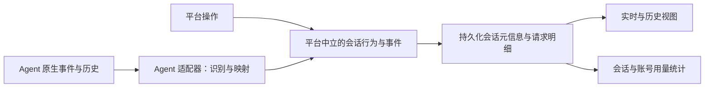

# AgentManager Agent 开发指南

## 工作入口

AgentManager 是管理多个 AI Agent 的本地协作平台，由 React/Vite dashboard、Fastify server、SQLite 持久层和 WebSocket 实时通道组成。开始工作前先阅读 [开发流程](docs/development-workflow.md)，并检查 `git worktree list`、`git status` 和当前分支。

每个新功能、修复或独立验证任务必须从最新 `main` 创建独立 worktree 和功能分支。主工作区与 `main` worktree 只用于同步和合并，不能承载多个任务的并行开发。已有未提交改动必须保留；发现任务混在同一工作区时，先拆分或说明冲突。

功能分支合入 `main` 后（包括 merge、cherry-pick，或把 worktree 改动迁回 `main`），同一轮内立刻清理：删除该功能分支的 git worktree（`git worktree remove <path>`），删除本地功能分支（`git branch -D <branch>`），远程分支存在时一并删除（`git push origin --delete <branch>`）。不要删除 `main` 本身，也不要移除主工作区。典型 worktree 目录：`/Users/ymchen/sources/agentManager-worktrees/`。

测试或验证结束后，同一轮内清理本次创建的临时文件、数据库、测试账号与会话、进程、端口及其他测试环境，包括外部平台和服务器上的测试资源。仅清理能确认属于本次任务的资源，保留已有数据；确认清理结果，无法清理时说明残留及原因。详细要求见 [开发流程](docs/development-workflow.md)。

## 代码区域

- `dashboard/`：React 用户界面、API 客户端和前端测试。
- `server/src/routes/`：HTTP/WebSocket 接口和请求级权限边界。
- `server/src/services/`：会话、终端、历史、持久化及平台业务服务。
- `server/src/services/agents/`：Agent 中立契约、注册表和各 Agent 的独立适配实现。
- `server/tests/`：服务端单元与集成测试。
- `dashboard/tests/`：前端组件与交互测试。
- `e2e/`：跨浏览器与服务端的端到端测试。
- `docs/`：架构决策、功能说明和测试约定。Agent 接入细节见 `docs/agent-abstraction.md`，测试隔离要求见 `docs/testing.md`。

目录和实现可能持续演进；修改前以代码和相关文档为准，不要仅凭本指南推断尚未实现的能力。

## 架构与设计原则

- **共性进入平台契约，个性留在适配器。** 平台负责一致的会话生命周期、权限、输入结果语义、历史分页、附件校验、恢复和 UI 工作流。Agent 适配器负责原生协议、CLI/SDK 调用、身份识别、历史解析、事件映射和特有控制。
- **高内聚、低耦合。** 同一职责的状态和逻辑放在一起；模块通过小而清晰的接口协作。避免跨层直接访问内部状态、重复实现同一平台规则，或让通用模块依赖某个厂商实现。
- **抽象共性，不抹平差异。** 只把多个 Agent 确实共有、平台不可或缺的能力放入中立契约。差异通过可选能力、描述符和独立适配实现表达，不以厂商名称散落条件分支，也不要求 Agent 伪造不支持的数据或能力。
- **依赖稳定边界。** Agent 注册表和平台业务依赖中立类型及接口，不直接依赖具体 Agent；具体实现依赖契约。原生 ID 视为不透明标识，不假定 UUID、文件路径或固定协议。
- **勿增实体。** 优先使用已有服务、类型、状态流和组件。没有明确需求或可验证收益时，不引入额外层、缓存、轮询、后台进程、迁移或配置项。
- **可靠性优先。** 区分未接受、已接受、排队和结果未知等状态；模糊失败不能被当成明确失败而自动重复提交。实时流、历史恢复和持久化应有明确的数据来源、顺序和幂等身份。
- **能力如实声明。** 不支持的功能应明确返回统一的不支持结果并在 UI 隐藏或禁用；未知用量、状态和统计保持未知，不编造默认值。
- **兼容性有边界。** 修改数据库、API、事件结构或历史格式时，考虑已有会话与旧数据的读取和迁移；保留兼容路径应有明确移除条件，避免永久双轨实现。
- **安全默认。** 在服务端执行授权和输入校验，遵循最小权限；敏感凭据不得进入日志、前端回显、测试夹具或提交内容。文件操作须限定在授权目录。
- **资源有上限。** 流、缓存、文件读取、重试、并发和队列应有清晰的边界与释放机制；优先采用事件驱动和增量读取，避免无界缓存或无必要的全量扫描。
- **易维护、易验证。** 选择直接、可读的实现；复杂逻辑说明关键不变量即可。不要为了抽象而抽象，也不要以复制粘贴替代真正共享的平台行为。

## Agent 接入规范

- **先定义平台行为，再实现 Agent 适配。** 新增或修改面向用户的功能时，先在中立契约中定义行为、能力声明、输入输出、状态、失败与不支持语义、身份和历史恢复规则；复用或扩展现有接口，再由各 Agent 在自身适配器中实现。Agent 特有能力也须通过可选能力和中立接口暴露，不得将原生协议或厂商条件分支散落到通用服务、路由和共享 UI。
- 新 Agent 应通过 `server/src/services/agents/` 中的中立契约注册，具体实现放在该 Agent 自己的目录内。
- 先确认其宿主类型和实际能力，再实现所需接口；不得把终端型、SDK 型或远程型 Agent 强行塞进不适合的运行模型。
- 将原生事件、历史、错误和状态映射成平台中立 DTO。原生协议细节不得泄漏到通用路由、共享 UI 或其他 Agent 的适配器中。
- 复用平台提供的权限、会话和实时流机制；禁止适配器绕过平台授权，或在浏览器重新连接时意外创建新会话、重发输入。
- 对每项声明能力提供可验证的实现和测试；不支持时使用统一语义，不做静默降级或伪成功。
- 新增、修改适配能力时更新 `docs/agent-abstraction.md`，并覆盖通用契约和该 Agent 的原生边界。

## 会话行为与统计规范

以下是平台统一行为的开发要求，并非声明所有现有 Agent 已完整实现。功能实现须先建立中立契约和可验证的适配能力，逐项说明已实现、部分支持与不支持的范围。



### 统一体验与会话生命周期

- 同一种平台功能在不同 Agent、实时查看、历史加载、刷新、重载和重连时，应使用一致的用户语义、统计口径及状态展示。Agent 能力和数据存在差异时，明确标识不支持、尚未确认或不可用，不能通过推测补造一致的效果。
- 通过中立接口表达可观察的创建、恢复、压缩、模型与账号或 Engine 切换、追问、排队、停止、中断、新开、重载、关闭和删除，以及它们的开始、受理、完成、失败或结果未知。区分用户请求、平台确认和 Agent 原生确认；不能把提交成功当作实际完成。
- 区分平台标签页、平台会话、原生会话、轮次及请求身份，均通过中立契约关联。新开可能产生新的原生会话，跨账号或 Engine 迁移可能继承历史；记录可验证的来源和边界，不把继承请求重复计为新账号消耗。
- 会话元信息应持久保存可确认的生命周期事实、模型和账号变化、请求用量及统计结果。打开历史和重载时读取已保存结果；新事件增量处理。历史首次回填、迟到事件、重连、来源替换或规则升级须可恢复、可对账、幂等，不假定所有历史始终不可变。
- 账号用量应覆盖已配置且有权访问的 Agent 原生会话，包括平台未打开的会话。复用现有后台采集与实时流：活跃会话按事件增量更新，其他会话按后台策略发现变化；不为每个历史会话增加常驻进程或每次变化全量重算。未配置、不可读取或上游未提供的数据保持明确的未知或不完整状态。

### Progress、Item 与 Final 的精确统计

- 以 Agent 可确认的模型请求和工具事件为统计事实，按稳定身份去重，关联原生会话、轮次、模型、账号、消息及适用的事件边界。输入、缓存输入、输出、推理输出和总量沿用各 Agent 的已验证语义；缓存输入和推理输出若已包含在输入或输出中，不得重复累加。
- 分别维护以下区间：**Final** 从上一个 Final 完成到当前 Final 完成；**Progress** 从上一个 Progress 完成到当前 Progress 完成；**Item** 从上一个 Item 完成到当前 Item 完成。没有前一个同类边界时，从可确认的会话首次任务开始；无法确认起点时明确标识。以完成事件和原生请求的实际统计边界对齐，不依据界面渲染顺序猜测。
- 各区间独立展示可确认的 Token、工具调用次数和工具轮次（rounds）：同一模型响应中的多个并行工具调用各计一次 call，共计一轮。区间可以相互重叠，不得把 Item、Progress 和 Final 的展示值再次相加作为会话总量。若产品使用 Runs 等名称，须在中立契约中明确其定义，不与工具轮次混淆。
- 已完成且来源完整的区间在实时和历史视图中应精确一致。尚未上报的用量显示等待；历史缺失、读取失败或无法确认边界时说明原因，不把未知当作零或精确值。多个 Item 共享同一请求时，只展示可验证的共享请求用量，不伪造逐 Item 或跨边界分摊；请求的用量在更大区间中只能计一次。

### 会话详情与模型维度

- 会话详情应读取统一的会话元信息，紧凑展示整个会话的累计 Token、预估积分、模型请求次数、用户问答轮次、工具轮次和工具调用次数，并分别说明这些计数的边界；不能把用户问答轮次、模型请求和工具轮次混为一谈。
- 除当前模型外，应按实际请求所使用的模型展示该会话的用量和请求次数；支持区分可确认的账号或 Engine 与服务速度。模型或速度切换时，积分先按每次请求实际记录的模型、速度和对应费率估算，再汇总到模型及会话；禁止以当前模型或速度的费率推算整个会话。未知模型、速度、用量或价格保持未知或标明覆盖不足。
- 会话详情应能查看可确认的生命周期、压缩、模型及账号切换、插入输入和中断等记录；实时会话、历史会话及重载后使用同一事实和口径。展示按能力提供的信息，不因 Agent 差异编造记录；区分最近请求、当前状态和会话累计。
- 累计 Token 信息栏应与 Progress 采用一致的积分含义和紫色样式，紧凑展示预估积分并保留一位小数；积分属于参考估算而非实际账单。可核对时按请求明细计算，不可完整核对时明确标注覆盖范围及原因。

### 缓存命中率异常与时间间隔

- 会话详情应以表格展示并统计会话中可确认的缓存命中率显著下降事件，关联前一次与本次的输入或请求，以及相应问答轮次。按各 Agent 的原生语义计算缓存命中输入占总输入的比例；同一轮存在多个模型请求时说明使用的请求和比较口径，不混用会话累计值与单次请求值。
- 每条记录应包含前后两次输入的 Token 与缓存命中 Token、命中率、下降幅度、可确认的输入或请求时间，以及前后输入之间的时间间隔；同时关联可确认的模型、账号或 Engine、速度、压缩与上下文变化等事件，方便定位原因。不同时间字段不得混用，无法确认时间或关联时保持未知。
- 详情表格中，每次输入的总输入 Token、缓存命中 Token 和命中率应紧凑地放在同一列或单元格，例如 `300K / 294K (98%)`，并为三项提供清晰标识；前次和本次各自展示，便于直接比较，窄屏下保持可读。
- 比较规则须定义可重复验证的“显著下降”条件和适用范围，兼顾输入量差异、首次冷缓存、模型或账号切换及压缩等情况；输入为零、用量缺失、计数不一致或历史不完整时不得编造命中率或异常。重复事件、历史回填、重连与数据修正不得造成重复或遗留错误告警。
- 命中率下降是可观察的异常，不足以单独证明缓存已失效、过期或判断原因。只有 Agent 提供可验证的原生证据时才标记为已确认失效；否则展示为命中率下降，保留已知的相关事件和未知原因。检测通过 Agent 中立契约与各自适配器提供真实数据，复用会话元信息和增量采集，不为历史会话增加独立轮询或全量扫描。
- 已确认达到下降规则时，对话页应及时在相关输入或请求的时间线位置展示缓存命中率下降卡片，复用现有卡片的交互、视觉体系和无障碍行为；卡片紧凑展示前后总输入、缓存输入、命中率及可确认的间隔与变化，并可查看详情。卡片和详情表格使用同一事件与身份；实时追加、迟到数据、刷新、重载和历史分页应去重及同步修正，不能跨会话串扰或中断用户输入。

### 运行中插入输入与中断

- 用户在 Progress 或 Item 执行中追加输入、排队或请求停止时，记录可观察的原生会话和轮次、最近已完成的 Progress 与 Item、当时已知的活动 Item 或并行工具，以及提交、受理、实际接收和完成或中断的时间与状态。时间、顺序或关联不可确认时保持未知，不能将界面点击时间冒充 Agent 接收时间。
- 追加输入、排队和中断是不同动作；结果未知时不得自动重复提交。中断后保留已完成的 Item、已确认用量和未完成部分的状态；迟到的原生用量须幂等补齐。跨输入或中断边界的进行中请求按上游可验证的请求边界统计，不能凭时间推算两侧的用量。
- 打开历史、刷新或重载后，应还原已记录的插入位置、当时可确认的执行状态及后续结果；恢复或并发事件不能覆盖其他会话、重复计数或虚构状态。平台可控的删除操作应先处理并持久化可确认的最后用量，明确删除对话历史与保留已发生账号耗用的语义；采集或停止结果无法确认时不得静默声称完整。

## 测试与质量要求

- Bug 修复应在能稳定复现问题的最低合理层添加回归测试；跨服务与浏览器边界的行为再增加集成或 E2E 覆盖。
- 测试必须确定、隔离、可重复。不得依赖开发者数据库、真实账号凭据、已安装的 CLI、生产端口或线上服务；使用临时数据库和模拟 Agent/终端数据。
- 测试行为和对外契约，不要为了让测试通过而复制实现细节或依赖脆弱的内部调用顺序。
- 运行与改动范围相称的检查。常用入口：

  ```bash
  npm test
  npm run test:coverage
  npm run test:e2e
  npm run test:all
  ```

- 提交前检查格式、类型、构建和差异；不能运行的测试应在交付说明中列明原因和未覆盖风险，不得声称已通过。
- 新测试应覆盖相关边界条件：缺失或异常输入、重复事件、重连与恢复、权限拒绝、部分失败、资源释放和兼容旧数据，按功能适用情况选择。

## 界面与交互

- 延续现有设计系统和组件模式；为真实工作流服务，避免无必要的营销式布局、重复信息和装饰性卡片。
- 优先节省空间，将关联操作与信息放在同一行；空间不足时自然换行，检查窄屏可读性和操作性。发现类似浪费空间的布局时主动整理优化。
- 状态、操作和错误应清楚且一致；控件须有可访问名称、键盘行为、加载/禁用/失败状态。
- 统一界面不等于强行统一 Agent 专属交互。共用组件接收中立数据和能力，不通过厂商名猜测行为。
- 调整会话、消息或实时 UI 时，同时检查增量更新、刷新恢复、切换会话和并行会话，避免某一视图修复造成另一视图覆盖或重复。

## 文档维护

架构边界、公开能力或开发流程变化时，同步更新对应文档。文档描述应与当前实现和测试一致；明确区分已实现、部分支持和规划中内容。
