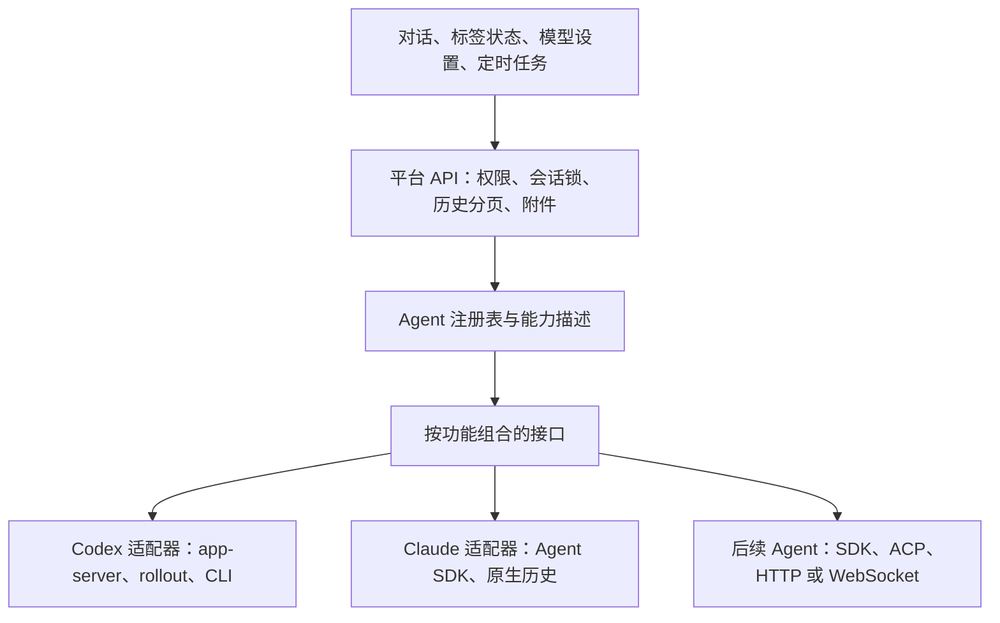
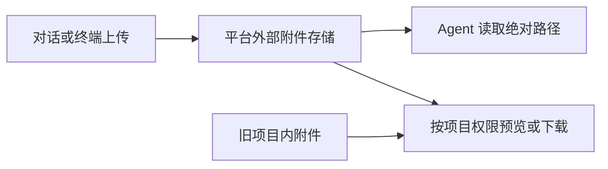

# Agent 接入架构

平台按功能组合接口，各 Agent 负责自己的协议和实现。注册入口为
`server/src/services/agents/index.ts`，纯注册表位于 `registry.ts`；注册表不引用具体厂商。



## 功能边界

| 接口 | 责任 | 接入要求 |
| --- | --- | --- |
| `history` | 返回统一消息、分页、统计；可选本地文件编解码策略 | 必需 |
| `runtime` | 原生执行状态，按需读取与变更通知 | 必需 |
| `input` | 提交对话、区分接受/排队/拒绝，防止模糊失败后重复发送 | 必需 |
| `stream` | 统一事件通道、交互回答、连接释放；可选实时通道升级与关闭钩子 | 必需 |
| `identity` | 原生标识、可选终端识别、旧绑定恢复与本地清理；可选异步清理适配器拥有的原始历史 | 默认使用通用标识，终端识别按需实现 |
| `controls` | 查询、验证、应用模型与推理设置 | 按能力声明 |
| `telemetry` / `statistics` | 用量与消息区间统计，未知数据保持空值 | 按能力声明 |
| `quota` / `retry` | 账户额度、失败判断与原生重试操作 | 按能力声明 |
| `lifecycle` / `launch` | 预检、压缩、新对话、中断、释放、启动/恢复准备 | 按能力声明 |
| `commands` | CLI 命令构造、权限和共享资源参数 | 仅终端宿主需要 |

`statistics.readProgress` 是可选能力，返回上一条结论完成以来、当前原生会话已记录的累计 Token 与工具调用统计；实时流通过 `progress_statistics` 推送变化。未完成的请求尚无 Token 时保持未知，历史不完整时标记为下限。Codex 同时提供可选的 per-input `segment`：原生用户输入或新轮次开始新段，后续输入、中断或完成关闭该段并记录耗时；跨输入边界尚未完成的请求不做虚假的 Token 归属。旧数据或未提供该能力的 Agent 保持未知。适配器不能通过汇总重复消息估算这些数据。

`stopTurn` 是独立的可选能力。只有会话创建者可停止当前执行，对话停止请求携带实时流中观察到的原生轮次 ID；适配器只中断匹配的活动轮次，状态变化后拒绝旧请求。接口返回已接受表示中断请求已发出，界面以实时流确认结束；不确定结果不自动重试。停止当前轮次不会关闭会话，也不取消已经排队的输入。

终端输入的浏览器 ID 与原生客户端 ID 可能不同。平台只在同一会话和原生线程内，依据发送前的文件边界及输入指纹一对一关联持久回显；`input_reconciliation` 推送已确认的关联，`native_client_id` 保留原生 ID 以合并实时回显。不同 ID 的相同文本不会单独触发去重。

### 批量消息展示

平台将批量草稿合并为一次输入，向 Agent 适配器提交原始正文与附件。可选 API `batch` 边界由平台校验并保存，不需要 Agent 实现新能力；同一提交 ID 的实时流与历史可携带中立 `AgentMessage.batch: [{text,attachments}]`，用于卡片及居中详情。边界缺失的旧消息不推断分组。记录随历史快照迁移和会话删除清理，详情见 [批量发送](batch-composer.md)。

### 输入来源与折叠卡片


平台在发送前记录提交 ID、来源类型和显示名称；正文与模型输入不添加展示标记。消息仅在提交 ID 或经验证的原生消息 ID 匹配时携带可选 `input_source: {kind,label}`，未知来源保持空值；旧消息不回填。实时流、历史分页和重连使用同一投影。重复正文不能单独证明来源。来源记录随会话删除及历史快照迁移。

新 Agent 的输入适配器声明 `input.supportsClientIdentity`，并在原生事件中保留客户端提交 ID，或通过可选 `input.messageId` 将提交 ID 映射到可靠的持久消息 ID。新建会话的 `launch.prepare` 接受可选的首次提交 ID，支持该能力的适配器声明 `launch.supportsInitialClientId`；若适配器掌握首次输入的持久消息 ID，可在启动结果中返回 `initialMessageId`。未声明首次输入身份支持的 Agent 不接收新建会话的定时任务。终端回退使用发送前文件边界和指纹关联；无法建立关联时拒绝发送，避免把其他输入误标为平台消息。Codex 首次定时输入需要可用的原生会话连接，Claude 使用 SDK 原生用户消息 ID。已绑定 Agent 的终端标签也使用来源关联；没有原生会话的纯终端任务仍是终端输入，没有结构化会话卡片。

前端的问题和工具使用 `ConversationCard` 内联折叠；自动上下文与有来源输入使用 `ConversationDialogCard` 打开居中、可滚动的详情窗口。卡片不依赖 Agent 名称，新来源类型可以复用同一平台展示路径。

已登记会话的 Engine 绑定优先于线程路由缓存；旧记录中空绑定按界面与权限规则解释为 `native`。若同一原生 ID 同时绑定多个 Engine，平台拒绝猜测。原生会话已有其他写入者时，恢复明确失败，不切换账号、不终止占用者；需要用户回到原会话继续，或先在原位置停止它。

`identity` 的可选 `purgeHistory` 在移除平台会话行前异步清理 Agent 原始历史。Codex 按历史行绑定的 Engine 和原生会话 ID 删除 `sessions` 或 `archived_sessions` 中对应的 rollout；跨 Provider 副本、新开后的历史行各自保留其环境和 ID。压缩可能共享的 `history_base` 祖先不会随子会话删除，以免破坏其他会话。

`AgentDefinition` 是新增 Agent 的实现契约；`resolveAgent()` 在注册时补齐可选接口，
不支持的操作统一返回 `AGENT_FEATURE_UNSUPPORTED`，不借用其他厂商实现。
注册时检查必需对话能力以及已声明功能的实现，重复或未知标识直接报错。

Agent 的原生消息、状态、模型、用量和事件须转换为 `types.ts` / `events.ts` 中的中立 DTO。
平台负责权限、会话生命周期锁、分页、附件与输入关联、重试预算等业务规则；
原生 RPC、CLI 参数、日志格式和版本探测留在各 Agent 目录。重试适配器负责错误分类，并返回中立的执行状态、输入关联 ID 与是否已有结论，共用重试逻辑不读取原生消息类型。

## 两类宿主

- `terminal`：使用现有 PTY worker；实现自己的 CLI 命令和原生绑定。
  多行输入框、调整尺寸后是否重绘等行为由描述符声明，终端组件不识别厂商名。
  复合粘贴/回车操作共享同一终端输入锁。启动命令由父进程的适配器构造，PTY worker 接收最终命令，不为每个会话加载全套 Agent 实现；父进程注册的 CLI 适配器也无需在子进程重复注册。
- `managed`：直接连接 SDK 或远程服务；不创建 PTY、不要求 CLI 命令或本地日志文件。
  `launch.prepare()` 创建或恢复原生会话，首次启动的任务由实现明确提交。
  `host.ts` 只附着已有原生标识；浏览器重连和订阅不会创建会话或重发任务。
  同一原生会话与凭据范围共享事件连接，浏览器退出后宿主订阅仍可接收状态；服务关闭时释放连接。

`history.read()` 支持服务端分页；`history.file` 是可选的本地文件策略。
提供 SDK/HTTP 历史的 Agent 无须伪造 rollout 路径、UUID 或本地 JSONL。
原生会话标识允许不透明字符串。

文件策略可实现 `turnBoundary(record)`，返回原生日志中的轮次开始／结束标记。
通用字节索引用这些标记补齐未逐条携带轮次标识的消息，再按原生轮次与条目 ID
建立实时流和历史记录的一致身份；不按正文跨轮次去重，也不解析工具输出中的伪标记。
标记来自已有的有界增量读取，不为关联消息扫描全部历史。

Codex 的待答问题索引位于其适配器目录，与对话历史复用 `codexUserText` 和相同的原生记录大小规则。
图片的原生包装文本不能参与回答正文识别；带图片的用户记录使用有界的大记录通道，工具输出仍受小记录上限约束。
索引只保留问题和已回答 ID，不保留图片数据，避免对话中已回答、标签却持续提示待答的状态分歧。

终端宿主统一使用 UTF-8 tmux 客户端参数，新建、重连、接管及历史恢复使用同一规则。
服务环境没有语言设置时按系统补上 UTF-8 默认值，显式语言配置和环境变量白名单保持有效。

Codex TUI 对异步回答的识别要求严格的单段纯文字回包，带图片或文件的原生输入不能直接用于终端的问题消除。
Codex 适配器因此为终端客户端使用本地兼容通道：请求逐字节转发，模型输入、附件和原生历史不改动；
仅在已接收的用户消息回执及历史重放中投影可识别的回答标识，按问题 ID 清除对应项。
普通输入、工具输出、其他待答问题和排队但尚未接收的回答保持原语义。
回答编辑器的图片位置不能套用到 JSON 回包中，原生组装时把图片占位放在完整回包后。

兼容通道按原生引擎共享，替换终端本来的连接，不创建额外原生订阅或轮询。
它按需启动、与平台进程分离，平台重启不会因此中断终端；最后一个终端断开后闲置 60 秒自动退出。
消息转发受发送完成回调控制，避免无界排队。已有终端需要在当前任务结束后重载标签页才能接入；
平台不会为清理提示自动重启正在工作的 Agent。

Codex Engine 使用权限在权限管理的用户详情中配置。现有 Engine 默认授权策略保持不变；管理员可对单个用户设置继承、允许或禁止。单用户覆盖不修改其他用户和默认策略，停用的 Engine 不因覆盖而启用；管理员不受单用户覆盖限制。授权变化会通知现有会话监听器，创建和恢复时再次校验。

Codex Engine 属于平台管理资源。默认 Engine 和各 Provider Engine 由 AgentManager
启动，Socket、PID、日志和启动元数据保存在数据库专属目录；Web 服务重启只重新验证并附着，
不会创建第二个所有者。生产启动会解除旧的 `com.ymchen.codex-engine*` launchd 作业，
保存的 Provider 路由优先于环境变量中的外部路由。模型目录在 Engine 启动时读取，
修改目录后由用户显式重启对应 Engine；共享原生 Engine 的重启入口必须说明会中断其会话。
测试和隔离预览通过 `AGENTMANAGER_MANAGE_CODEX_ENGINES=false` 或
`AGENTMANAGER_TAKEOVER_CODEX_LAUNCH_AGENTS=false` 避免接管真实进程。

Engine 设置分别读取单个 Provider 状态，Provider 卡片和设置页共享该 Provider 的查询键，
不同 Provider 之间不共享运行状态或操作状态。每页显示实际 argv，并允许设置无 shell 的
启动命令和每行一个的附加参数；参数保存后重启目标 Engine。主动启动、停止、重启和配置保存
通过 NDJSON 进度流返回校验、准备、启动、等待 socket、确认和清理等阶段，前端按阶段显示
进度条与历史步骤，只有目标 Provider 的缓存会更新。

模型悬停详情仅展示所选 Engine 的模型目录中明确提供的字段。账号 Engine 的目录通过对应系统账号读取，读取失败时保持未知；API Provider 不套用 ChatGPT 的 Credits 价格。账号模型的参考 Credits 来自用量统计的同一费率表，标明日期且不作为实际账单。

Codex 用量采集在适配器中维护请求指纹和复制来源，原生 turn_id、分页祖先及累计基线不会泄漏为通用平台规则。删除、压缩与新开不撤销已记录消耗；跨环境继承历史不归为目标账号新请求。聚合与去重身份原子发布，未知继承关系或来源冲突保持部分数据。具体边界见 [账号用量统计](codex-account-usage.md)。

## 新增服务型 Agent 的最小结构

```ts
import {registerAgent} from './registry.js';
import {capabilities, type AgentDefinition} from './types.js';

const adapter: AgentDefinition = {
  descriptor: {
    id: 'example_agent', label: 'Example Agent', sessionHost: 'managed',
    presentation: {icon: 'agent', color: '#64748b'},
    capabilities: capabilities(['history', 'runtime', 'input', 'stream', 'launch', 'resume']),
  },
  history: {read: (context, query) => transport.history(context.nativeId, query)},
  runtime: {read: context => transport.runtime(context.nativeId)},
  input: {submit: (context, text, clientId, attachments) =>
    transport.submit(context.nativeId, {text, clientId, attachments})},
  stream: {observe: (context, emit, onFailure) =>
    transport.observe(context.nativeId, emit, onFailure)},
  launch: {prepare: (context, task, instructions, resume) =>
    transport.prepare({context, task, instructions, resume})},
};
registerAgent(adapter);
```

示例中的 `transport` 是该 Agent 自己的实现，负责认证、原生事件转换和连接管理。
`observe()` 返回可调用的取消订阅函数，函数附带 `respond(id, answer)`。
未声明问题交互的 Agent 可以在该方法中报告不支持。
`submit()` 的 `false` 表示未接受；终端宿主可使用平台的 PTY 后备通道，服务宿主明确拒绝。
网络超时等模糊失败应抛错，不能返回 `false` 触发重复发送。

## 实时流与回答的扩展规则

- 注册时统一包裹 `sharedAgentStream()`，负责订阅复用、重放和连接失败的退避恢复。
  复用键包含原生标识与凭据范围；多租户或多端点适配器通过 `stream.scope(context)`
  明确隔离。平台 API 在每条消息上继续检查权限并应用个人忽略偏好。
- 适配器输出 `AgentStreamFrame`。初始附着和新轮次发送 `snapshot`；正文增量使用
  `patch.deltas`，消息完成使用 `patch.upserts`，执行状态使用 `patch.state`。
  偏移采用 JavaScript UTF-16 字符串长度。空消息开始事件可以省略，但首次可见正文必须
  通过 upsert 建立消息；状态与结束事件立即刷新，纯文字允许小批量合并。
- `stream_id` / `stream_seq` 由共享层维护，版本 2 的浏览器据此发现丢帧。
  API 不得因重复用量等原因丢弃带序号的事件。持久历史恢复是前缀，不能覆盖已经收到的
  新正文、工具状态或完成事件。历史补充持久顺序号后，按顺序号重新排列已确认消息；
  尚无顺序号的实时消息和乐观输入保留原位，不使用时间戳推断因果。只关心状态的宿主和重试监控使用 `streamFormat: 'state'`。
- 统计归属使用与消息展示一致的原生 item ID。Codex 的 `item_completed` 和 `response_item` 可能描述同一个 item，须去重后再划分请求统计和结论耗时；真正属于同一请求的不同消息仍标记共享，不猜测分摊值。
- 原生初始化、观察和恢复只能重订阅，不得启动新会话或重发用户输入。
  `runtime.subscribe()` 必须独立于可选日志文件；健康文件观察器不轮询，缺失或失败时退避重建。
  浏览器失活检测使用单调时钟，与展示用的浏览器日期时间分开。
- 问题回答的公共结构为 `AgentQuestionAnswer`：`answers` 按问题 ID 分组，
  可选 `attachments` 使用同样的问题 ID。API 统一检查上传目录、文件类型、整组大小和权限，
  适配器映射原生格式。`respond()` 可以返回 Promise，平台等待其确认接受后才返回成功；
  失败不清除回答草稿。Codex 阻塞提问的文本协议以文件引用交付附件，异步提问走正常附件输入。
- UI 的问题编辑器复用主输入框的附件上传、预览、取消和重试能力，单独管理回答草稿；
  不按 Agent 名称选择组件，也不把主输入框草稿混入回答事务。
  同一平台会话的所有输入位置共享上传/打包队列，避免多个回答框并行加载大目录；
  独立会话互不阻塞。排队任务可以移除，进行中的任务通过现有 AbortSignal 取消。
  纯进度变化不更新父表单的业务状态或重复写入草稿；就绪状态在显示前同步，
  草稿保留附件所在的文本位置。
- 问题卡片、待回答提醒和答案状态共用原生 ID 索引，正文增量不使索引失效。
  已确认的原生回答优先于旧排队副本；缺少 ID 的旧格式回答仍按因果顺序匹配。
  多问题分组只对重复 ID 去重，不能因局部已加载而丢弃整组的其他问题。

当前 Codex 队列展示保留 100 条上限，原生读取分为每页 4 条，并对页数和重复游标设限。
通知突发时只保留一个进行中的队列读取和一次补读。
发送前的历史关联确认、自动重试检查仍保留原有完整轮次读取；极长轮次仍可能遇到原生
2 MiB 响应限制。这些路径涉及重复执行保护，不能用不完整快照当作完整的幂等证据。
后续应通过持久提交记录或原生关联 ID 查询来替代，不能直接删掉校验或模糊失败后重发。

注册后，创建选项、图标/名称、状态、模型控件、额度入口和调度能力由服务端描述符驱动。
用户仍须具备相应项目和 Agent 的权限。新增 Agent 不自动扩大已有用户授权。

## 数据兼容

数据库版本 23 增加 `agent_id` 与 `native_session_id`，迁移时回填旧绑定。
`cli_type`、`codex_session_id`、`claude_session_id` 暂时保留，旧入口写入通过触发器同步。
新 Agent 不增加专属数据库列。原模块路径保留薄的导出兼容层，业务实现已迁入对应 Agent 目录。

旧会话兼容指保留平台会话 ID、原生绑定、历史及附件关联；恢复时继续同一原生对话。
不会为迁移清空历史，也不会因浏览器重连自动启动新的 CLI。

## 当前实现与验证边界

Codex 继续使用原有 app-server 流式通道、模型/推理控制、问题回答、统计、额度和重试实现。
Claude 接入同一套查询/控制/生命周期 API，支持 SDK 结构化事件流、原生历史事件更新、模型别名设置、新开、恢复和中断。
Claude 的持久化历史与 Codex 一样通过通用有界文件索引分页；适配器只提供记录投影，
把助手记录中的文字与工具块转为统一消息，并把工具结果折叠回对应工具 ID。
实时 SDK 以助手 API 消息 ID 作为消息身份，工具块按工具 ID 更新，不使用逐 chunk UUID。
进程重启后的持久历史由通用读取接口恢复；实时观察只附着既有运行时，不重新发送输入。
工具块在会话界面内联显示；持久历史和实时事件使用同一消息 ID，重连不能产生重复结论。
Claude 桌面会话仍使用通用的项目授权、会话锁、输入关联和诊断；重启不会自动创建原生轮次。
模型变更提交后标记待确认；缺失的累计用量、窗口和统计不编造。
Claude 尚未提供统一的问题交互、逐进展统计、自动重试或额度驱动，相应能力不展示为可用。
验证使用临时目录中的 Claude JSONL 夹具和模拟 SDK 事件，没有使用真实凭据或启动本机 Claude Code。

新增测试用第三种 Agent 验证独立历史格式、不透明 ID、统一 API/权限、服务宿主及共享连接；
同时回归 Codex 的增量流式、排队回答、模型/压缩控制、重载和结论区间统计。

Codex 压缩记录中的 `replacement_history` 是模型后续使用的上下文，不是完整的用户对话历史。对话视图保留原始问答，并将可读取的压缩摘要显示为独立卡片；压缩内容只有加密数据或没有摘要正文时，卡片说明正文不可用，不展示密文。
不增加按 token 的轮询：使用事件/文件通知、合并状态推送、有界缓存和增量文件读取。

## DeepSeek Harness 的后续接入

官方提供 `dsh sdk`（stdio JSON-RPC）和 `dsh acp`（stdio ACP），以及 `dsh web`。
可在独立 Agent 目录实现上述服务宿主接口，保留平台内对话。
现有 `dsh web` 实例的认证、会话枚举和绑定协议仍需验证；本次未实现或部署 DSH 适配器。

官方资料：
[项目](https://github.com/deepseek-ai/deepseek-harness)、
[CLI 说明](https://github.com/deepseek-ai/deepseek-harness/blob/master/apps/cli/README.md)。

## Codex 账号环境

Codex 适配器支持同机不同系统用户的已登录账号环境，独立于 API Provider
标识。平台会话使用可选的 `agent_environment_id` 持久绑定环境；通用权限
边界统一执行环境授权，账号连接、原生历史传输和 RPC 路由留在 Codex
适配层。环境切换复用会话生命周期的串行化、历史快照、恢复与回滚流程。

配置、权限、预检和历史格式边界见 [Codex 账号环境](codex-environments.md)。

### 账号额度与输入工具栏

顶部 Codex 额度展示当前用户可见且启用的账号环境（`kind: account`），并包含有权控制的本机默认环境中已登录的订阅账号，无账号时隐藏；多个账号以名称分别展示，各自刷新。`GET /api/codex/environments/:id/quota` 校验读取权限与账号可见性，并使用该账号的引擎读取订阅额度，不回退到宿主账号。API 接入、确认未登录的本机环境和未获授权的宿主账号不展示额度。额度读取失败时保留账号名称、不可用状态和刷新操作，不能将失败视为账号不存在。

会话的账号、模型、强度、Fast、压缩和新开操作位于输入框附件工具栏；上下文用量位于底部状态栏；运行信息与详情仍在下方。工具栏使用统一间距，发送快捷键提示靠右。telemetry.contextBreakdown 是可选的只读分类能力，当前由 Codex 分析该账号的 JSONL，原生占用与可见文本估算分别展示；范围和上限见 [会话上下文分类](context-breakdown.md)。

Codex 原生及受管理 Provider 支持单独修改显示名称；名称修改不重启引擎，不更改 Provider ID 或会话归属。

点击顶部 Codex 账号卡片可查看居中详情：额度窗口、重置卡数量与到期时间，以及可按日、周、月、项目、模型切换的三级 Token 用量表。后台按账号首次一轮采集全部历史，之后每 5 分钟重读 UTC 当天修改的 JSONL、替换当天统计；额度与重置卡由独立后台每 5 分钟采集。前端所有查看和刷新均只查询 SQLite 缓存，不触发引擎读取或文件扫描。接口沿用账号可见性与本机账号控制权限，未知数据不当作零。时间边界、资源限制和历史迟到记录的范围见 [账号用量与状态](codex-account-usage.md)。

Codex 登录账号的文件由其系统用户通过 SSH 读取和保存，与平台进程本机 Provider 的文件路径隔离。本机与 SSH 登录账号使用共同的详情组件展示实际返回的认证、模型和配置；占用仅在删除确认时展示；不支持或未返回的内容保持未知。账号可编辑文件及授权、大小和冲突处理见 `docs/codex-environments.md`。
# Codex Engine 认证和余额

Codex 环境沿用 `native`、`provider:*` 和 `account:*` 标识以恢复既有会话。对外环境摘要增加 `source` 表示本机托管、本机托管 Provider 或系统用户；`auth_mode` 由后台运行时认证探测提供，在不能确认时为 `null`。来源不决定认证类型。账号额度和 API 钱包是不同数据源，余额查询由 Codex 适配器负责，不属于通用 Agent 额度契约。

原生会话标题作为可选的中立 `native_title` 元数据提供给标签展示。Codex 适配器从 `thread/read` 的 `name` 和 `thread/name/updated` 的 `threadName` 采集，按 Engine 与原生会话身份匹配平台会话并持久化。订阅与 API Provider 使用相同路径；未提供标题时保持默认标签。用户 `customLabel` 始终优先，自动去重不把自动名称转成用户手动名称。


### 附件存储与仓库边界

对话附件、终端粘贴/拖入文件及平台 AI 转交截图通过平台上传接口保存在数据库同级的
`attachments/<项目规范路径的 SHA-256>/pastes/`，可用 `AGENTMANAGER_ATTACHMENTS_DIR`
指定外部存储根目录。上传不在项目中创建目录或 `.gitignore`，也不修改 Git 配置。
写入及清理前检查真实存储路径：位于任何已注册项目或 Git 工作树内时拒绝操作，不回退到项目目录。
文件管理器上传同样保存到该项目命名空间的 `uploads/`，保留所选目录相对项目根目录的层级和上传文件夹结构。
上传结果提供“查看上传文件”入口；不会向业务项目写入文件或目录。`POST /files/upload-directory`
返回实际平台目录，`POST /files/upload` 也会将旧客户端传来的项目目录映射到平台存储，不能绕过统一存储。



项目权限绑定到附件所属项目；对话粘贴附件仅放行文件 API 的单文件只读入口；文件管理器的 `uploads/` 可按项目权限浏览、下载和管理，
不能借此访问其他项目。Agent 输出的 Markdown 链接、图片、普通绝对路径、代码格式文件路径和 `sandbox:/`
链接都可打开预览；路径是否可访问由服务端账号授权和文件系统权限决定，前端不将项目外路径一律禁用。Agent 使用的系统账号还须有存储目录祖先的穿越权限和文件读取权限；
存储命名空间目录权限为 `0711`，对话粘贴文件为 `0644`，文件管理器上传文件沿用 `0600`
（仍受进程 umask 限制），不自动扩大既有平台数据目录的权限。
若平台数据目录不允许其他系统账号访问，管理员应配置独立、可读取且位于仓库之外的附件目录。

既有 `<项目>/.agentmanager/pastes/` 只读兼容，保持原路径，不自动移动、删除或更改忽略规则；
待旧会话与草稿不再引用后，可由用户自行移除旧目录。清理仅作用于新的外置目录，沿用每项目 7 天、
最多 50 个上传文件的规则，在上传后、启动时和每 12 小时触发。该规则不保证历史附件永久保留。
Agent API 契约版本为 `3.10.2`，上传响应 `path` 为不透明绝对路径，客户端不得假定它位于项目内。

新建 Session 窗口和快捷创建只创建等待输入的会话，不自动发送问候语或项目 Session Prompt。`POST /api/sessions` 的 `task` 可省略或为空；适配器须建立原生会话但不提交空消息，首次手动输入通过既有输入接口发送。显式提供的非空任务（含定时任务和平台 AI）仍在创建时提交。

会话列表的原生运行状态读取失败时仍返回平台会话记录，缺失状态保持未知。恢复的标签页可单独读取会话记录，不依赖全项目历史加载。账号用量详情的管理员接口同时返回原始日志目录和统计缓存目录，界面在单行状态栏显示来源，悬浮查看完整路径。
