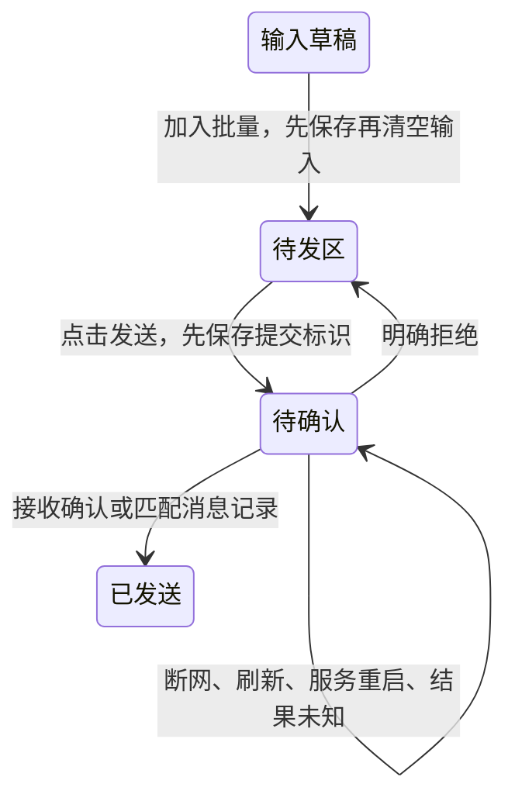

# 批量发送

对话输入框工具栏的“模式”位于账号选择之前，默认“立即发送”。选择“批量发送”后，Enter 或输入框发送按钮把当前输入加入右侧只读待发区；右侧“发送批量内容”提交全部待发条目。在输入框按 Ctrl+Enter（macOS 也支持 Command+Enter）直接发送当前输入和附件，使用普通消息展示，不影响待发区；加入待发区后焦点回到输入框；输入框为空且没有附件时，该快捷键发送待发批次；待发区的发送按钮获得焦点后也支持此快捷键。输入法组合期间或按键自动重复时不触发快捷键。多条内容按顺序以空行拼成一条消息，附件位置随之调整。窄屏时待发区显示在对话区域下方，阅读宽度拖动线只属于对话列。待发条目可逐条撤回至输入框，保留已有输入及附件；红色“撤回”旁的橙色“删除”直接移除该条目并保存，不改动当前输入；该次发送中或结果待确认的条目禁止撤回或删除。待发附件复用对话中的悬停预览和居中图片预览。

草稿、模式、待发条目和待确认标识同步保存在当前浏览器的 localStorage，以平台用户和会话隔离。恢复同一浏览器页面不依赖服务器内存；服务器重启期间仍可读回内容。此存储不提供跨设备同步；清除站点数据或更换浏览器无法恢复。加入待发区的已上传附件保存服务端路径；尚未完成上传的文件需要重新选择。

发送期间保留待发条目。收到明确接受确认或匹配 client_id 的真实用户消息后，仅删除该次提交的条目，保留新输入。结果未知时禁止再次发送该批，恢复实时流或历史后继续核对；不因超时或刷新自动重发。没有确认记录时继续保留内容，不假定发送失败。只读区文字始终可复制。保存失败显示错误，加入批量和批量发送不会清空未保存内容。

每批最多 100 条、64 KiB 文本、8 个附件；服务端继续执行原有权限及附件大小校验。该功能通过现有 input API 的可选 batch 字段携带展示边界；Agent 输入适配器仍接收合并后的单条正文和附件。

回归覆盖：模式切换、合并提交、刷新恢复输入及待发区、结果未知恢复与去重核对、明确拒绝、发送期间新输入、用户/会话隔离、附件偏移与存储故障。测试使用模拟实时流及输入 API，不连接真实 Agent。

发送后的批量消息显示为卡片，点击在居中弹窗按顺序展示原始条目及各自附件。平台接收 input API 的可选 `batch: [{length,attachments}]` 边界信息：length 为每条原始文本的 UTF-16 长度，attachments 为其附件数量；文本以两个换行分隔。服务器校验边界必须完整覆盖正文和已授权附件，之后以提交 ID 保存到 SQLite 的 `conversation_batches`，通过同一身份关联投影到实时流和历史的可选 `message.batch: [{text,attachments}]`。该展示信息不会写入模型提示词。新建会话和回滚时随历史迁移，删除会话时级联清理。旧消息没有边界信息时保持原有展示，不根据空行猜测分组。Agent API 契约版本为 3.10.1。

待发条目的标题显示加入待发区的时间，随草稿一并保存在浏览器。已发送卡片详情中的各条目显示该批消息的原生发送时间，沿用会话时间格式和时钟校准。旧草稿没有记录时间时保持未知，不以恢复页面的时间补填。

图片预览的标题、尺寸、缩放、格式和下载操作在同一行，统一使用 11px 字体和紧凑控件。桌面端初始宽度至少 720px，图片加载后保留该最小宽度。缩放、格式选择及下载工具保持单行；窄屏时按视口限制弹窗尺寸，工具栏可横向滚动。
