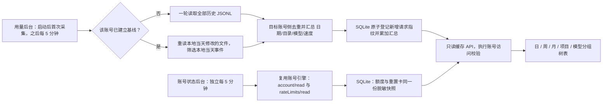
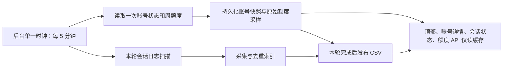

# Codex 账号用量与状态

顶部账号卡片打开居中详情窗口。额度、重置卡和用量均由后台采集；打开窗口、切换栏目、刷新缓存和 HTTP GET 均不触发 Codex 请求或 JSONL 扫描。

## 采集策略

每个账号单独记录是否完成首次全量采集。首次在一次任务内扫描该账号 CODEX_HOME 下 sessions 与 archived_sessions 全部 JSONL，不分批、不存字节偏移；后续每 5 分钟盘点文件，仅完整读取修改日期为本地当天的文件，筛选事件时间为本地当天的计数。首次允许 300 秒，日常允许 120 秒；账号之间顺序采集，同一账号并发请求合并。账号状态使用独立定时任务，历史扫描不会阻塞额度与重置卡更新。实际周期为上轮完成后 5 分钟，避免重叠堆积。

目标账号侧先去重再聚合，传回日期、完整工作目录、模型、速度模式、请求数量及 Token 计数，以及新增请求的 SHA-256 指纹（每个 32 字节，按日期打包传输）。使用 last_token_usage，不把继承的累计基线当作新消耗；文件内过滤重复累计快照，请求身份取原生 turn_id、工作目录与累计计数，旧记录缺少 turn_id 时回退到原始时间。独立新会话即使时间和计数相同，也由不同 turn_id 区分。模型从 session_meta 和 turn_context 提取，缺失时明确显示“模型未记录”；服务档位从这些记录或 thread_settings_applied 的 thread_settings.service_tier 提取。设置事件影响之后的请求。不同账号通过各自 SSH 连接读取；本机默认环境使用服务账号。只采集该环境能够读取的会话文件，没有 Token 事件的项目不会编造用量。

一次成功扫描以事务登记请求指纹并累加新增计数，不删除已采集数据。删除、移走、归档、裁剪或重写 JSONL 不会撤销既有耗用；重复采集、文件副本、重启服务均复用持久化指纹。指纹唯一约束与汇总在同一事务中，异常或重复响应整体回滚。完整与缺失字段按不同桶汇总，未知输入字段不会抹掉同模型已知请求的 Credits，覆盖比例仍按请求数计算。

异常响应、读取权限失败、超时或资源上限导致任务失败时保留上次成功结果，首次失败仍重试全量。账号源（系统用户或 CODEX_HOME）改变时重新建立基线。旧版聚合缓存没有逐请求身份，迁移时保留原有汇总，以旧缓存最后成功时间作为固定基线，只补记其后的请求；不能从旧聚合结果还原边界前迟到写入的明细，也不能追回升级前已经遗漏的未采集记录。旧游标表删除，不恢复字节游标或分批扫描。

## 新开、复制与压缩

| 场景 | 处理 |
| --- | --- |
| 本平台新开 | 原历史耗用保留；新原生 turn_id 独立登记，只加新请求 |
| 压缩上下文 | 摘要与替换消息不是用量事件；不扣除压缩前消耗，原生记录的压缩请求用量照常计入 |
| 重放累计快照 | 相同 turn_id / 累计计数不因记录时间变化重复计入 |
| 同账号复制文件 | 指纹去重，不把完整历史再次累加 |
| 跨 Engine / 账号复制 | 平台记录 fork 边界和生成的祖先 ID；目标账号排除导入祖先及继承前缀，源账号耗用保持原归属 |
| paginated fork | 从祖先的不可变字节前缀读取末次累计基线，避免将恢复通知当作新请求；不会读取前缀之后的分支记录 |
| 无法确认继承关系 | 标记部分数据并保留旧缓存，不把未知基线猜成目标账号的新增用量 |

平台生成的导入祖先仍作为原生恢复依赖保留，不改写或删除历史内容。原生 fork 元数据提供可用边界时同样用于排除继承记录。平台外手动复制且不保留原生身份/边界的日志无法可靠还原跨账号归属；已有旧聚合中的重复计数也不能仅凭汇总安全扣减。

**时间边界：**文件修改日期、事件归属和周/月边界统一采用平台运行环境的本地 IANA 时区（当前部署为 Asia/Taipei，UTC+8）。服务端将时区显式传给本机或 SSH 扫描器，不依赖远端机器的时区设置。API 返回缓存实际使用的 timezone，界面以同一时区显示采集时间。周从本地周一开始；日期标签已完成时区归属，周分组只进行日历运算。日常只更新当天；跨本地午夜的第一次采集额外收尾前一天，之后恢复当天范围，避免漏掉零点前最后一次采集之后的请求，也不假定有夏令时的日期固定为 24 小时。跨越一个以上未采集日期时，恢复后的首次扫描执行有界全量补采并去重；正常采集不会无界回扫历史迟到写入或补导入的所有日期。

旧 UTC 缓存由后台自动做一次全量日期重分配，之后恢复每 5 分钟的当天采集；打开弹窗不会触发重建。请求指纹不包含时区，重分日期不重复累计。重新读取到的已登记请求从旧桶扣除后按本地日期归属；已删除或无法恢复原始时间的历史耗用单独保存在未归属汇总中，并在界面明确提示，不猜测日期，也不混入本地日期占比。迁移失败保留旧缓存及其 UTC 标记，等待下一轮重试，不发布半成品。正常迁移完成后，缺失历史的指纹仍保留，文件重新出现也不再次计入。要重建其他遗漏历史仍需重新建立账号基线。

### 统计规则升级

影响持久化归属或解释方式的解析规则变化时，开发者必须递增 `USAGE_RULE_VERSION`，并覆盖旧缓存升级及原始历史缺失的测试。后台对各账号顺序执行有界全量核对：已有请求身份必须与投影一致，旧请求均可重读且关键字段一致，旧聚合须与投影逐项相符；成功才在同一事务替换缓存和版本，保留新增请求。存在已删除的旧请求、未归属记录、截断或旧数据不一致时，不覆盖旧缓存，界面提示部分估算可能仍用旧规则，并延迟重试；其他无法解析的记录不会阻止已核对的旧数据更新，但结果仍标记为部分数据。历史局部缺失与当日采集状态分别保留；历史不完整时，耗用额度仍根据已记录请求分配并标注部分数据，但权重可能有偏差。无法重读的历史不能凭空推断其服务档位。

## 资源与异常

扫描仅保留有界行缓冲、最多 200 万个去重身份及 5 万个聚合组合；盘点最多 2 万个目录/JSONL 文件，响应上限 128 MiB（包含首次全量新增指纹）。日常只发送当前日期范围的已知指纹，目标端先过滤，只传回新增指纹与汇总；不会每 5 分钟传输全部历史请求或逐条正文。普通行 256 KiB，元数据与上下文最多 4 MiB；巨型工具输出按块跳过。祖先基线优先从尾部按 256 KiB 逆向寻找，按 ID/前缀长度在单轮复用，额外读取总预算 64 MiB、递归最多 64 层；缺失、冲突或超限均标记不完整。读取文件开始时固定该文件长度，追加内容留到下一轮，半行和异常记录标记不完整。不可读取的文件使整轮失败，避免发布一个缺项目的快照。未知计数字段保持 null。停止服务会中止正在执行的用量子进程。

不跟随符号链接，不读取认证文件，不传回或持久化提示正文、指令和工具输出。为了识别完整行仍需读取源文件内容；只对必要的记录进行 JSON 解析。前端最多返回最新 5000 个日期/目录组合，超过时标记部分数据。采集进度代表上次完成扫描，不表示正在运行的实时进度。progress.history_files / history_bytes 是该账号当前发现的全部历史 JSONL 文件数/大小；files_selected / files_complete / bytes_total / bytes_read 仅代表上轮实际选择、处理的文件及字节，mode/day 表示全量或本地当天范围。日常扫描不能把当天修改的 30 个文件标成整个历史的“30 个会话”。文件副本也不等于独立会话；日期/项目组合记录数也不是会话数。旧缓存缺少 history_files 时保持历史总数未知。

## 账号额度与重置卡

独立后台每 5 分钟通过该账号的现有引擎读取 account/read 和 account/rateLimits/read，一次生成额度、套餐、邮箱、重置卡数量及到期明细的脱敏快照。两个 HTTP 视图共用该快照；即使缓存为空或过期，GET 和刷新也不调用引擎。首次无数据保持未知；失败保留成功数据并标记陈旧；退出 ChatGPT 登录或改为 API Key 后下一次采集清除订阅快照。未支持重置卡或只返回数量时明确说明，不显示零张替代未知。

用量详情与重置卡端点执行 agent_api/read、管理员身份、环境可见性及启用状态校验；本机默认环境还需账号控制权限。普通用户只查看已授权账号的额度摘要，不能点击卡片打开账号详情；直接请求详情接口也会被拒绝。账号源变化时旧状态缓存不会返回给新源。

### 观测额度的分配

后台随账号状态记录最近 90 天的周额度采样，仅保存账号来源、邮箱、采样时刻、重置时刻和已用百分比。相邻读数在同一账号、间隔不超过 15 分钟且读数未倒退时，计算账号观测变化；扫描尚未覆盖、采样断档或额度回升时跳过并提示未覆盖。跨整点区间使用区间内各小时请求的订阅参考值拆分；缺乏可计算权重时跳过。账号耗用先按所选小时、日、周、月或整个日期范围汇总，再按同周期全部项目和模型的订阅参考值分配，搜索和列筛选不改变分母。读数未变化时为零，但上游百分比可能取整，不能证明没有耗用。旧采样之前的历史保持未知。采样间其他客户端的用量或缺失历史可能影响分配。API Provider 不适用该订阅额度列。

## 统计维度与指标

| 维度 | 展开顺序 | 占比分母 |
| --- | --- | --- |
| 日 | 日期 → 项目 → 模型 | 筛选后当日预计 Credits |
| 周 | 周一至周日 → 项目 → 模型 | 筛选后当周预计 Credits |
| 月 | 月份 → 项目 → 模型 | 筛选后当月预计 Credits |
| 项目 | 项目 → 模型 → 日期 | 筛选后整个范围预计 Credits |
| 模型 | 模型 → 项目 → 日期 | 筛选后整个范围预计 Credits |

日期/项目搜索先于分组，支持逐级展开、本页展开、全部收起和按顶层分组分页。项目使用完整工作目录区分，重名项目不会合并；项目名采用平台登记目录的最长前缀匹配，未登记显示末级目录名。旧后台缺少 models 字段时显示“模型明细未返回”并提示检查服务版本，不能解释为 0 个模型。

界面使用与 DolphinDB Manager 相同的紧凑表格规格，工作目录为独立字段，采集元数据合并到单条状态栏。预计 Credits 位于“耗用占比”前；耗用占比按 Credits 计算，分母为零或未知时显示空白。完全无法估算 Credits 的项目/模型记录仍展示，估算为空；Token 汇总保留全部筛选记录；部分估算保留覆盖标记。视觉规格与权限边界见 [平台管理界面](management-ui.md)。

所有汇总层累加原始 Token 后计算缓存率（缓存输入 / 输入），不平均子层百分比。输入为零、字段缺失或缓存超过输入时保持未知；缓存输入属于输入、推理输出属于输出，不重复计入总量。模型的不同速度合并 Token，Credits 逐速度估算后相加。

Credits 使用 [官方定价](https://learn.chatgpt.com/docs/pricing) 在 2026-11-14 核对的费率：非缓存输入 × 输入费率 + 缓存输入 × 缓存费率 + 输出 × 输出费率。订阅额度比较使用 Fast/priority 2.5 倍、Ultrafast 8 倍；API 上游的 Credits 参考仍使用 Fast/priority 2 倍、Ultrafast 6 倍。订阅估算是将标准 Credits 费率与订阅速度倍率结合的相对参考值，并非已购 Credits 的计费值；未记录速度按 Standard 估算；历史缓存的解析规则版本变化时，后台会重新扫描并核对旧请求身份、Token 与汇总；全部核对通过后原子切换，缺失、冲突或超限时保留旧缓存并提示，稍后自动重试。费率直接在读取时应用，不需要重建原始 Token。不重建历史价格，不代表账单或订阅额度消耗比例。缺少模型、未知模式或计数不完整时不编造估算，按请求数保留覆盖信息，部分覆盖以 * 标明。
# API 钱包与估算用量

API 钱包余额和服务商提供的 `actual_cost` 来自服务商钱包接口，与 JSONL Token 统计中按官方费率估算的 Credits 不同，不能相加或互相替代。服务商没有返回扣费或余额时保持未知；DeepSeek 官方钱包的币种来自其响应。当前支持明确注册的 Sub2API 兼容服务以及 DeepSeek 官方钱包，其他服务显示未声明余额接口。

上游以规范化的 URL 分组（忽略末尾斜杠和 `/v1`）。同组的用量根据历史记录中的 `model_provider` 归属，并按请求指纹去重后合并；缺少来源、指纹冲突或采集不完整时标注部分统计。相同 URL 的 Key 余额不一定相同，因此各 Key 的余额和实际扣费分别展示，不将它们直接相加。共用历史目录但上游不同或无法确定上游时，不归属给该 Provider，以免重复计算。

为合并采集增加的请求投影仅包含哈希、模型/来源与 Token 计数，不包含对话正文。正常采集仅追加新增投影，文件消失不删除已保存记录。每个环境单次最多回传 500000 条投影，合并读取上限为 500000 条；超限明确标记不完整，不将截断结果当完整统计。原有账号级聚合独立保存，不受投影上限影响。旧聚合缓存缺少跨 Engine 投影时，仅为投影做一次有界全量回填；原统计按固定时间基线补新，不重复累加历史。新旧指纹以时间指纹别名作无歧义衔接，两个真实原生 turn_id 即使同一时间也不合并，存在旧记录归属歧义时标记部分数据。

本机隔离性能样本（30 个文件、约 184 MiB、15000 个请求，包含跨 Engine 请求投影）：全量约 0.85 秒，无新增请求的重扫约 0.63 秒；无新增时只返回 345 字节状态与空增量，SQLite 写入 15000 个指纹约 41 毫秒。该样本用于验证读文件和传输规模，不能替代不同磁盘、SSH 与数据量下的实测。

小时维度使用每条原生 Token 记录的实际时间戳，按平台本地时区整点分组并显示 UTC 偏移，夏令时重复的小时不会混合；日期、周、月和原有聚合保持不变。升级后后台对可读历史做一次有界回填，只补充已有请求身份的小时，不修改或重复累加既有用量。文件已删除、超限或无法归属的记录保留原有日统计；小时无法确认时显示“时间未知”并标注部分统计，不推测时间。回填与正常采集共享原有权限和资源上限。

管理员可通过 `POST /api/codex/environments/:id/insights/rebuild` 对指定 Engine 从现存历史完整重建日和小时统计。重建完成并校验后才原子替换缓存；无法扫描、结果截断或请求身份不一致时保留原缓存；少量记录不可解析时重建可读取的数据，并将统计标为不完整。重建按现存文件计算，之前已删除的历史不再计入；不会删除会话文件或凭据。

### CSV 当前数据与小时归档

用量后台首次成功采集后，将现有采集索引完整投影到数据库同目录的 `usage-csv/<账号 ID 的 SHA-256>/`。`manifest.json` 指向同一代的四个文件：`current-*.csv` 保存当天请求用量；`hourly-*.csv` 保存历史小时、目录、模型、速度、会话与 Token 汇总；`quota-*.csv` 保存当天额度采样；`observed-*.csv` 保存历史及当前可观测的账号小时额度变化。后续更新当天用量，并复核前一天尚未闭合的额度区间；跨天后的下一轮采集将前一天请求合并到历史小时文件，既有历史小时记录直接复用，当天文件只包含新一天。未知小时的旧缓存保留为小时为空的日记录，不伪造小时和会话。

文件通过临时文件、fsync 和原子 manifest 替换发布；读取校验整代 SHA-256，避免读取部分写入结果；保留上一代 manifest 及其引用文件，支持恢复。未变化的文件复用内容哈希，避免每轮重写历史文件。日和小时统计在规则与数据完整时读取 CSV；首次尚未转换、规则待核对或数据不完整时继续兼容旧索引。SQLite 的原始采集、去重、跨 Engine 合并和迁移索引仍保留作为兼容与恢复来源，不自动删除已有历史。CSV 损坏可由下一轮采集重建；已经清理出额度采样保留窗口的小时额度从上一代 CSV 继承。

预估 Credit 从归档中的模型、速度和 Token 重新计算。归档不会保存作为周、月结果使用的项目小时分配值。界面先按选定周期汇总账号观测耗用与全部项目、模型参考 Credit，再进行一次周期分配；搜索和列筛选只控制展示。四位小数采用最大余数分配，显示的各项额度与显示的周期总量守恒。采样边界拆分仍是参考估算，既不代表逐会话精确扣费，也不将采样缺失当作零。

专用浏览器回归入口：`npm exec playwright test -- --config playwright.usage.config.ts`。它在独立端口使用模拟额度与用量响应，验证日、周、月切换、展开和筛选不改变隐藏项归属。

### 后台统一采集与页面读取

每个启用的订阅账号每轮只请求一次 `account/rateLimits/read`。额度和会话采集在同一轮启动，各自记录真实完成时间；并不声称远程接口和本地文件拥有原子快照。所有页面查询（包括刷新参数）均不触发额度采集，不另建额度读取进程；API Engine 不请求订阅周额度。周期按启动时间安排，耗时计入 5 分钟间隔，不重叠或补发漏掉的时钟；单轮超过 5 分钟时延后下一轮，不并发补采。

| 界面时间 | 含义 |
|---|---|
| 重置 | 当前额度窗口的下次重置时刻，来自上游 |
| 额度读取完成 | 最近成功读取账号额度接口的完成时刻；悬停可查看该轮额度采集启动时间 |
| 用量扫描完成 | 最近成功扫描会话日志的完成时刻，不是最后一次 Token 使用时刻 |
| 额度采样覆盖 | 首次至末次能计入分配的采样区间，可能有缺口，不是周额度窗口或计费周期 |

只有日志扫描边界覆盖采样结束时刻，额度区间才可计入分配。同轮额度响应晚于文件扫描开始时，本次原始额度采样照常保存，区间可能到下一轮扫描后才能纳入，因此页面覆盖终点可能落后最近额度读取时间。前端定时读取后台缓存与后台采集互相隔离。

### 停机与部分失败后恢复

已完成的采集检查点和请求身份均持久化。数小时且未跨多日的恢复使用正常当天／跨天扫描；跨多日使用 `catchup`，从上次成功日期开始选择修改过的文件，并只返回该日期至今天的新增请求。无需读取此前未改动的冷历史文件。请求身份、聚合与检查点在同一事务提交，重复恢复不会重复累计；部分读取失败时保留原检查点，下轮继续补采，CSV 重新核对受影响的历史。

额度快照没有上游历史补读接口。停机中缺失的额度采样不推造；超过 15 分钟的采样空档不参与分配，重启后开始新的观测区间。可从尚存 JSONL 恢复的 Token 用量与无法恢复的历史额度采样须分开理解。原文件已删除或超出资源上限时保留旧数据并标明不完整。
