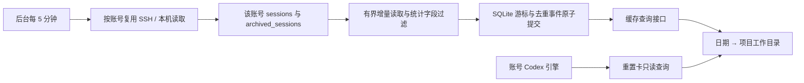

# Codex 账号每日用量

点击顶部账号额度卡片打开居中详情窗口，展示账号身份、服务返回的重置卡可用数量及到期明细，以及日期 → 工作目录两级用量表。

首次分批建立历史基线，随后仅处理修改文件的新完整行。每轮每账号最多读取 16 MiB、处理 200 个变更文件和 1000 个用量事件；未完成内容留至下一轮。记录按原始时间归属 UTC 日期。缓存保留历史，界面一次返回最新 5000 个日期/目录组合，超过时标记部分数据。

计数使用 `last_token_usage`，避免继承会话的累计基线被当作新消耗。重复累计快照在文件游标内过滤；继承历史及文件重读以原始时间、工作目录和累计计数的 SHA-256 身份在同一账号内去重。不同账号独立保存游标和事件。源文件缩短、替换或原地改写时重新读取，已记录事件不再增加；缓存表示观察到的使用记录，删除或重写历史不会撤销已经发生的消耗。若上游改写了历史事件的时间或计数，无法将其与原记录可靠关联。

游标只前进到完整换行。超长或不完整记录不被视为成功统计，状态会提示。扫描不跟随符号链接，不读取认证文件、提示正文或工具输出；只输出统计字段与必要的工作目录。请求端点不触发扫描，失败保留上次成功数据；停用账号停止后续采集，关闭服务等待正在进行的有界任务。

账号缓存与重置卡端点校验 `agent_api/read`、环境可见性及启用状态；本机默认环境还需账号控制权限。账号授权包含查看该账号全部工作目录的用量。重置卡读取失败独立于用量展示；字段缺失显示未知，明细不能代替服务返回的可用总数。

占比为项目 Token / 当日已采集 Token，不能解释为订阅额度占比。缓存输入属于输入计数，推理输出属于输出计数，不再次叠加到总量。当前不提供 Credits 数值估算，缺少可核对费率时显示未知，不声称是实际账单。官方账号字段可能受 Codex 版本和服务端支持影响；未支持时不会显示为零张。
