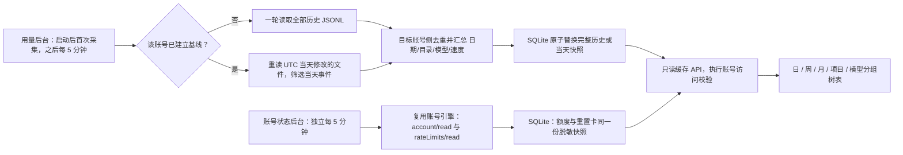

# Codex 账号用量与状态

顶部账号卡片打开居中详情窗口。额度、重置卡和用量均由后台采集；打开窗口、切换栏目、刷新缓存和 HTTP GET 均不触发 Codex 请求或 JSONL 扫描。

## 采集策略

每个账号单独记录是否完成首次全量采集。首次在一次任务内扫描该账号 CODEX_HOME 下 sessions 与 archived_sessions 全部 JSONL，不分批、不存字节偏移；后续每 5 分钟盘点文件，仅完整读取修改日期为 UTC 当天的文件，筛选事件时间为 UTC 当天的计数。首次允许 300 秒，日常允许 120 秒；账号之间顺序采集，同一账号并发请求合并。账号状态使用独立定时任务，历史扫描不会阻塞额度与重置卡更新。实际周期为上轮完成后 5 分钟，避免重叠堆积。

目标账号侧先去重再聚合，传回日期、完整工作目录、模型、速度模式、请求数量及 Token 计数。使用 last_token_usage，不把继承的累计基线当作新消耗；文件内过滤重复累计快照，同账号的继承/复制历史使用原始时间、工作目录与累计计数的 SHA-256 身份去重。模型从 session_meta / turn_context 提取，缺失时明确显示“模型未记录”。不同账号通过各自 SSH 连接读取；本机默认环境使用服务账号。只采集该环境能够读取的会话文件，没有 Token 事件的项目不会编造用量。

一次成功扫描以事务发布快照：首次替换该账号全部历史，后续仅替换当天，避免重读累加和保留已经被修正的当天旧数据。异常响应、读取权限失败、超时或资源上限导致任务失败时，保留上次成功结果，首次失败仍重试全量。账号源（系统用户或 CODEX_HOME）改变时重新建立基线。旧版游标表在初始化时删除；旧版计数缓存可继续展示，首次新扫描成功后一次替换，不保留双轨采集。

**时间边界：**所有文件修改日期、事件归属和周/月边界均为 UTC。采用用户指定的“只更新当天”规则，历史日期迟到写入、补导入、修改和停机期间未采集的日期不会在后续日常任务中自动补算；跨午夜前最后一轮之后写入的前一天记录也可能遗漏。历史保留首次全量及其后已发布的快照。需要重建历史时须重新建立该账号基线，打开弹窗不会触发重建。

## 资源与异常

扫描仅保留有界行缓冲、最多 200 万个去重身份及 5 万个聚合组合；盘点最多 2 万个目录/JSONL 文件，响应上限 32 MiB。普通行 256 KiB，元数据与上下文最多 4 MiB；巨型工具输出按块跳过。读取文件开始时固定该文件长度，追加内容留到下一轮，半行和异常记录标记不完整。不可读取的文件使整轮失败，避免发布一个缺项目的快照。未知计数字段保持 null。停止服务会中止正在执行的用量子进程。

不跟随符号链接，不读取认证文件，不传回或持久化提示正文、指令和工具输出。为了识别完整行仍需读取源文件内容；只对必要的记录进行 JSON 解析。前端最多返回最新 5000 个日期/目录组合，超过时标记部分数据。采集进度代表上次完成扫描，不表示正在运行的实时进度。progress.history_files / history_bytes 是该账号当前发现的全部历史 JSONL 文件数/大小；files_selected / files_complete / bytes_total / bytes_read 仅代表上轮实际选择、处理的文件及字节，mode/day 表示全量或 UTC 当天范围。日常扫描不能把当天修改的 30 个文件标成整个历史的“30 个会话”。文件副本也不等于独立会话；日期/项目组合记录数也不是会话数。旧缓存缺少 history_files 时保持历史总数未知。

## 账号额度与重置卡

独立后台每 5 分钟通过该账号的现有引擎读取 account/read 和 account/rateLimits/read，一次生成额度、套餐、邮箱、重置卡数量及到期明细的脱敏快照。两个 HTTP 视图共用该快照；即使缓存为空或过期，GET 和刷新也不调用引擎。首次无数据保持未知；失败保留成功数据并标记陈旧；退出 ChatGPT 登录或改为 API Key 后下一次采集清除订阅快照。未支持重置卡或只返回数量时明确说明，不显示零张替代未知。

用量详情与重置卡端点执行 agent_api/read、管理员身份、环境可见性及启用状态校验；本机默认环境还需账号控制权限。普通用户只查看已授权账号的额度摘要，不能点击卡片打开账号详情；直接请求详情接口也会被拒绝。账号源变化时旧状态缓存不会返回给新源。

## 统计维度与指标

| 维度 | 展开顺序 | 占比分母 |
| --- | --- | --- |
| 日 | 日期 → 项目 → 模型 | 筛选后当日预计 Credits |
| 周 | 周一至周日 → 项目 → 模型 | 筛选后当周预计 Credits |
| 月 | 月份 → 项目 → 模型 | 筛选后当月预计 Credits |
| 项目 | 项目 → 模型 → 日期 | 筛选后整个范围预计 Credits |
| 模型 | 模型 → 项目 → 日期 | 筛选后整个范围预计 Credits |

日期/项目搜索先于分组，支持逐级展开、本页展开、全部收起和按顶层分组分页。项目使用完整工作目录区分，重名项目不会合并；项目名采用平台登记目录的最长前缀匹配，未登记显示末级目录名。旧后台缺少 models 字段时显示“模型明细未返回”并提示检查服务版本，不能解释为 0 个模型。

界面使用与 DolphinDB Manager 相同的紧凑表格规格，工作目录为独立字段，采集元数据合并到单条状态栏。预计 Credits 位于“耗用占比”前；耗用占比按 Credits 计算，分母为零或未知时显示 —。完全无法估算 Credits 的项目/模型记录隐藏，Token 汇总、占比和日期/项目记录数量按可展示记录重新计算；部分估算保留覆盖标记。视觉规格与权限边界见 [平台管理界面](management-ui.md)。

所有汇总层累加原始 Token 后计算缓存率（缓存输入 / 输入），不平均子层百分比。输入为零、字段缺失或缓存超过输入时保持未知；缓存输入属于输入、推理输出属于输出，不重复计入总量。模型的不同速度合并 Token，Credits 逐速度估算后相加。

Credits 使用 [官方定价](https://learn.chatgpt.com/docs/pricing) 在 2026-11-11 核对的费率：非缓存输入 × 输入费率 + 缓存输入 × 缓存费率 + 输出 × 输出费率。Fast/priority 为 2 倍，Ultrafast 为 6 倍；未记录速度按 Standard 估算。不重建历史价格，不代表账单或订阅额度消耗比例。缺少模型、未知模式或计数不完整时不编造估算，按请求数保留覆盖信息，部分覆盖以 * 标明。
# API 钱包与估算用量

API 钱包余额和服务商提供的 `actual_cost` 来自服务商钱包接口，与 JSONL Token 统计中按官方费率估算的 Credits 不同，不能相加或互相替代。服务商没有返回扣费或余额时保持未知；DeepSeek 官方钱包的币种来自其响应。当前支持明确注册的 Sub2API 兼容服务以及 DeepSeek 官方钱包，其他服务显示未声明余额接口。

上游以规范化的 URL 分组（忽略末尾斜杠和 `/v1`）。同组的用量按请求指纹去重后合并；指纹冲突或采集不完整时标注部分统计。相同 URL 的 Key 余额不一定相同，因此各 Key 的余额和实际扣费分别展示，不将它们直接相加。共用历史目录但上游不同或无法确定上游时，不归属给该 Provider，以免重复计算。

为合并采集增加的请求指纹仅包含哈希和 Token 计数，不包含对话正文。每个环境单次读取最多记录 50000 条指纹，合并上限为 200000 条；超过上限时合并统计明确标记为不完整，不把截断结果当完整统计。原有账号级聚合仍独立保存。旧缓存首次升级后需要一次有界全量采集，随后按日更新。
