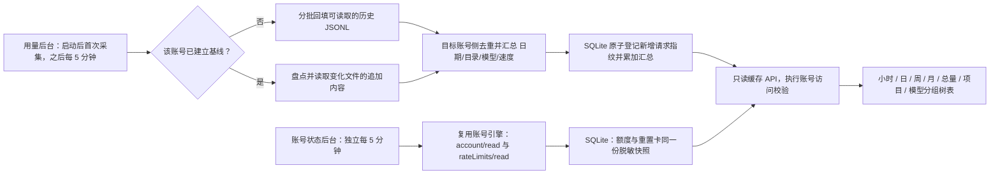
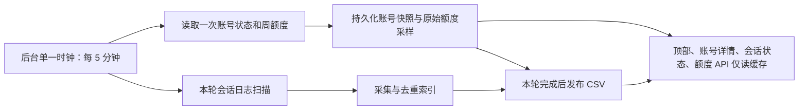

# Codex 账号用量与状态

顶部账号卡片打开居中详情窗口。额度、重置卡和用量均由后台采集；打开窗口、切换栏目、刷新缓存和 HTTP GET 均不触发 Codex 请求或 JSONL 扫描。

## 采集策略

每个账号盘点其 CODEX_HOME 的 sessions 与 archived_sessions。初次回填和日常增量都保存文件身份、偏移与最小解析状态。正常扫描每轮读取预算为 256 MiB，边界记录可在下一轮续读。已确认未变的文件跳过，变化文件从持久化偏移续读。替换来源或切换统计时区时重新核对已采集请求。账号之间顺序采集，同一账号的采集任务串行提交。

优先采集 `token_usage_record.usage`，按 `response_id` 标识请求。随后的累计回显用于兼容旧账本身份。同一个请求只计一次，即使压缩导致累计计数不变或最后用量过时。仅有旧式记录时，使用可确认的 `last_token_usage` 和累计指纹。模型及速度取当时原生设置与请求字段。目标账号侧只传回用量、归属和检查点。旧账本只有在已记录请求与其回显可逐条核对后才更新解释。

一次成功扫描以事务登记请求指纹并累加新增计数，不删除已采集数据。删除、移走、归档、裁剪或重写 JSONL 不会撤销既有耗用；重复采集、文件副本、重启服务均复用持久化指纹。指纹唯一约束与汇总在同一事务中，异常或重复响应整体回滚。完整与缺失字段按不同桶汇总，未知输入字段不会抹掉同模型已知请求的 Credits，覆盖比例仍按请求数计算。

异常响应、读取权限失败、超时或资源上限导致任务失败时保留上次成功结果，首次失败仍重试全量。账号源（系统用户或 CODEX_HOME）改变时重新建立基线。旧版聚合缓存没有逐请求身份，迁移时保留原有汇总，以旧缓存最后成功时间作为固定基线，只补记其后的请求；不能从旧聚合结果还原边界前迟到写入的明细，也不能追回升级前已经遗漏的未采集记录。无可验证身份的旧数据仍保留覆盖限制。

## 新开、复制与压缩

| 场景 | 处理 |
| --- | --- |
| 本平台新开 | 原历史耗用保留；新原生 turn_id 独立登记，只加新请求 |
| 压缩上下文 | 摘要与替换消息不是用量事件；不扣除压缩前消耗，原生记录的压缩请求用量照常计入 |
| 重放累计快照 | 相同 turn_id / 累计计数不因记录时间变化重复计入 |
| 同账号复制文件 | 指纹去重，不把完整历史再次累加 |
| 跨 Engine / 账号复制 | 平台记录 fork 边界和生成的祖先 ID；目标账号排除导入祖先及继承前缀，源账号耗用保持原归属 |
| paginated fork | 从祖先的不可变字节前缀读取末次累计基线，避免将恢复通知当作新请求；不会读取前缀之后的分支记录 |
| 无法确认继承关系 | 标记部分数据并保留旧缓存，不把未知基线猜成目标账号的新增用量 |

平台生成的导入祖先仍作为原生恢复依赖保留，不改写或删除历史内容。原生 fork 元数据提供可用边界时同样用于排除继承记录。平台外手动复制且不保留原生身份/边界的日志无法可靠还原跨账号归属；已有旧聚合中的重复计数也不能仅凭汇总安全扣减。

**时间边界：**文件修改日期、事件归属和周/月边界统一采用平台运行环境的本地 IANA 时区（当前部署为 Asia/Taipei，UTC+8）。服务端将时区显式传给本机或 SSH 扫描器，不依赖远端机器的时区设置。API 返回缓存实际使用的 timezone，界面以同一时区显示采集时间。周从本地周一开始；日期标签已完成时区归属，周分组只进行日历运算。日常只更新当天；跨本地午夜的第一次采集额外收尾前一天，之后恢复当天范围，避免漏掉零点前最后一次采集之后的请求，也不假定有夏令时的日期固定为 24 小时。跨越一个以上未采集日期时，恢复后的首次扫描执行有界全量补采并去重；正常采集不会无界回扫历史迟到写入或补导入的所有日期。

旧 UTC 缓存由后台自动做一次全量日期重分配，之后恢复每 5 分钟的当天采集；打开弹窗不会触发重建。请求指纹不包含时区，重分日期不重复累计。重新读取到的已登记请求从旧桶扣除后按本地日期归属；已删除或无法恢复原始时间的历史耗用单独保存在未归属汇总中，并在界面明确提示，不猜测日期，也不混入本地日期占比。迁移失败保留旧缓存及其 UTC 标记，等待下一轮重试，不发布半成品。正常迁移完成后，缺失历史的指纹仍保留，文件重新出现也不再次计入。要重建其他遗漏历史仍需重新建立账号基线。

### 统计规则升级

影响持久化归属或解释方式的解析规则变化时，开发者必须递增 `USAGE_RULE_VERSION`，并覆盖旧缓存升级及原始历史缺失的测试。后台对各账号顺序执行有界全量核对：已有请求身份必须与投影一致，旧请求均可重读且关键字段一致，旧聚合须与投影逐项相符；成功才在同一事务替换缓存和版本，保留新增请求。存在已删除的旧请求、未归属记录、截断或旧数据不一致时，不覆盖旧缓存，界面提示部分估算可能仍用旧规则，并延迟重试；其他无法解析的记录不会阻止已核对的旧数据更新，但结果仍标记为部分数据。历史局部缺失与当日采集状态分别保留；历史不完整时，耗用额度仍根据已记录请求分配并标注部分数据，但权重可能有偏差。无法重读的历史不能凭空推断其服务档位。

## 资源与异常

扫描仅保留有界行缓冲、最多 200 万个去重身份及 5 万个聚合组合；盘点最多 2 万个目录/JSONL 文件，响应上限 128 MiB（包含首次全量新增指纹）。日常只发送当前日期范围的已知指纹，目标端先过滤，只传回新增指纹与汇总；不会每 5 分钟传输全部历史请求或逐条正文。普通行 256 KiB，元数据与上下文最多 4 MiB；巨型工具输出按块跳过。祖先基线优先从尾部按 256 KiB 逆向寻找，按 ID/前缀长度在单轮复用，额外读取总预算 64 MiB、递归最多 64 层；缺失、冲突或超限均标记不完整。读取文件开始时固定该文件长度，追加内容留到下一轮，半行和异常记录标记不完整。不可读取的文件使整轮失败，避免发布一个缺项目的快照。未知计数字段保持 null。停止服务会中止正在执行的用量子进程。

不跟随符号链接，不读取认证文件，不传回或持久化提示正文、指令和工具输出。为了识别完整行仍需读取源文件内容；只对必要的记录进行 JSON 解析。前端最多返回最新 5000 个日期/目录组合，超过时标记部分数据。采集进度代表上次完成扫描，不表示正在运行的实时进度。progress.history_files / history_bytes 是该账号当前发现的全部历史 JSONL 文件数/大小；files_selected / files_complete / bytes_total / bytes_read 仅代表上轮实际选择、处理的文件及字节，mode/day 表示全量或本地当天范围。日常扫描不能把当天修改的 30 个文件标成整个历史的“30 个会话”。文件副本也不等于独立会话；日期/项目组合记录数也不是会话数。旧缓存缺少 history_files 时保持历史总数未知。

## 账号额度与重置卡

独立后台每 5 分钟通过该账号的现有引擎读取 account/read 和 account/rateLimits/read，一次生成额度、套餐、邮箱、重置卡数量及到期明细的脱敏快照。两个 HTTP 视图共用该快照；即使缓存为空或过期，GET 和刷新也不调用引擎。首次无数据保持未知；失败保留成功数据并标记陈旧；退出 ChatGPT 登录或改为 API Key 后下一次采集清除订阅快照。未支持重置卡或只返回数量时明确说明，不显示零张替代未知。

用量详情与重置卡端点执行 agent_api/read、管理员身份、环境可见性及启用状态校验；本机默认环境还需账号控制权限。普通用户只查看已授权账号的额度摘要，不能点击卡片打开账号详情；直接请求详情接口也会被拒绝。账号源变化时旧状态缓存不会返回给新源。

### 观测额度的分配

后台随账号状态记录最近 90 天的周额度采样，仅保存账号来源、邮箱、采样时刻、重置时刻和已用百分比。相邻读数在同一账号、间隔不超过 15 分钟且读数未倒退时，计算账号观测变化；扫描尚未覆盖、采样断档或额度回升时跳过并提示未覆盖。跨整点区间使用区间内各小时请求的订阅参考值拆分；缺乏可计算权重时跳过。账号耗用先按所选小时、日、周、月或整个日期范围汇总，再按同周期全部项目和模型的订阅参考值分配，搜索和列筛选不改变分母。读数未变化时为零，但上游百分比可能取整，不能证明没有耗用。旧采样之前的历史保持未知。采样间其他客户端的用量或缺失历史可能影响分配。API Provider 不适用该订阅额度列。

## 统计维度与指标

| 维度 | 展开顺序 | 占比分母 |
| --- | --- | --- |
| 日 | 日期 → 项目 → 模型 | 当日全部项目与模型预计 USD 金额 |
| 周 | 完整自然周（周一至周日） → 项目 → 模型 | 完整自然周全部项目与模型预计 USD 金额 |
| 月 | 完整自然月 → 项目 → 模型 | 完整自然月全部项目与模型预计 USD 金额 |
| 总量 | 所选日期范围 → 项目 → 模型 | 该范围全部项目与模型预计 USD 金额 |
| 项目 | 项目 → 模型 → 日期 | 所选日期范围全部项目与模型预计 USD 金额 |
| 模型 | 模型 → 项目 → 日期 | 所选日期范围全部项目与模型预计 USD 金额 |

周、月先把日期选择扩展为涉及的完整自然周期，再统一筛选 Token、USD 等值金额和额度小时观测；总量、小时、日、项目和模型严格按日期选择统计，包含起止当天。状态栏明确显示实际统计范围，日期输入保留用户原始选择；清空边界时使用缓存数据的可用起止日期。总量按整个范围总额度与内部 Credit 权重重新分配，不累加小时、日、周已分配的项目结果；缺少额度小时观测时总量额度保持未知。搜索和列筛选在分配之后执行，不修改未筛选的金额分母，也不缩短总量行的日期标签。API Engine 共用相同的日期与总量规则，隐藏订阅额度和金额分配列；不会因切换维度触发新采集，5 分钟后台采集间隔保持不变。

项目搜索和字段筛选支持逐级展开、本页展开、全部收起和按顶层分组分页。项目使用完整工作目录区分，重名项目不会合并；项目名采用平台登记目录的最长前缀匹配，未登记显示末级目录名。旧后台缺少 models 字段时显示“模型明细未返回”并提示检查服务版本，不能解释为 0 个模型。

界面使用与 DolphinDB Manager 相同的紧凑表格规格，工作目录为独立字段，采集元数据合并到单条状态栏。预计 USD 金额位于“占比”前；占比按金额计算，分母为零或未知时显示空白。完全无法估算金额的项目/模型记录仍展示，金额为空；Token 汇总保留全部筛选记录；部分估算保留覆盖标记。视觉规格与权限边界见 [平台管理界面](management-ui.md)。

所有汇总层累加原始 Token 后计算缓存率（缓存输入 / 输入），不平均子层百分比。输入为零、字段缺失或缓存超过输入时保持未知；缓存输入属于输入、推理输出属于输出，不重复计入总量。模型的不同速度合并 Token，Credits 逐速度估算后相加。

Credits 使用 [官方定价](https://learn.chatgpt.com/docs/pricing#token-rates) 在 2026-11-18 核对的费率：`((输入 − 缓存输入) × 输入费率 + 缓存输入 × 缓存费率 + 输出 × 输出费率) ÷ 1,000,000 × 速度倍率`。推理 Token 已包含在输出中，不重复计价；订阅积分没有单独的缓存写入费。

| 模型 | 输入 / 百万 Token | 缓存输入 / 百万 Token | 输出 / 百万 Token | 订阅 Fast / priority | 订阅 Ultrafast |
| --- | --- | --- | --- | --- | --- |
| GPT-6.2 Sol | 50 | 2.5 | 250 | 2 倍 | 6 倍 |
| GPT-6.2 Astra | 200 | 10 | 1,000 | 2 倍 | 6 倍 |
| GPT-6.1 Sol | 50 | 2.5 | 250 | 2.5 倍 | 8 倍 |
| GPT-6 Astra | 250 | 25 | 1,250 | 2.5 倍 | 8 倍 |

[速度倍率](https://learn.chatgpt.com/docs/pricing#speed-multipliers) 按模型和估算口径区分。其余已登记旧模型保留 Standard 与 Fast 参考费率，未支持的 Ultrafast 组合保持未知。已购 Credits 参考的 Fast 为 2 倍；6.2 Sol / Astra 的 Ultrafast 在符合优惠条件时为 3 倍，2027-03-01 太平洋时间零点（08:00 UTC）起自动改为 6 倍；旧版 Astra / 6.1 Sol 的已购 Credits Ultrafast 为 6 倍。该优惠不适用于订阅内额度，6.2 的订阅 Ultrafast 始终为 6 倍。平台的已购 Credits 口径仅作当前公开费率参考，不能据此判断账号优惠资格或实际 API 扣费。

账号统计、对话 Item / Progress / Final 和额度分配共用同一换算函数；模型悬停详情展示同表的 Standard 费率和核对日期。订阅估算是将标准 Credits 费率与订阅速度倍率结合的相对参考值，并非已购 Credits 的计费值；未记录速度按 Standard 估算。费率直接在读取数据库与 CSV 时应用，不需要重建原始 Token，也不递增解析规则版本；历史价格不重建，不代表账单或订阅额度消耗比例。历史缓存的解析规则版本变化时才需要后台重新扫描并核对旧请求身份、Token 与汇总；全部核对通过后原子切换，缺失、冲突或超限时保留旧缓存并提示，稍后自动重试。缺少模型、未知模式或计数不完整时不编造估算，按请求数保留覆盖信息，部分覆盖以 * 标明。
# API 钱包与估算用量

API 钱包余额和服务商提供的 `actual_cost` 来自服务商钱包接口，与 JSONL Token 统计中按官方费率估算的 Credits 不同，不能相加或互相替代。服务商没有返回扣费或余额时保持未知；DeepSeek 官方钱包的币种来自其响应。当前支持明确注册的 Sub2API 兼容服务以及 DeepSeek 官方钱包，其他服务显示未声明余额接口。

账号和 API 的用量表共用「Token 数（预计耗费）」格式，适用于各时间分组、项目和模型。账号显示 USD 等值金额，官方 API 显示其计费币种。缓存列同时保留命中率，推理用量及其金额包含在输出中。`—` 表示未知，`*` 表示估算覆盖不完整。

官方 DeepSeek Responses 接入（`https://api.deepseek.com` 或 `/v1`）的上游详情显示今日预估 Token 费用及按项目、模型分组的金额。先按去重后的每次请求分别计算缓存命中输入、缓存未命中输入和输出，再汇总。使用原生用量回执时间判定费率。北京时间周一至周五的 09:00 到 12:00 和 14:00 到 18:00 为高峰，公布的放假区间和周末使用空闲单价。今日金额按北京时间统计。用量表日期仍沿用平台时区。

估算从已核验的 2026 年 11 月 18 日 12:00（北京时间）起覆盖。缺少时间、模型、必要计数或当年节假日数据时，保留 Token 用量并标明估算覆盖不足。官方调整费率且未声明生效时间时，以首次成功确认变更的时间作为版本边界。金额仅涵盖可归属的本地 Token 记录。参见 [DeepSeek 官方费率](https://api-docs.deepseek.com/zh-cn/quick_start/pricing/)。

上游以规范化的 URL 分组（忽略末尾斜杠和 `/v1`）。同组的用量根据历史记录中的 `model_provider` 归属，并按请求指纹去重后合并；缺少来源、指纹冲突或采集不完整时标注部分统计。相同 URL 的 Key 余额不一定相同，因此各 Key 的余额和实际扣费分别展示，不将它们直接相加。共用历史目录但上游不同或无法确定上游时，不归属给该 Provider，以免重复计算。

为合并采集增加的请求投影仅包含哈希、模型/来源与 Token 计数，不包含对话正文。正常采集仅追加新增投影，文件消失不删除已保存记录。每个环境单次最多回传 500000 条投影，合并读取上限为 500000 条；超限明确标记不完整，不将截断结果当完整统计。原有账号级聚合独立保存，不受投影上限影响。旧聚合缓存缺少跨 Engine 投影时，仅为投影做一次有界全量回填；原统计按固定时间基线补新，不重复累加历史。新旧指纹以时间指纹别名作无歧义衔接，两个真实原生 turn_id 即使同一时间也不合并，存在旧记录归属歧义时标记部分数据。

本机隔离性能样本（30 个文件、约 184 MiB、15000 个请求，包含跨 Engine 请求投影）：全量约 0.85 秒，无新增请求的重扫约 0.63 秒；无新增时只返回 345 字节状态与空增量，SQLite 写入 15000 个指纹约 41 毫秒。该样本用于验证读文件和传输规模，不能替代不同磁盘、SSH 与数据量下的实测。

小时维度使用每条原生 Token 记录的实际时间戳，按平台本地时区整点分组并显示 UTC 偏移，夏令时重复的小时不会混合；日期、周、月和原有聚合保持不变。升级后后台对可读历史做一次有界回填，只补充已有请求身份的小时，不修改或重复累加既有用量。文件已删除、超限或无法归属的记录保留原有日统计；小时无法确认时显示“时间未知”并标注部分统计，不推测时间。回填与正常采集共享原有权限和资源上限。

管理员可通过 `POST /api/codex/environments/:id/insights/rebuild` 对指定 Engine 从现存历史完整重建日和小时统计。重建完成并校验后才原子替换缓存；无法扫描、结果截断或请求身份不一致时保留原缓存；少量记录不可解析时重建可读取的数据，并将统计标为不完整。重建按现存文件计算，之前已删除的历史不再计入；不会删除会话文件或凭据。

### CSV 当前数据与小时归档

用量后台首次成功采集后，将现有采集索引完整投影到数据库同目录的 `usage-csv/<账号 ID 的 SHA-256>/`。`manifest.json` 指向同一代的四个文件：`current-*.csv` 保存当天请求用量；`hourly-*.csv` 保存历史小时、目录、模型、速度、会话与 Token 汇总；`quota-*.csv` 保存当天额度采样；`observed-*.csv` 保存历史及当前可观测的账号小时额度变化。后续更新当天用量，并复核前一天尚未闭合的额度区间；跨天后的下一轮采集将前一天请求合并到历史小时文件，既有历史小时记录直接复用，当天文件只包含新一天。未知小时的旧缓存保留为小时为空的日记录，不伪造小时和会话。

文件通过临时文件、fsync 和原子 manifest 替换发布；读取校验整代 SHA-256，避免读取部分写入结果；保留上一代 manifest 及其引用文件，支持恢复。未变化的文件复用内容哈希，避免每轮重写历史文件。日和小时统计在规则与数据完整时读取 CSV；首次尚未转换、规则待核对或数据不完整时继续兼容旧索引。SQLite 的原始采集、去重、跨 Engine 合并和迁移索引仍保留作为兼容与恢复来源，不自动删除已有历史。CSV 损坏可由下一轮采集重建；已经清理出额度采样保留窗口的小时额度从上一代 CSV 继承。

用于额度分配的订阅参考值从归档中的模型、速度和 Token 重新计算。归档不会保存作为周、月结果使用的项目小时分配值。界面先按选定周期汇总账号观测耗用与全部项目、模型订阅参考值，再进行一次周期分配；搜索和列筛选只控制展示，耗用额度和金额占比均保留原周期完整分母。金额按 USD 等值展示，不在用量表中显示积分单位。四位小数采用最大余数分配，显示的各项额度与显示的周期总量守恒。采样边界拆分仍是参考估算，既不代表逐会话精确扣费，也不将采样缺失当作零。

专用浏览器回归入口：`npm exec playwright test -- --config playwright.usage.config.ts`。它在独立端口使用模拟额度与用量响应，验证日、周、月切换、展开和筛选不改变隐藏项归属。

### 后台统一采集与页面读取

每个启用的订阅账号每轮只请求一次 `account/rateLimits/read`。额度和会话采集在同一轮启动，各自记录真实完成时间；并不声称远程接口和本地文件拥有原子快照。所有页面查询（包括刷新参数）均不触发额度采集，不另建额度读取进程；API Engine 不请求订阅周额度。周期按启动时间安排，耗时计入 5 分钟间隔，不重叠或补发漏掉的时钟；单轮超过 5 分钟时延后下一轮，不并发补采。

| 界面时间 | 含义 |
|---|---|
| 重置 | 当前额度窗口的下次重置时刻，来自上游 |
| 额度读取完成 | 最近成功读取账号额度接口的完成时刻；悬停可查看该轮额度采集启动时间 |
| 用量扫描完成 | 最近成功扫描会话日志的完成时刻，不是最后一次 Token 使用时刻 |
| 额度采样覆盖 | 首次至末次能计入分配的采样区间，可能有缺口，不是周额度窗口或计费周期 |

只有日志扫描边界覆盖采样结束时刻，额度区间才可计入分配。同轮额度响应晚于文件扫描开始时，本次原始额度采样照常保存，区间可能到下一轮扫描后才能纳入，因此页面覆盖终点可能落后最近额度读取时间。前端定时读取后台缓存与后台采集互相隔离。

### 停机与部分失败后恢复

已完成的采集检查点和请求身份均持久化。数小时且未跨多日的恢复使用正常当天／跨天扫描；跨多日使用 `catchup`，从上次成功日期开始选择修改过的文件，并只返回该日期至今天的新增请求。无需读取此前未改动的冷历史文件。请求身份、聚合与检查点在同一事务提交，重复恢复不会重复累计；部分读取失败时保留原检查点，下轮继续补采，CSV 重新核对受影响的历史。

额度快照没有上游历史补读接口。停机中缺失的额度采样不推造；超过 15 分钟的采样空档不参与分配，重启后开始新的观测区间。可从尚存 JSONL 恢复的 Token 用量与无法恢复的历史额度采样须分开理解。原文件已删除或超出资源上限时保留旧数据并标明不完整。

### 统计来源显示

状态栏保持一行，显示这次查询实际采用的 `CSV` 或 `数据库`、CSV 目录或数据库文件的完整路径，以及最新成功采集完成时间。日志目录作为悬停补充信息，不替代实际统计存储位置；窄屏可横向滚动查看完整路径。后端通过 `usage.storage.kind/path` 提供真实读取来源，空缓存、数据库回退、账号日统计和单账号小时统计分别验证。

本项验证：服务端 `codex-usage-storage.test.ts` 和 `codex-environments.test.ts` 共 26 项通过，账号详情组件 16 项通过，用量浏览器用例通过，前后端构建通过。

来源栏直接显示 `CSV 目录：<实际目录>` 与最新成功采集时间；去掉原始 JSONL 文件数量和日志目录。匹配采集检查点与时区的 CSV 即使原始历史不完整也优先读取；只有缺失、损坏或检查点不匹配时回退数据库，并明确显示数据库路径。

### 已迁移历史汇总的数据库清理

每次 CSV 原子发布并通过校验后，自动清理 `codex_usage_events` 中早于昨天、可完整重建的历史日汇总。删除前核对文件校验值、账号来源、时区、采集检查点，以及同组全部 Token 字段和请求数；CSV 和逐请求投影均须与原汇总一致。旧格式身份不能无歧义恢复或核对失败时保留该行。今天和昨天的汇总继续用于增量采集与午夜收尾。

删除和归档标识在一个 SQLite 事务内提交。标识只保存账号与汇总键，不保存 Token 或请求数；正常查询读取 CSV，数据库回退、规则重算和时区迁移按已知归档键从保留的请求投影重建，避免把未曾归档的孤立投影当成历史汇总。CSV 损坏可恢复；晚到历史请求先还原旧总量，再增加新请求，重新发布后再次清理。

逐请求投影、请求身份、采集检查点、额度采样和账号状态仍参与跨 Engine 去重、区间计算与恢复，因此本次不删除它们。这里清理的是已核验迁出的重复日汇总，不是删除整个业务数据库。

统计展示按真实工作目录合并软链接别名，优先显示平台登记的项目目录；同名但物理目录不同的项目保持独立。归一化发生在 Token、模型和 Credit 汇总之前，不更改原始日志、CSV 路径或请求指纹，避免误合并独立请求。

用量表将 USD 等值预估与耗用额度合并为“预估金额 | 额度”一列，例如 `40.00 | 20 (2.00)`。金额基于模型费率和速度档位估算，不是实际账单。括号内为同一行汇总金额除以汇总额度，即每 1 个额度百分点对应的金额；先汇总再计算，不累加或平均子项比值。额度为零或字段缺失时比值显示 `—`，保留已知零值及金额部分覆盖的 `*` 标记。该列按金额排序和筛选，额度分配和占比分母沿用原统计口径；API 引擎不显示此订阅列。
