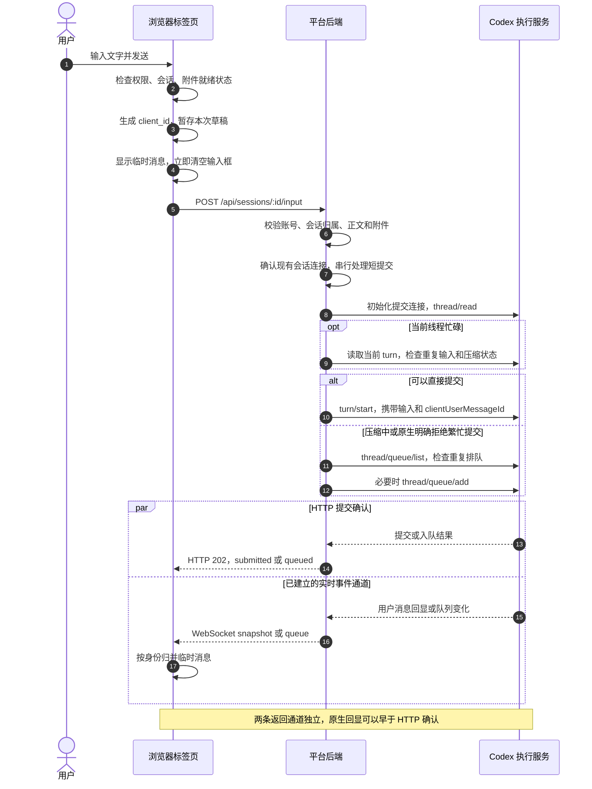
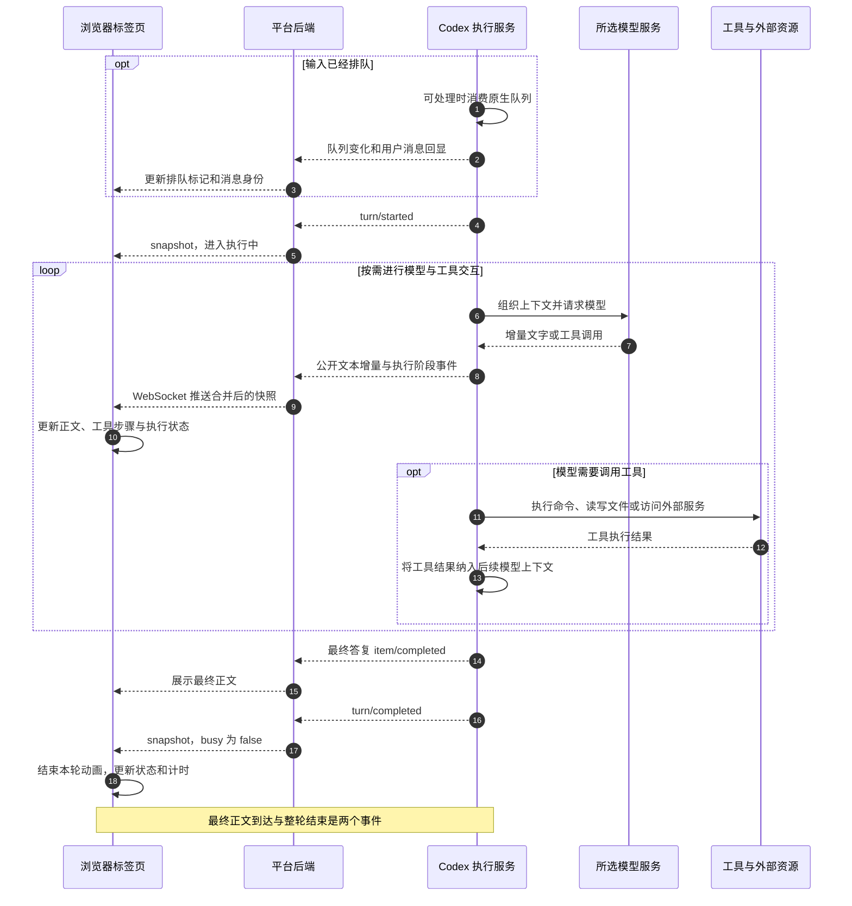
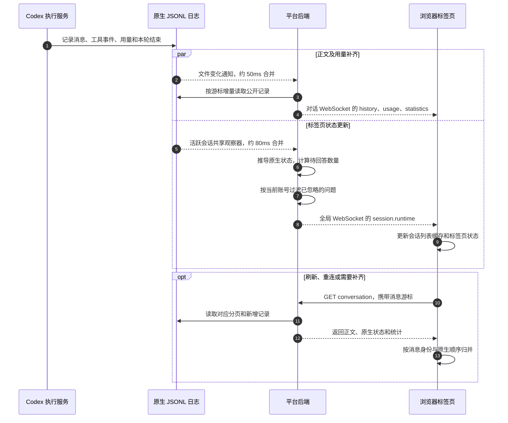

# 标签页消息的实际时序

本文以当前工作区的实现为准，描述已接入独立 Codex 服务的标签页“对话”模式。执行服务到模型和工具之间表示职责边界；平台通过原生 RPC 和执行事件观察这一过程。

一条消息通常经过：浏览器标签页 → 平台后端 → 该标签页绑定的 Codex 线程 → 所选模型服务。工具执行、排队和上下文压缩按需发生。正文通过已有 WebSocket 返回，HTTP 发送请求只负责提交确认。

**输入之前：会话绑定、上下文和返回通道。**

- 平台标签页保存自己的 `session_id`，后端据此查找 `codex_session_id`，对应原生 `threadId`。不同标签页按各自绑定路由。
- 浏览器先读取 `/api/sessions/:id/conversation`，加载一页历史和原生状态；之后用消息游标补齐新增记录。
- 当前 Codex 对话建立 `/api/sessions/:id/conversation/stream`，订阅该线程的文本、工具阶段、交互、用量和队列变化。后端通过原生连接初始化、读取线程、接入已加载线程并获取当前轮次基线；这个观察过程不提交用户任务。
- 浏览器另有全局 `/api/stream`，用于标签页和项目汇总状态。正文返回与全局状态更新使用不同的通道。
- 符合账号和目录范围的共享资源说明，在新建、恢复或显式重载时接入。普通发送不重复注入。平台只提供共享目录、`.env` 路径和使用说明；工具在需要时读取凭据。原生记录中的共享说明在对话里显示为可折叠的“自动信息 · 共享资源”。

**发送到受理。**

1. 附件在发送前上传到项目的附件目录；发送时使用已上传的路径和展示元数据。图片转换为原生 `localImage` 输入，普通文件提供可读取的文件路径。
2. 浏览器生成一次提交的 `client_id`，立即插入临时消息并清空已提交的草稿。HTTP 尚未返回时，可以继续编辑下一份草稿。
3. 后端检查登录和写权限、会话访问范围、正文大小及附件路径，尝试重新连接已有会话。连接不可恢复时返回明确失败，保留历史。
4. 同一标签页的短提交过程串行执行，避免同时粘贴或提交互相交错；不会锁住整个 Agent 执行周期。
5. 已接入原生服务时，普通聊天直接调用原生 RPC。忙碌时先核对当前 turn：如果同一 `client_id` 已存在，则复用受理结果；压缩中或遭到明确的繁忙拒绝时进入原生队列。其他错误不会一律转成排队。
6. `submitted` 表示输入已受理，`queued` 表示原生队列已接收。两者都不表示任务已完成。

**受理到最终答复。**

执行服务负责组织已有指令、会话历史、当前输入和工具结果，再请求所选模型。工具可能只是读取本地文件，也可能通过本地程序携带凭据访问 Jira、Confluence、GitLab 等外部服务。普通发送没有额外的平台 AI 改写步骤；提示词增强等独立功能需要显式触发。

模型文本到达时，平台更新公开的进展和答复；工具开始、结束时更新精简活动信息。工具结果和内部推理不会直接作为普通聊天气泡展示。一个用户问题可能经历多次模型请求和多轮工具调用。

原生最终消息完成后，正文可以已经完整显示，而 turn 仍处于收尾阶段。收到 `turn/completed` 才表示该轮执行结束。这不等于业务任务已经验收通过；存在未回答的异步问题时，标签页仍显示黄色提醒。

**正文持久化、状态推送和断线补齐。**

正文的持久化来源主要是原生 JSONL 日志。平台数据库另保存会话绑定、附件展示信息、个人设置和提醒偏好等数据。实时快照和日志中的同一消息需要归并，不能简单地每收到一次就新增一个气泡。

| 通道或机制 | 当前行为 | 是否请求模型 |
| --- | --- | --- |
| 发送 HTTP 请求 | 只确认受理或排队 | 提交任务可能启动模型执行，HTTP 确认本身不生成答复 |
| 原生文本和阶段事件 | 约 10ms 合并快照后推送 | 否 |
| 原生日志中的公开正文、用量和统计 | 文件变化后约 50ms 合并处理 | 否 |
| 标签页原生状态和待回答数量 | 文件变化后约 80ms 合并，变化才推送 | 否 |
| 会话历史兜底读取 | 正常推送可用时约 30 秒；不可用时前台约 2 秒，网页隐藏时约 10 秒 | 否 |
| Codex 会话列表状态兜底 | 约 5 秒读取 | 否 |
| 压缩完成提示 | 最多显示 3 秒，继续执行时立即让位 | 该提示不请求模型；实际压缩由原生服务执行 |

这些毫秒数是代码中的合并窗口，不是端到端延迟保证；总耗时还包括网络、磁盘读取、事件循环和浏览器渲染。

性能上，同一活跃会话共用状态观察器，突发变化合并处理，相同状态不重复广播。正文按游标补齐，未变化历史的问题元数据复用缓存。全局状态事件直接更新列表缓存，不为每个事件重新请求整个会话列表、模型目录或额度。

**需要用户操作和异常时发生什么。**

| 情况 | 实际处理 |
| --- | --- |
| 异步提问 | 展示可稍后回答的卡片；Agent 可以继续执行。提交回答复用普通消息提交链路，保留原生问题标识 |
| 授权或阻塞式确认 | 展示交互卡，通过对话 WebSocket 提交响应；原生服务收到响应后决定是否继续 |
| 全部忽略 | 只更新当前账号对这些问题的持久化移除标记，清除问题卡和提醒；不向模型发送回答 |
| HTTP 报错，但已有对应原生回显 | 原生回显作为更强的受理证据，不把已成功提交的消息恢复成草稿 |
| 明确提交失败 | 恢复原草稿；已有新草稿时，把失败内容单独保留供恢复 |
| 网络超时，提交结果未知 | 展示待确认结果，不盲目重新发送，避免重复执行 |
| 特定模型容量错误 | 符合条件时可自动重试最多 3 次，等待间隔为 10、20、40 秒；展示重试状态并允许取消。新发言会取消旧任务的待重试计划 |
| 重试计划被取消 | 显示实际发起次数和停止原因。异步提问即使使用原生 `final_answer` 阶段，也不算任务最终答复，不会据此取消容量重试 |
| 原生实时连接断开 | 尝试重新订阅，使用日志和分页补齐已完成的消息；观察和补齐本身不重新发起用户任务 |
| 丢失结束快照 | 同一原生 turn 的更新日志完成事件可清除旧 busy 状态；其他 turn 或更早的完成事件不能结束当前任务 |

**几个标识分别解决什么问题。**

| 标识 | 含义 |
| --- | --- |
| 平台 `session_id` | 决定访问哪个标签页会话、执行什么权限校验 |
| `codex_session_id` / `threadId` | 指向该标签页绑定的原生会话 |
| `client_id` | 关联本次发送、临时气泡、受理回显和排队项，并支持当前提交过程的去重 |
| `turn_id` | 区分一次执行轮次，用于状态、计时和结束事件校验 |
| 原生消息或条目 ID | 把实时增量、完成快照和持久化消息归并为同一条内容 |

`client_id` 不是平台跨所有重启场景的永久“恰好一次”保证。因此提交结果未知时保留核对路径，而不是直接重新发送。

原始终端和未接入独立执行服务的会话还有一条兼容路径：浏览器终端输入经平台透传到 PTY，再由 CLI 接收；“对话”提交必要时可退回向 PTY 写入正文，约 50ms 后写入 Enter。Claude 和嵌入式 CLI 也使用相应的终端及原生日志链路，不能把上面的 Codex 原生 RPC 路径套用于所有模式。

代码入口：

- 前端发送与归并：[SessionConversation.tsx](../dashboard/src/components/SessionConversation.tsx)、[conversation-timeline.ts](../dashboard/src/lib/conversation-timeline.ts)。
- HTTP 提交和会话 WebSocket：[agent.ts](../server/src/routes/agent.ts)。
- 原生提交、排队和事件转换：[conversation-stream.ts](../server/src/services/conversation-stream.ts)。
- 日志补齐：[conversation-file-stream.ts](../server/src/services/conversation-file-stream.ts)、[conversation-reader.ts](../server/src/services/conversation-reader.ts)。
- 标签页状态推送：[session-runtime-watch.ts](../server/src/services/session-runtime-watch.ts)、[stream.ts](../server/src/routes/stream.ts)。
