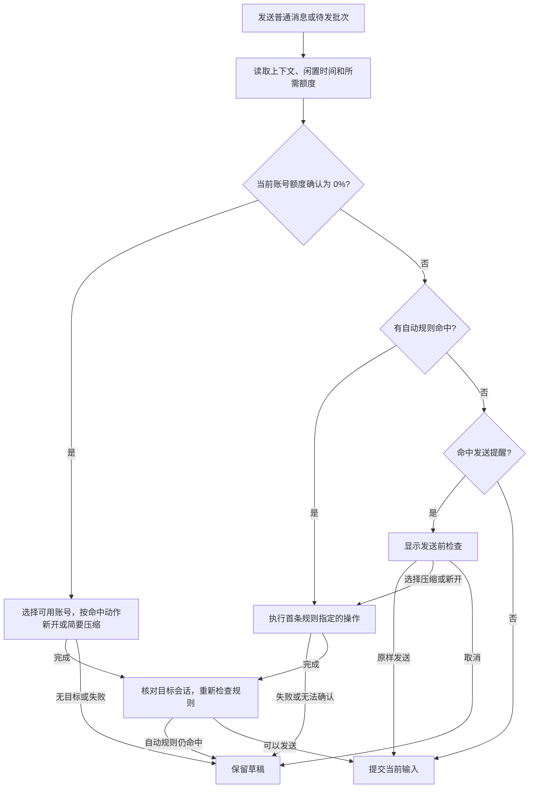

# 发送保护

平台设置 → 发送保护提供全平台规则。只有平台管理员能修改；即使成员拥有 `settings:write`，服务端也拒绝修改此配置。规则保存在 SQLite settings 表的 `conversation_send_guard`，保存后立即生效，重启后保留。列表 `rules` 中每项包含 `action`、`conditions`，以及可选的 `provider_ids`。

发送保护默认启用。满足下列任意一条即提醒。

| 上轮结束后闲置 | 窗口占用率 |
|---|---|
| 任意时间 | ≥ 80% |
| ≥ 30 分钟 | ≥ 30% |
| ≥ 20 分钟 | ≥ 50% |
| ≥ 10 分钟 | ≥ 60% |
| ≥ 60 分钟 | ≥ 20% |

默认规则用「或」连接各行。同一行设有两项阈值时，两项用「且」连接。已保存的规则优先于默认值。

规则与定时任务共用条件组编辑器，支持且／或和嵌套分组。每组 1–20 项，每套条件最多 4 层、50 项（含分组）。可配置窗口占用率（1–100%）、上下文 Token（1–2000000）、闲置分钟（1–10080）和账号额度剩余百分比（0–99%）。

每行代表一条完整规则，包括适用的 Provider、整组触发条件和执行动作。点击一行可在居中的窗口编辑。Provider 范围可选「全部 Provider」，也可选一个或多个已配置的 Provider。规则按会话的 Provider 绑定判断，Codex 和 Claude 的同名 Provider 各自独立。无法确认 Provider 绑定的会话适用全局规则。

旧配置的所有提醒分支保留在一条「发送提醒」规则里。旧自动规则保留各自的条件和顺序。两类旧规则默认适用全部 Provider，保存时使用新的规则列表。点「应用到表格」可继续编辑其他行，保存发送保护设置后生效。

## 规则执行

发送保护启用后，平台先确认当前账号是否耗尽额度，并按表格顺序找出首条适用且命中的自动规则。额度耗尽时优先换号。其余情况下执行命中的自动规则，或者在适用的提醒规则命中时弹出提醒。每条规则独立配置且／或条件组，发送提醒开关可单独关闭。管理员可添加最多 8 条自动规则和 20 条提醒规则。

| 操作 | 发送位置 | 携带历史 |
|---|---|---|
| 新开会话 | 同一标签页的新会话 | 发送当前草稿 |
| 简要压缩 | 同一标签页的新会话 | 携带节选历史及当前草稿 |
| 原生压缩 | 当前会话 | 由 Agent 执行原生上下文压缩 |

当前账号剩余额度确认为 0% 后，下次发送自动尝试换号。命中的「新开会话」或「简要压缩」规则决定如何接续。没有此类动作时默认简要压缩，尚未执行首轮的空会话直接新开。额度大于 0% 或未知时，命中的操作使用当前账号。这项能力使用 Codex 订阅账号的后台采样。平台取当前账号各有效额度窗口中最少的剩余百分比，从已启用、当前用户有权使用和控制、额度可确认且登录身份不同的账号中，选择剩余比例最高的一个。切换沿用现有跨账号新开流程，核对项目访问权限、模型和新会话身份。自动新开或简要压缩在新会话就绪后同样提交旧会话的永久删除。采样过期、额度不可读或当前 Agent 未提供账号额度能力时，额度保持未知。无可用目标、操作失败或处理后仍命中自动规则时，停止本次发送并保留草稿。



加入待发区时保存草稿，实际发送时触发检查。文字、图片和文件沿用原有发送入口。结构化问题回答、定时任务和原始终端键盘输入使用各自的投递流程。网页发送会自动执行规则，使用结构化输入 API 的客户端可根据返回的操作和目标账号处理。

窗口占用取最近一次原生用量的 `last.total_tokens / window`，Token 条件使用同一原生 Token 数。页面显示采集时间。未知数据不触发仅依赖该条件的规则，其他已确认的分支仍可命中。正在运行时，闲置条件按零分钟判断。

原生运行时的可选 `last_turn_ended_at` 记录真实轮次结束事件，和 `last_activity_at` 分开。Codex 使用 task_complete / turn_aborted，Claude SDK 使用结果完成时间，Claude 历史使用 end_turn / turn_duration。拿不到结束记录时闲置时间保持未知，不使用刷新时间、用户最后输入时间或 PTY 重绘时间代替。

压缩及新开按钮沿用现有接口的管理员、会话所有权、Agent 能力和空闲状态限制。压缩请求被接收不等于已经完成；只有收到本次操作之后的完成记录，才继续发送。新开成功后还须确认原生会话 ID 确实变化，再将消息和待发恢复状态绑定到新会话。未知结果、失败、超时或取消不会自动提交原消息。压缩/新开等待上限为 2 分钟；检查请求上限为 15 秒。点击“压缩后发送”或“新开后发送”会立即收起确认弹窗，等待进度和“取消后续发送”放在会话输入区。压缩完成后的重新检查及失败提示也保持在页面内；取消后续发送不会停止已发出的原生压缩操作。

刷新期间草稿和待发批次仍通过既有浏览器存储恢复，提醒窗口不自动恢复执行。未确认的提醒在切换标签页时取消；已经选择压缩、新开或简要压缩的原会话继续保留受时限约束的实时订阅，切换项目标签页、会话标签页或原始终端后仍会等待操作就绪，并向该操作关联的原生会话提交。提交期间也保留订阅以接收投递回执；结束等待或提交后，非活动会话释放订阅。明确取消、压缩失败或结果未知会停止后续发送。关闭标签页、组件卸载或刷新会取消浏览器内等待，但保留草稿，不在重载时自动重发。压缩期间原生会话身份改变也不会自动投递。原生会话变更或管理员更新配置会使旧确认失效。配置只是风险阈值，不能据此宣称缓存已经过期；压缩和新开也不承诺立即节省固定额度。

## 原样发送的额外消耗

发送提醒会用红字显示缓存未命中的估算。按上一次请求命中的输入 Token 测算这些 Token 全部改按普通输入计费的情形。已有对应费率时，金额按「缓存命中 Token ×（普通输入单价 − 缓存读取单价）」计算。用量或费率缺失时，提示中显示能确认的部分。实际费用取决于本次缓存命中、费率和缓存写入。

## 简要压缩

发送前检查和会话工具栏提供“简要压缩”。执行前可选择目标账号和模型；不选择时沿用当前账号和模型。切换账号须先验证目标连接、使用与控制权限以及模型可用性；目标不支持当前模型时要求重新选择。平台读取已有的原生对话历史，按轮保留用户输入、最终结论和一条简短文字过程；不复制工具输出或隐藏推理，不调用模型生成摘要。随后沿用现有新开流程，在同一标签页创建新原生对话，将整理出的历史与当前草稿、附件或待发批次一起作为一次输入发送。工具栏直接操作时，如果没有草稿，会发送历史和等待下一条需求的提示。新会话确认可用后，旧 Agent 原始对话文件和平台记录进入后台删除。

网页确认简要压缩后立即收起设置弹窗。历史整理与新会话创建在原标签内继续，期间可以切换标签。原标签显示当前阶段和「取消后续发送」操作。普通发送在输入区显示「检查中」和「正在发送」，提交后由消息回执显示 Agent 接收状态。

新对话将这段自动整理的历史显示为可点击的“简要压缩”卡片，详情按轮显示输入、过程、结论和旧附件引用；当前需求仍单独可见。详情可在项目文件权限范围内打开已保存的引用。新对话收到文件名和路径的文本引用，附件内容只随当前草稿中的附件发送。简要内容由原文节选组成。附件预览仍受项目权限和附件保留策略约束。

每次最多读取 12 个消息页，每页 80 条。若分页只扫到工具记录等内容，接口返回空页且标明还有更早历史，平台会沿用当前分页位置继续读取，最多额外跨过 12 个空页。若后续页的历史版本改变或接口要求重置分页，平台丢弃本次读取的页面，从最新一页自动重读，最多重试两次。历史读取成功后继续原来的发送流程。历史持续变化、读取失败或草稿太长时，保留草稿和待发批次，停止新开和发送。

Codex 日志里同一次输入有两份记录时，历史分页在去重后仍能识别先前返回的消息标识。整理结果最多 32 KiB，并与当前输入一起遵守 64 KiB 发送上限。历史过长会截取文字或较早记录，卡片标记“部分记录已截取”。重复简要压缩会展开上次的节选而非嵌套复制。

新开请求携带读取历史时的原生会话 ID，并在生命周期锁内核对身份及空闲状态；会话已变化、仍在执行或状态不可确认时拒绝操作。新开完成后核对当前原生会话 ID 与新建结果一致，再沿用既有确认标识和提交回执；结果未知不自动重试，草稿和待发内容保持原有恢复语义。

Codex 在原生连接准备阶段遇到短暂断连时，会为同一会话和消息标识尝试重连一次。重连和投递前核对当前账号与原生会话绑定。输入已发出但回执缺失时，结果保持未知，等待接收状态恢复。

整理历史和创建新会话期间可以切换标签，操作会在来源标签继续。输入区可取消后续发送。关闭页面或刷新会结束浏览器内等待。

提交前将简要历史与目标原生会话 ID、原草稿和附件的身份保存在既有浏览器草稿中；提交被拒绝或结果未知时保留，刷新后仍与原草稿一起使用，并在输入区提供移除入口。绑定的原生会话或草稿不匹配时拒绝发送，避免将历史带到其他对话或误附到另一条输入；收到提交回执后清除这份待发副本。原生消息仍是已发送内容的持久记录。

企微引用回复命中普通发送提醒且允许新开时，沿用原有自动简要压缩流程。命中平台自动规则时，渠道返回未投递，需要从网页处理。详见[企微引用回复](wecom-integration.md#引用任务通知直接回复)。

简要压缩先从完整历史消息中排除自动注入的项目规则及运行环境，再截取对话记录。

### 连续重复输入去重

连续多轮的完整输入相同时，简要历史只保留这一组的第一条输入。每轮仍保留各自的过程、结论和附件引用，详情里按轮次展示。遇到不同输入就开始新的一组。人工输入和定时任务共用这条规则，带有不同任务名称的输入各自成组。本次待发送的输入照常提交。

比较在截取前进行。截取时会记录原输入的 SHA-256 指纹，供后续压缩核对相邻轮次的完整提示词。再次简要压缩会展开此前保存的引用，裁掉较早轮次时会把保留下来的第一轮重新设为引用目标。旧节选缺少完整内容及指纹时保留各自的节选。超出比较上限的输入也分别保留。

向空闲且有历史的 Agent 会话发布定时任务时，平台先整理历史，再在同一标签页开启新会话并发送任务，旧会话保留在项目历史。没有历史的空闲会话直接发送。目标会话正在执行且后续队列为空时，支持排队的 Agent 会把定时输入加入当前会话的队列，等本轮结束后执行。若已有消息排队，自动触发和手动执行都跳过本次，原因可在执行记录查看。队列腾出后，下次触发可再次入队。任务显式配置的开始和停止条件在提交前照常判断。

## API 契约 3.35.0

- `POST /api/sessions/:id/input-check`：接受 `{input, attachments?, batch?}`，只读检查，要求会话访问和 Agent 写权限。不创建轮次、不恢复会话、不请求模型目录。
- 返回 `needs_confirmation`、三值 `matched`、上下文和闲置指标、`can_compact`、`can_new`、`account_remaining_percent` 和 `token`。
- `cache_miss_estimate` 仅在提醒时提供。返回可能改按普通输入计费的 `tokens` 和可空的 `cost: {amount, unit}`，无可用缓存命中量时整个字段为 `null`。
- 自动规则命中或默认换号触发时，`required_action` 为 `new`、`brief` 或 `compact`，`token` 为 `null`。发送保护启用且当前账号剩余额度确认为 0% 时，`switch_account` 为真。`target_account` 为已确认的目标 `{id,label}` 或 `null`。旧配置中的 `target: available_account` 可继续读取，随下次在页面保存设置移除。
- 新开和压缩接受可选 `expected_native_id`，用于在执行前核对原生会话。跨账号新开还传入 `target_account.id` 作为 `environment_id`。操作完成后对结果会话重新执行输入检查。
- 新开返回的 `previous_conversation_deletion: pending` 表示旧会话已提交后台删除，`history_id` 可用于跟踪这条记录。
- 交互输入 `POST /api/sessions/:id/input` 增加可选 `guard_token`。仍命中自动规则，或命中提醒且没有有效确认时返回 `409`、`submission: rejected`、`send_guard`，尚未向 Agent 投递。
- 确认标识有效期 5 分钟，绑定用户、平台会话、原生会话、正文、附件、批量分组和当前配置版本。进程重启后旧标识失效，需要重新检查。标识只用于此次输入的确认，不授予额外业务权限。

```json
{
  "input": "继续处理当前任务",
  "source": "conversation",
  "client_id": "stable-client-id",
  "guard_token": "<token returned by input-check>"
}
```

测试覆盖条件边界/未知值、嵌套限制、管理员写权限、确认标识范围及过期、服务端拦截、草稿取消和刷新恢复、压缩完成前不投递、新开失败及未知结果不自动重试、实际页面布局和交互。
