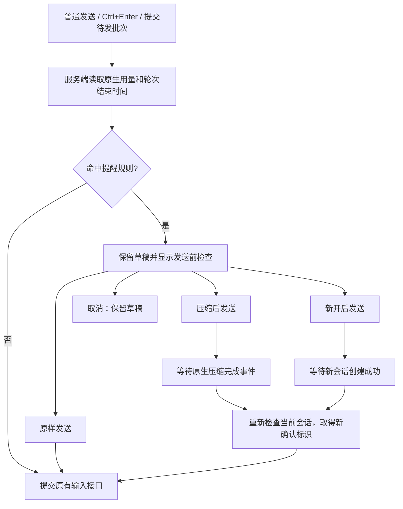

# 发送保护

平台设置 → 发送保护提供全平台规则。只有平台管理员能修改；即使成员拥有 `settings:write`，服务端也拒绝修改此配置。规则保存在已有 SQLite settings 表的 `conversation_send_guard`，保存后立即生效，重启后保留。

默认启用：

```text
窗口占用率 ≥ 80%
或
  窗口占用率 ≥ 50%
  且 上轮结束后闲置 ≥ 30 分钟
```

规则与定时任务共用条件组编辑器，支持且／或和嵌套分组。每组 1–20 项，最多 4 层、50 项（含分组）。可配置窗口占用百分比（1–100）、上下文 Token（1–2000000）及闲置分钟（1–10080）。



加入待发区不触发检查，实际发送时才检查。文字、图片和文件沿用原有发送入口；结构化问题回答不触发新话题提醒。定时任务仍走自身条件和投递机制，不额外弹交互窗口。原始终端键盘输入不经过结构化会话发送入口，不在本功能的拦截范围内。

窗口占用取最近一次原生用量的 `last.total_tokens / window`；Token 条件使用同一原生 Token 数，显示采集时间。这是最近一次观测，无法预知尚未生成的新请求完整输入。未知数据保持未知，条件采用三值逻辑；有历史或部分用量、但无法判定的情况也要求确认。新建且尚无历史/用量的会话不伪造占用值。正在运行时不把执行耗时算成闲置。

原生运行时的可选 `last_turn_ended_at` 记录真实轮次结束事件，和 `last_activity_at` 分开。Codex 使用 task_complete / turn_aborted，Claude SDK 使用结果完成时间，Claude 历史使用 end_turn / turn_duration。拿不到结束记录时闲置时间保持未知，不使用刷新时间、用户最后输入时间或 PTY 重绘时间代替。

压缩及新开按钮沿用现有接口的管理员、会话所有权、Agent 能力和空闲状态限制。压缩请求被接收不等于已经完成；只有收到本次操作之后的完成记录，才继续发送。新开成功后还须确认原生会话 ID 确实变化，再将消息和待发恢复状态绑定到新会话。未知结果、失败、超时或取消不会自动提交原消息。压缩/新开等待上限为 2 分钟；检查请求上限为 15 秒。点击“压缩后发送”立即关闭确认弹窗，等待进度和“取消后续发送”放在会话输入区，不遮挡页面。压缩完成后的重新检查及失败提示也保持在页面内；取消后续发送不会停止已发出的原生压缩操作。

刷新期间草稿和待发批次仍通过既有浏览器存储恢复，提醒窗口不自动恢复执行。未确认的提醒在切换标签页时取消；已经选择“压缩后发送”的原会话继续保留受时限约束的实时订阅，切换项目标签页、会话标签页或原始终端后仍会等待压缩完成，并自动提交到原会话，不会投递到当前显示的其他会话。提交期间也保留订阅以接收投递回执；结束等待或提交后，非活动会话释放订阅。明确取消、压缩失败或结果未知会停止后续发送。关闭标签页、组件卸载或刷新会取消浏览器内等待，但保留草稿，不在重载时自动重发。压缩期间原生会话身份改变也不会自动投递。原生会话变更或管理员更新配置会使旧确认失效。配置只是风险阈值，不能据此宣称缓存已经过期；压缩和新开也不承诺立即节省固定额度。

## API 契约 3.11.0

- `POST /api/sessions/:id/input-check`：接受 `{input, attachments?, batch?}`，只读检查，要求会话访问和 Agent 写权限。不创建轮次、不恢复会话、不请求模型目录。
- 返回 `needs_confirmation`、三值 `matched`、上下文/闲置可空指标、`can_compact` / `can_new`、`token`。
- 交互输入 `POST /api/sessions/:id/input` 增加可选 `guard_token`。命中规则但没有有效确认时返回 `409`、`submission: rejected`、`send_guard`，尚未向 Agent 投递。
- 确认标识有效期 5 分钟，绑定用户、平台会话、原生会话、正文、附件、批量分组和当前配置版本。进程重启后旧标识失效，需要重新检查。标识只用于此次输入的确认，不授予额外业务权限。

```json
{
  "input": "继续处理当前任务",
  "source": "conversation",
  "client_id": "stable-client-id",
  "guard_token": "<token returned by input-check>"
}
```

测试覆盖条件边界/未知值、嵌套限制、管理员写权限、确认标识范围及过期、服务端拦截、草稿取消和刷新恢复、压缩完成前不投递、新开失败及未知结果不自动重试、实际页面布局和交互。
