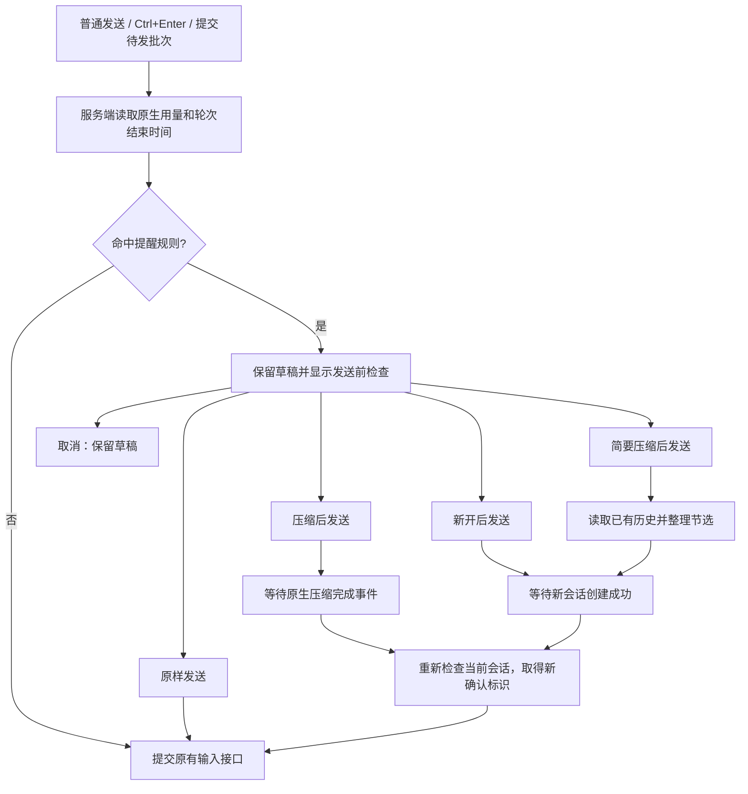

# 发送保护

平台设置 → 发送保护提供全平台规则。只有平台管理员能修改；即使成员拥有 `settings:write`，服务端也拒绝修改此配置。规则保存在已有 SQLite settings 表的 `conversation_send_guard`，保存后立即生效，重启后保留。

发送保护默认启用。满足下列任意一条即提醒。

| 上轮结束后闲置 | 窗口占用率 |
|---|---|
| 任意时间 | ≥ 80% |
| ≥ 30 分钟 | ≥ 30% |
| ≥ 20 分钟 | ≥ 50% |
| ≥ 10 分钟 | ≥ 60% |
| ≥ 60 分钟 | ≥ 20% |

默认规则用「或」连接各行。同一行设有两项阈值时，两项用「且」连接。已保存的规则优先于默认值。

规则与定时任务共用条件组编辑器，支持且／或和嵌套分组。每组 1–20 项，最多 4 层、50 项（含分组）。可配置窗口占用百分比（1–100）、上下文 Token（1–2000000）及闲置分钟（1–10080）。



加入待发区不触发检查，实际发送时才检查。文字、图片和文件沿用原有发送入口；结构化问题回答不触发新话题提醒。定时任务仍走自身条件和投递机制，不额外弹交互窗口。原始终端键盘输入不经过结构化会话发送入口，不在本功能的拦截范围内。

窗口占用取最近一次原生用量的 `last.total_tokens / window`；Token 条件使用同一原生 Token 数，显示采集时间。这是最近一次观测，无法预知尚未生成的新请求完整输入。未知数据保持未知，条件采用三值逻辑；有历史或部分用量、但无法判定的情况也要求确认。新建且尚无历史/用量的会话不伪造占用值。正在运行时不把执行耗时算成闲置。

原生运行时的可选 `last_turn_ended_at` 记录真实轮次结束事件，和 `last_activity_at` 分开。Codex 使用 task_complete / turn_aborted，Claude SDK 使用结果完成时间，Claude 历史使用 end_turn / turn_duration。拿不到结束记录时闲置时间保持未知，不使用刷新时间、用户最后输入时间或 PTY 重绘时间代替。

压缩及新开按钮沿用现有接口的管理员、会话所有权、Agent 能力和空闲状态限制。压缩请求被接收不等于已经完成；只有收到本次操作之后的完成记录，才继续发送。新开成功后还须确认原生会话 ID 确实变化，再将消息和待发恢复状态绑定到新会话。未知结果、失败、超时或取消不会自动提交原消息。压缩/新开等待上限为 2 分钟；检查请求上限为 15 秒。点击“压缩后发送”立即关闭确认弹窗，等待进度和“取消后续发送”放在会话输入区，不遮挡页面。压缩完成后的重新检查及失败提示也保持在页面内；取消后续发送不会停止已发出的原生压缩操作。

刷新期间草稿和待发批次仍通过既有浏览器存储恢复，提醒窗口不自动恢复执行。未确认的提醒在切换标签页时取消；已经选择“压缩后发送”的原会话继续保留受时限约束的实时订阅，切换项目标签页、会话标签页或原始终端后仍会等待压缩完成，并自动提交到原会话，不会投递到当前显示的其他会话。提交期间也保留订阅以接收投递回执；结束等待或提交后，非活动会话释放订阅。明确取消、压缩失败或结果未知会停止后续发送。关闭标签页、组件卸载或刷新会取消浏览器内等待，但保留草稿，不在重载时自动重发。压缩期间原生会话身份改变也不会自动投递。原生会话变更或管理员更新配置会使旧确认失效。配置只是风险阈值，不能据此宣称缓存已经过期；压缩和新开也不承诺立即节省固定额度。

## 简要压缩

发送前检查和会话工具栏提供“简要压缩”。执行前可选择目标账号和模型；不选择时沿用当前账号和模型。切换账号须先验证目标连接、使用与控制权限以及模型可用性；目标不支持当前模型时要求重新选择。平台读取已有的原生对话历史，按轮保留用户输入、最终结论和一条简短文字过程；不复制工具输出或隐藏推理，不调用模型生成摘要。随后沿用现有新开流程，在同一标签页创建新原生对话，将整理出的历史与当前草稿、附件或待发批次一起作为一次输入发送。工具栏直接操作时，如果没有草稿，会发送历史和等待下一条需求的提示。旧对话保留在项目会话记录中。

新对话将这段自动整理的历史显示为可点击的“简要压缩”卡片，详情按轮显示输入、过程、结论和旧附件引用；当前需求仍单独可见。详情可在项目文件权限范围内打开已保存的引用。新对话收到文件名和路径的文本引用，附件内容只随当前草稿中的附件发送。简要内容由原文节选组成。历史附件引用缺失时，可从保留该附件的原会话重新整理。

历史读取最多 12 页、每页 80 条，整理结果最多 32 KiB，并与当前输入一起遵守 64 KiB 发送上限。历史过长会截取文字或较早记录，卡片标记“部分记录已截取”；完整旧记录仍保留。重复简要压缩会展开上次的节选而非嵌套复制。读取失败、分页变化或草稿太长时不创建新会话，也不发送输入。

新开请求携带读取历史时的原生会话 ID，并在生命周期锁内核对身份及空闲状态；会话已变化、仍在执行或状态不可确认时拒绝操作。新开完成后核对当前原生会话 ID 与新建结果一致，再沿用既有确认标识和提交回执；结果未知不自动重试，草稿和待发内容保持原有恢复语义。

整理历史期间切换标签会取消本次操作。确认开始创建新会话后，切换标签仍会在原会话等待并提交，不会发到当前显示的其他标签；输入区可取消后续发送，取消不会撤销已开始的新会话操作。关闭页面或刷新会取消浏览器内等待，不自动重发。

提交前将简要历史与目标原生会话 ID、原草稿和附件的身份保存在既有浏览器草稿中；提交被拒绝或结果未知时保留，刷新后仍与原草稿一起使用，并在输入区提供移除入口。绑定的原生会话或草稿不匹配时拒绝发送，避免将历史带到其他对话或误附到另一条输入；收到提交回执后清除这份待发副本。原生消息仍是已发送内容的持久记录。

企微引用回复遇到发送保护的明确拒绝时，会在权限和原会话状态允许的情况下自动走同样的简要压缩及新会话流程，详见[企微引用回复](wecom-integration.md#引用任务通知直接回复)。其他渠道和定时任务不因此自动新开。

### 定时任务提示词去重

对于历史中已验证为定时任务的输入，仅当任务名称和完整原文完全一致时，才考虑共用一份提示词；每次执行仍保留独立的过程、结论和附件引用。平台会比较整组内容使用引用前后的字节数，只有引用更短时才使用引用；提示词很短时直接保留原文，避免引用格式增大输入。字节数不是 Token 数，实际用量仍随内容和模型变化。普通输入、来源未知的旧记录、不同任务名称或不同提示词不会按正文合并。即使不同任务恰好同名且提示词相同，也只共用相同文本，不合并各次执行记录；原始历史只有任务名称，不能可靠区分同名任务。

比较在截取前进行，避免不同提示词因截取后看起来相同而被误判。重复简要压缩会重新计算引用，并确保引用的轮次没有被长度限制舍弃。未使用引用的节选不会附加任务来源，之前简要历史若没有保存来源，无法凭空恢复；如果提示词已在早前截断，也不能将它与之后的新输入断言为完全相同。去重使用有上限的临时索引，超出时保留原文节选，不猜测是否重复。

## API 契约 3.11.0

- `POST /api/sessions/:id/input-check`：接受 `{input, attachments?, batch?}`，只读检查，要求会话访问和 Agent 写权限。不创建轮次、不恢复会话、不请求模型目录。
- 返回 `needs_confirmation`、三值 `matched`、上下文/闲置可空指标、`can_compact` / `can_new`、`token`。
- 交互输入 `POST /api/sessions/:id/input` 增加可选 `guard_token`。命中规则但没有有效确认时返回 `409`、`submission: rejected`、`send_guard`，尚未向 Agent 投递。
- 确认标识有效期 5 分钟，绑定用户、平台会话、原生会话、正文、附件、批量分组和当前配置版本。进程重启后旧标识失效，需要重新检查。标识只用于此次输入的确认，不授予额外业务权限。

```json
{
  "input": "继续处理当前任务",
  "source": "conversation",
  "client_id": "stable-client-id",
  "guard_token": "<token returned by input-check>"
}
```

测试覆盖条件边界/未知值、嵌套限制、管理员写权限、确认标识范围及过期、服务端拦截、草稿取消和刷新恢复、压缩完成前不投递、新开失败及未知结果不自动重试、实际页面布局和交互。
