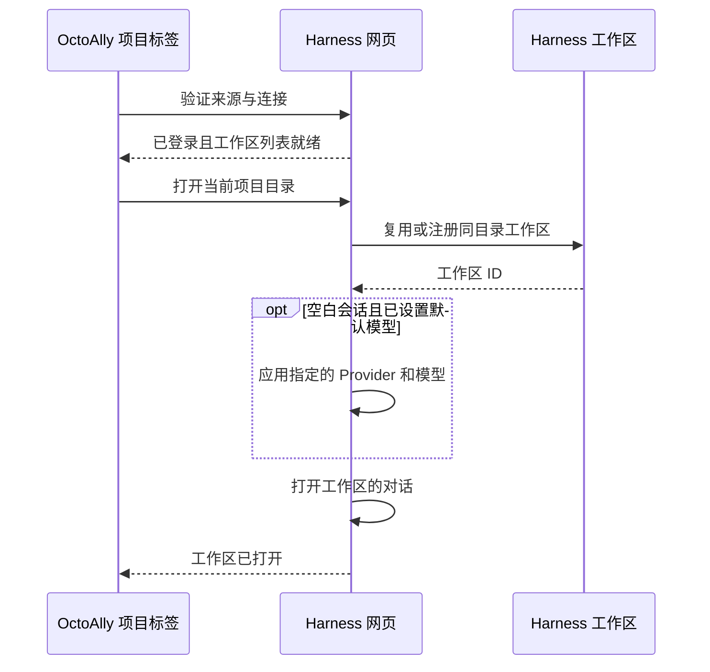

# DeepSeek Harness 网页标签

OctoAlly 可以从项目列表的「打开」和项目内的「＋」打开 DeepSeek Harness 标签。标签使用 Harness 原版网页。首次打开时，Harness 将 OctoAlly 已授权项目的目录注册为工作区，或复用同目录的现有工作区，然后打开其中的对话。每个项目有一个 Harness 标签，同一浏览器刷新后会恢复标签。已经打开的标签在切换项目时保留网页状态，关闭标签不会删除 Harness 的工作区或对话。

在项目内的会话标签栏拖动 Harness 标签可调整顺序。双击标签名称，或在标签获得键盘焦点时按 `F2`，即可重命名。名称和位置按项目保存在当前浏览器，刷新后会恢复。



## 配置 Harness 实例

插件按 DeepSeek Harness `0.2.2-rc.5` 开发。Web 实例需要可从浏览器访问，且能以自身运行账号读取项目的同一绝对路径。远程实例可以通过共享挂载提供相同的路径。本次接入使用原版 Harness 侧栏和权限，Harness 账号可以看到自己有权访问的其他工作区。

在已经初始化的 Harness Web profile 中安装插件。安装命令需要 `pnpm`。

```sh
npm pack ./integrations/deepseek-harness
dsh plugin --profile web add "$(pwd)/dsh-octoally-workspace-1.1.0.tgz"
```

在该 profile 的 `cordis.patch.yml` 添加 OctoAlly 的浏览器来源。若文件只有默认的空列表 `[]`，将它替换为下方列表。使用完整来源，包含协议与端口且无尾斜杠。重启对应的 Harness 实例让配置生效。

```yaml
- id: octoally-workspace
  config:
    parentOrigins:
      - https://octoally.example.com
```

将 OctoAlly 与 Harness 放在同站点的独立来源，例如 `https://octoally.example.com` 和 `https://harness.example.com`。独立主机名使浏览器的 Host-only Cookie 各自归属对应应用。反代需允许嵌入，转发 WebSocket 与 Harness 登录 Cookie。先在浏览器顶层用 Harness 提供的登录入口建立会话，再回到 OctoAlly。在 **Agent 配置 → 新增 Provider → DeepSeek Harness** 输入不带登录参数的 Harness 根地址。进入项目后，用「＋」选择 **DeepSeek Harness**。

Harness 插件仅对已登录的所有者网页启用，并检查父窗口与配置的精确来源。OctoAlly 向已确认的项目 iframe 发送当前项目的路径和可选的默认模型。Harness 在服务端校验目录并保存会话。平台设置中的网址字段仅保存无凭据的根地址。

## 在 Agent Manager 管理上游和模型

设置 Harness 网页地址并安装 OctoAlly 插件 `1.1.0` 后，用 Harness 所有者账号登录网页。返回 **Agent 配置 → Provider**，每个上游都有独立的表格行。网页接入地址仍通过 **DeepSeek Harness** 网页行编辑。

1. 点击 **新增 Provider**，选择 **DeepSeek Harness**。填写 Provider ID、API 基础地址、协议和模型 ID。按上游要求填写 API Key。可以重复添加多个上游，例如将 `xindu` 配置为 **OpenAI Responses**，并填写 `deepseek-v4-flash` 与 `deepseek-v4-pro`。
2. 展开上游所在行查看模型列表，并点击 **设为新标签页默认**。默认值同时记录 Provider ID 和模型 ID，多个上游提供同名模型时仍会选中指定上游。
3. 打开一个项目的 Harness 标签时，空白会话会应用该模型。已有记录的对话恢复原来的模型，已经挂载的标签保持当前会话。清除默认值后，Harness 会按自身的默认模型处理新会话。

可在 Agent Manager 编辑拥有明确 API 基础地址和协议的自定义上游。Harness 原生账号及其他内置上游在模型可用时可展开查看和选择，认证与原生设置在 Harness 管理。Provider、模型和 API Key 通过已授权的浏览器桥接写入 Harness 配置与凭据存储。Agent Manager 的平台设置只保存 Harness 地址及选中的 Provider、模型 ID。更换 Harness 地址会清除该默认值。

Harness 通过原生模型选择接口应用默认值。该接口也会更新 Harness 实例自身的模型默认值。Harness 实例或上游拒绝所选模型时，项目标签显示失败并可重试。

## 验证

`e2e/deepseek-harness.spec.ts` 的常规测试使用隔离网页验证设置保存、两个项目分别定位、项目切换、标签重命名及排序、刷新与关闭，并通过插件模拟原生接口验证多个上游、同名模型、默认值应用和已有对话恢复。用受控的 loopback Harness 实例启动 OctoAlly 插件并授权测试页面来源后，可通过 `E2E_DEEPSEEK_HARNESS_LOG` 指定该临时实例自己的启动日志，运行真实 Web 校验。未指定线上模型时，测试添加一个合成上游并直接核对新标签页选中的模型，验证过程无需发送模型请求。日志含一次实例启动凭据，测试结束后随隔离实例一并清理。常规测试无需购买模型额度或访问线上服务。

可同时设置 `E2E_DEEPSEEK_HARNESS_MODEL`，验证已经配置的模型发送对话、显示答复和刷新恢复。使用线上模型时，此步骤会产生真实模型请求。
