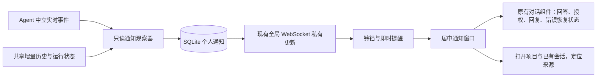

# 站内消息通知

顶部铃铛集中显示自己的会话中需要关注的变化，项目是否打开不影响通知。第一版收取执行错误、结构化提问／授权请求，以及运行结束后的最终答复；普通进展、工具输出和仅仅打开标签页不会生成通知。“本轮运行完成”表示原生执行已结束，不等于业务任务通过验收。

## 操作

| 入口 | 行为 |
| --- | --- |
| 小铃铛 | 显示未读数量并打开居中窗口；默认打开待处理，有未读结果而无待处理时打开未读列表 |
| 即时提醒 | 保留约 10 秒，提供查看并处理、打开标签页；不抢焦点或自动切换项目 |
| 待处理／未读／全部 | 筛选仍需关注的事项；已提交、已处理及手动关闭的通知不再展示，包括“全部”；项目选项仅列出当前用户拥有的项目，管理员也遵循此范围 |
| 点击通知 | 打开原会话对话，可回答问题、处理授权、发送文字与附件、查看和停止已有自动重试 |
| 打开标签页 | 打开所属项目并显示已有会话；定位原消息或待答问题，不新建会话或重发输入 |
| 项目静音 | 暂停该项目的即时提醒与角标计数，记录仍可在通知列表查看 |
| 标为已读 | 列表行和详情标题旁均可操作；不需要回复时手动关闭该条通知并移除角标，不会向 Agent 发送回答、授权或其他输入 |
| 全部标为已读 | 手动关闭本次已观察到的通知，不包含随后到达的新通知；选择项目时仅影响该项目 |

窗口左侧按“项目 → 标签页”分层展示：项目名配文件夹图标，可折叠／展开；下面缩进显示有通知的标签名、本地完整时间（例如 `2026.11.17 13:58`）和小型已读操作。项目与各自通知按最近通知顺序排列，不展示没有通知的项目或标签页；同名项目按项目 ID 分组。新通知通过既有 WebSocket 自动更新列表，无需手动刷新或点击显示；当前选中会话与正在编辑的草稿保持不变。窄屏时选择一条后显示详情，可返回列表。

详情按需加载原会话；隐藏 Token、费用、调用次数及耗时统计，原标签页仍保留这些信息。回复框将附件、“更多”和发送放在同一行；账号、模型、强度及发送模式等选项收进“更多”。会话标题旁持续显示回复目标；草稿按用户、会话和通知入口单独保存，避免覆盖原标签页中的草稿。回复后通知从列表移除时，已打开的详情继续保留，避免中断阅读或后续编辑。

只有前台可见对话中实际展示的消息、问题或授权请求才自动标记已读；切换到项目或跳转动作本身不算已读。自动已读只改变阅读状态，手动“标为已读”另持久记录关闭状态，历史重放和重连不会恢复同一条提醒；同一恢复链发生新的错误时仍可重新提醒。通知和原标签页共用现有输入及实时流机制：提交中、排队、已接收和结果未知保持原有语义，模糊失败不自动重复提交。回答、授权、静音、已读和手动关闭状态会同步更新其他浏览器窗口。

输入确认接收或排队后，移除发送前已有的结果及错误通知，不影响发送期间到达的新结果；问题／授权仍依据各自交互状态处理。原标签页或其他客户端已确认的用户回复也会清理较早结果；排队、自动平台消息和未确认发送不作为处理完成证据。

## 状态与边界

| 通知状态 | 含义 |
| --- | --- |
| 待处理 | 问题／授权尚待处理，或执行错误仍需关注 |
| 自动恢复中 | Agent 自行重试或平台已有容量错误恢复任务；不作为新失败反复提醒 |
| 已提交 · 等待结果 | 回答已接收或排队，或已开始后续处理；不宣称错误已经修复 |
| 已处理 | 交互已结束、问题已回答／忽略、恢复已确认，或通知所属原生对话已被替换 |
| 新结果 | 运行结束的最终答复，阅读状态独立保存 |

通知只属于会话创建者，管理员的通知列表也不混入其他用户的会话。读取时重新检查账号、Agent API 权限、项目／工具权限和 Engine 访问权；所有回答和控制操作仍由原接口再次授权。全局通知更新只发送给所属用户，不广播消息正文。纯 Shell 没有结构化 Agent 提问或结论时不会伪造这些能力。账号／配置错误需要用户处理相应配置，界面不会为所有错误提供通用重试或自行修改设置。

通知不依赖平台 AI，不为分类或检查通知调用模型。回复和明确发起的继续执行仍会使用对应 Agent。外部渠道继续使用原有项目订阅，站内通知不替代或自动新增外部订阅。

## 持久化与资源

- 数据库迁移至 v29，沿用迁移前备份；通知、阅读、手动关闭和静音偏好持久保存，已有通知不丢失。首次启用前的旧结果不会批量补发，已有待答问题可以恢复。
- 使用共享原生连接和共享历史增量读取；观察器只读，不启动／恢复 Agent、不向会话写入探测消息。服务关闭释放本次持有的连接和文件监听租约。
- 当前单进程最多观察 512 个活跃绑定会话，每批附着 8 个；每会话缓存最多 32 个候选结论和 256 个消息身份。记录正文最多 12,000 字符，完整内容通过原对话读取。
- 列表每页 50 条，使用递减通知 ID 分页；保留每用户最近 1,000 条已结束／结果记录及最近 30 天，未处理事项不随历史清理丢失。
- 读取原消息时沿用现有分页，自动向前最多加载 20 页；历史已删除、旧绑定或超出读取范围时保留通知来源和原文片段，不将操作应用到新对话。

`/api/notifications`、`/api/notifications/read`、`/api/notifications/dismiss` 和 `/api/notifications/preferences` 是个人 Dashboard 内部接口，使用浏览器登录认证；不加入外部 Agent API 契约。消息发送、提问回答和控制沿用原有接口，外部 Agent API 的认证、参数和响应没有改变。

验证覆盖通知触发与去重、运行完成边界、个人权限、已读与待处理分离、排队与撤销、静音、恢复／迁移、资源释放，以及浏览器内的提醒、直接回答、窄屏和标签跳转。
