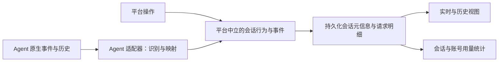

# 会话元信息与统计

本文记录会话元信息的行为、采集口径和验收条件。项目级开发规范见 Agent 接入约定。

## 数据来源与行为

`AgentStatisticsPort.facts` 是原生记录归一化接口。Codex 与 Claude 适配器只提取身份、时间、请求用量与边界。平台按 Agent、Engine 和原生会话身份保存请求、区间、事件与检查点。检查点与新增聚合在一次 SQLite 事务中提交，用量记录不保存输入正文、工具参数或工具输出。消息正文继续来自原生对话。实时观察、历史翻页与刷新读取同一套已提交投影。

| 数据 | Codex | Claude |
| --- | --- | --- |
| 请求用量 | 优先用带 `response_id` 的原生请求。旧版累计事件的最后请求用量用于兼容。重复累计快照与新版回显去重 | 按原生模型响应 ID 合并拆开的内容块。输入含缓存写入和命中。未报告的推理 Token 保持未知 |
| 模型和速度 | 使用请求关联的模型和设置回执。已记录的订阅费率按请求估算 | 取实际响应的模型、可确认的服务档位和环境。积分未提供时保持未知 |
| 历史回填 | 已配置 Codex 环境的账号采集器盘点本机、独立 Provider 和系统账号的原生历史。会话视图在授权读取原生文件后补齐消息边界 | 盘点本机 Claude 原生项目记录，包括没有平台标签页的文件。原生记录缺少账号归属时保留未知 |
| 停止与恢复 | 平台回执记录受理状态。原生轮次与压缩记录提供完成或中断证据 | 同样区分平台回执与原生记录。只有原生中断标记或请求边界存在时可重新定位对应位置 |
| 删除 | 先保存可读取的会话事实和对应账号请求，再移除原始对话 | 先保存可读取的请求和事实，再移除原始对话 |

`Runs` 是有原生证据的模型请求数。一个请求可以调用多次工具。同一请求中的并行调用共计一轮。问答数按有用户输入且产生 Final 的轮次统计。Progress 汇总所属 Item 的请求。同一请求产生多个 Item 时，由一个 Item 记录用量，其他 Item 标注共享请求。用量仍在写入、起点不可确认或来源被截断时，展示相应覆盖状态。

普通输入比较相邻输入各自首个可绑定的响应。记录压缩或请求维度变化时，比较该事件前后的相邻请求。前次命中率至少 80%，下降至少 25 个百分点时触发。详见缓存异常规则。

SQLite 的检查点按追加读取更新。文件替换会重建当前会话投影，账号账本保留已采集耗用。确认无法读取的记录保持部分或不可用。缺失的原生事件不会由界面时间、当前模型或当前账号设置补造。

## 会话行为与统计规范

以下条目也是新增 Agent 和变更采集规则时的验收条件。

### 统一体验与会话生命周期

- 同一种平台功能在不同 Agent、实时查看、历史加载、刷新、重载和重连时，应使用一致的用户语义、统计口径及状态展示。Agent 能力和数据存在差异时，明确标识不支持、尚未确认或不可用，不能通过推测补造一致的效果。
- 通过中立接口表达可观察的创建、恢复、压缩、模型与账号或 Engine 切换、追问、排队、停止、中断、新开、重载、关闭和删除，以及它们的开始、受理、完成、失败或结果未知。区分用户请求、平台确认和 Agent 原生确认；不能把提交成功当作实际完成。
- 区分平台标签页、平台会话、原生会话、轮次及请求身份，均通过中立契约关联。新开可能产生新的原生会话，跨账号或 Engine 迁移可能继承历史；记录可验证的来源和边界，不把继承请求重复计为新账号消耗。
- 会话元信息应持久保存可确认的生命周期事实、模型和账号变化、请求用量及统计结果。打开历史和重载时读取已保存结果；新事件增量处理。历史首次回填、迟到事件、重连、来源替换或规则升级须可恢复、可对账、幂等，不假定所有历史始终不可变。
- 账号用量应覆盖已配置且有权访问的 Agent 原生会话，包括平台未打开的会话。复用现有后台采集与实时流：活跃会话按事件增量更新，其他会话按后台策略发现变化；不为每个历史会话增加常驻进程或每次变化全量重算。未配置、不可读取或上游未提供的数据保持明确的未知或不完整状态。

### Progress、Item 与 Final 的精确统计

- 以 Agent 可确认的模型请求和工具事件为统计事实，按稳定身份去重，关联原生会话、轮次、模型、账号、消息及适用的事件边界。输入、缓存输入、输出、推理输出和总量沿用各 Agent 的已验证语义；缓存输入和推理输出若已包含在输入或输出中，不得重复累加。
- **Final** 汇总从上一个 Final 完成到当前 Final 完成的原生用量，首个 Final 从可确认的会话开始计算。**Progress** 汇总所属 Item。**Item** 从同组上一项的统计边界开始，该组首个 Item 从本组起点开始。原生接收插入、完成压缩或结束轮次可结束当前 Progress。当请求在边界前已经开始且有原生证据时，回执仍归原 Progress。
- Token、工具轮次、工具调用、Runs 和预估积分按所属请求汇总。文字先完成时显示「等待用量回执」，收到回执后补齐。有回执而当前没有独立消息承载的请求列为「无单独消息的用量」，计入所在 Progress。
- 对话、累计栏和逐区间用量中的 Input 表示未缓存输入，由原生总输入减去缓存命中输入，与同栏积分口径一致。Cache 表示缓存命中输入。缓存异常表仍以总输入、命中输入和命中率展示前后变化。
- 已完成且来源完整的区间在实时和历史视图中应精确一致。尚未上报的用量显示等待；历史缺失、读取失败或无法确认边界时说明原因，不把未知当作零或精确值。多个 Item 共享同一请求时，只展示可验证的共享请求用量，不伪造逐 Item 或跨边界分摊；请求的用量在更大区间中只能计一次。

### 会话详情与模型维度

- 弹窗提供概览、缓存异常和会话详情三个页签。概览对照最近请求与会话累计，另列预估积分、模型请求、用户问答与工具统计。
- 会话详情按模型和速度汇总已记录的用量和请求。积分按每次请求当时的参数和费率估算后再汇总。已确认的账号、Engine 和生命周期事件仍保存在会话元信息中。
- 逐区间用量表通过时间列的缩进和按钮，从答复展开到 Progress，再到 Item。答复自己的 Item 与所属 Progress 并列。未完成答复的已记录区间可单独展开。主列显示总输入、缓存输入、未缓存输入、缓存率、输出、总量及预估积分，数字保持单行右对齐。推理输出和调用计数可悬停查看。各层分页读取，保留待确认及共享请求标记。
- 累计 Token 信息栏应与 Progress 采用一致的积分含义和紫色样式，紧凑展示预估积分并保留一位小数；积分属于参考估算而非实际账单。可核对时按请求明细计算，不可完整核对时明确标注覆盖范围及原因。

### 缓存命中率异常与时间间隔

- 会话详情应增加缓存命中率异常信息项或分类，以表格逐条展示并统计会话中可确认的显著下降事件；每行包含异常时间、前次缓存情况、本次缓存情况、两次输入间隔和原因或相关因素，并关联前一次与本次的输入或请求及相应问答轮次。按各 Agent 的原生语义计算缓存命中输入占总输入的比例；同一轮存在多个模型请求时说明使用的请求和比较口径，不混用会话累计值与单次请求值。
- 每条记录应包含前后两次输入的 Token 与缓存命中 Token、命中率、下降幅度、可确认的输入或请求时间，以及前后输入之间的时间间隔；同时关联可确认的模型、账号或 Engine、速度、压缩与上下文变化等事件，方便定位原因。不同时间字段不得混用，无法确认时间或关联时保持未知。
- 表格和对话卡片使用浏览器所在时区。日期与时间显示在同一行，省略时区后缀。输入或请求间隔单独显示。前后采样时间和关联记录保存在元信息中，以供核对。
- 详情表格中，每次输入的总输入 Token、缓存命中 Token 和命中率应紧凑地放在同一列或单元格，例如 `300K / 294K (98%)`，并为三项提供清晰标识；前次和本次各自展示，便于直接比较，窄屏下保持可读。
- 普通输入比较各次输入的首个可确认响应。已确认压缩或请求维度变化时比较该边界前后相邻的可比较原生回执，同一轮内也采集。原生压缩事件能关联压缩请求时，用压缩前最后一笔普通请求和压缩后第一笔普通请求比较，压缩请求仍计入会话用量。两笔输入均至少 1,024 Token，前次命中率至少 80%，下降至少 25 个百分点。输入量相差超过两倍时需要可确认的压缩或维度变化。计数缺失或不一致时中断比较。重复回执按原生身份去重。
- 同一输入内的变化记录请求间隔。压缩告警在对话中与对应压缩摘要相邻，详情使用同一事件。只有压缩事件而缺少后续请求时继续等待真实用量。
- 原因列直接显示有记录的变化，例如「上下文压缩」「模型变化」或「输入间隔较长」。同时发生的变化并列显示。压缩条目的依据是压缩前后相邻原生请求的比较。原生服务给出的原因和证据另行记录，以供核对。
- 命中率下降是可观察的异常，不足以单独证明缓存已失效、过期或判断原因。只有 Agent 提供可验证的原生证据时才标记为已确认失效；否则展示为命中率下降，保留已知的相关事件和未知原因。检测通过 Agent 中立契约与各自适配器提供真实数据，复用会话元信息和增量采集，不为历史会话增加独立轮询或全量扫描。
- 已确认达到下降规则时，对话页应及时在相关输入或请求的时间线位置展示缓存命中率下降卡片，复用现有卡片的交互、视觉体系和无障碍行为；卡片紧凑展示前后总输入、缓存输入、命中率及可确认的间隔与变化，并可查看详情。卡片和详情表格使用同一事件与身份；实时追加、迟到数据、刷新、重载和历史分页应去重及同步修正，不能跨会话串扰或中断用户输入。

### 运行中插入输入与中断

- 用户在 Progress 或 Item 执行中追加输入、排队或请求停止时，记录可观察的原生会话和轮次、最近已完成的 Progress 与 Item、当时已知的活动 Item 或并行工具，以及提交、受理、实际接收和完成或中断的时间与状态。时间、顺序或关联不可确认时保持未知，不能将界面点击时间冒充 Agent 接收时间。
- 追加输入、排队和中断是不同动作；结果未知时不得自动重复提交。中断后保留已完成的 Item、已确认用量和未完成部分的状态；迟到的原生用量须幂等补齐。跨输入或中断边界的进行中请求按上游可验证的请求边界统计，不能凭时间推算两侧的用量。
- 用户消息右下角显示提交中、排队中、等待 Agent 接收、发送结果待确认或已发送。已发送勾号以匹配的原生用户消息为依据。当前浏览器页签刷新后按会话恢复尚待确认的消息，随后用原生队列和回执更新。
- 等待发送的消息单独呈现。Agent 接收用户输入后才形成对应的进展边界。连续插入之间只有推理回执时，用量照常记录。对话中的活动进展对应可见输出或原生工具事件。

### 用量边界与发送状态回归

| 场景 | 核对结果 |
| --- | --- |
| 单 Item、连续 Item、多个 Final | Item 只记所属 Progress 内的用量，Progress 与子项加总一致。Final 连续区间在历史、实时和刷新后相符。 |
| 一个模型响应并行调用多个工具 | 一次模型请求和一轮工具调用。调用次数等于可见工具数。 |
| 单个模型请求产生多个 Item | Item 标明共享请求。同一请求在 Progress 和 Final 汇总中计一次。 |
| 一次插入、连续插入、前一个请求迟到 | 新组首个 Item 从本组起点开始。迟到的回执只更新原属区间一次。逐项核对 Token、积分及计数。 |
| 最后可见 Item 之后仍有请求 | 正在执行的 Item 包含已确认用量。一旦回执归到可见 Item，界面与详情同步更新。 |
| 只有工具或推理、未形成 Final、中断 | 保留已记录的用量和覆盖状态。对话中只在有活动证据时显示进展。 |
| 模型或速度变化、不同缓存比例、按差量显示待完成 Item | 按实际请求估算积分。待完成 Item 的积分总额和各项分解一起取差。推理输出包含在输出中。 |
| 全部命中缓存、部分命中、缓存计数缺失或不一致 | Input 显示与积分一致的未缓存数量。缓存命中率使用总输入。必要字段缺失时保留未知。 |
| 同轮压缩、上下文规模突变、缓存下降 | 压缩后无回执期间等待。相邻回执满足阈值时，压缩摘要旁和详情出现同一条告警，准确显示请求间隔。 |
| 手动压缩回执在压缩完成事件之前或之后 | 原生请求 ID 从压缩记录关联，比较压缩前后的普通请求。长压缩记录、重复回执和刷新后只记录一次下降。 |
| 压缩后命中率保持、重复回执、重新连接 | 仅满足下降条件时报告。重复回执、重连、刷新及历史纠正按事件身份更新。 |
| 回执缺字段、重复回执、来源替换、历史补齐 | 记录已知部分和覆盖状态。重放无重复。原生历史可读时分批补齐新增的区间字段。 |
| 多级分页、会话切换、重载、刷新、实时修正 | 每一级按自己的游标读取。展开状态在当前窗口保持，数据按原生会话与代次隔离。 |
| 提交中、继续等待、排队后取消、接收结果未知 | 消息显示对应状态。等待过程中保持原进展，可用原生回执确认发送结果。 |
| 原生回执先于 HTTP 响应或迟到 | 收到匹配回执后显示勾号。旧队列消息和后到的 HTTP 结果保留已确认的状态。 |
| 两条连续插入之间只有推理或空占位 | 确认后的两条用户消息相邻显示。后续真实工具仍可显示正在执行的进展。 |
| 窄屏、键盘切页、无权限或没有用量记录 | 表格可在弹窗内滚动。日期和时间显示为一行。无权访问时拒绝读取，暂无数据时显示明确状态。 |
- 打开历史、刷新或重载后，应还原已记录的插入位置、当时可确认的执行状态及后续结果；恢复或并发事件不能覆盖其他会话、重复计数或虚构状态。平台可控的删除操作应先处理并持久化可确认的最后用量，明确删除对话历史与保留已发生账号耗用的语义；采集或停止结果无法确认时不得静默声称完整。
