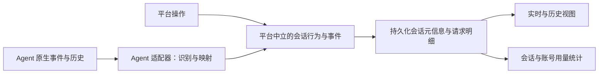

# 会话元信息与统计

本文记录会话元信息的行为、采集口径和验收条件。项目级开发规范见 Agent 接入约定。

## 数据来源与行为

`AgentStatisticsPort.facts` 是原生记录归一化接口。Codex 与 Claude 适配器只提取身份、时间、请求用量与边界。平台按 Agent、Engine 和原生会话身份保存请求、区间、事件与检查点。检查点与新增聚合在一次 SQLite 事务中提交，用量记录不保存输入正文、工具参数或工具输出。消息正文继续来自原生对话。实时观察、历史翻页与刷新读取同一套已提交投影。

| 数据 | Codex | Claude |
| --- | --- | --- |
| 请求用量 | 优先用带 `response_id` 的原生请求。旧版累计事件的最后请求用量用于兼容。重复累计快照与新版回显去重 | 按原生模型响应 ID 合并拆开的内容块。输入含缓存写入和命中。未报告的推理 Token 保持未知 |
| 模型和速度 | 使用请求关联的模型和设置回执。已记录的订阅费率按请求估算 | 取实际响应的模型、可确认的服务档位和环境。积分未提供时保持未知 |
| 历史回填 | 已配置 Codex 环境的账号采集器盘点本机、独立 Provider 和系统账号的原生历史。会话视图在授权读取原生文件后补齐消息边界 | 盘点本机 Claude 原生项目记录，包括没有平台标签页的文件。原生记录缺少账号归属时保留未知 |
| 停止与恢复 | 平台回执记录受理状态。原生轮次与压缩记录提供完成或中断证据 | 同样区分平台回执与原生记录。只有原生中断标记或请求边界存在时可重新定位对应位置 |
| 删除 | 先保存可读取的会话事实和对应账号请求，再移除原始对话 | 先保存可读取的请求和事实，再移除原始对话 |

`Runs` 是有原生证据的模型请求数。一个请求可以调用多次工具。同一请求中的并行调用共计一轮。问答数按有用户输入且产生 Final 的轮次统计。三个区间独立维护，同一请求可出现在多个层级。共享同一响应的 Item 标注共享用量。用量仍在写入、起点不可确认或来源被截断时，展示相应覆盖状态。

缓存比较使用相邻可确认输入各自首个可绑定到该输入的响应。输入少于 1024 Token、计数不一致或者输入归属未知时跳过比较。前次命中至少 80%，下降至少 25 个百分点时触发。两次输入量相差超过两倍且没有可确认的压缩、模型、速度、账号或 Engine 变化时跳过。输入间隔达到 15 分钟可以列入相关因素。异常时间是本次原生请求时间，间隔取两次输入时间。只有原生证据明确给出原因时，才显示已确认原因。

SQLite 的检查点按追加读取更新。文件替换会重建当前会话投影，账号账本保留已采集耗用。确认无法读取的记录保持部分或不可用。缺失的原生事件不会由界面时间、当前模型或当前账号设置补造。

## 会话行为与统计规范

以下条目也是新增 Agent 和变更采集规则时的验收条件。

### 统一体验与会话生命周期

- 同一种平台功能在不同 Agent、实时查看、历史加载、刷新、重载和重连时，应使用一致的用户语义、统计口径及状态展示。Agent 能力和数据存在差异时，明确标识不支持、尚未确认或不可用，不能通过推测补造一致的效果。
- 通过中立接口表达可观察的创建、恢复、压缩、模型与账号或 Engine 切换、追问、排队、停止、中断、新开、重载、关闭和删除，以及它们的开始、受理、完成、失败或结果未知。区分用户请求、平台确认和 Agent 原生确认；不能把提交成功当作实际完成。
- 区分平台标签页、平台会话、原生会话、轮次及请求身份，均通过中立契约关联。新开可能产生新的原生会话，跨账号或 Engine 迁移可能继承历史；记录可验证的来源和边界，不把继承请求重复计为新账号消耗。
- 会话元信息应持久保存可确认的生命周期事实、模型和账号变化、请求用量及统计结果。打开历史和重载时读取已保存结果；新事件增量处理。历史首次回填、迟到事件、重连、来源替换或规则升级须可恢复、可对账、幂等，不假定所有历史始终不可变。
- 账号用量应覆盖已配置且有权访问的 Agent 原生会话，包括平台未打开的会话。复用现有后台采集与实时流：活跃会话按事件增量更新，其他会话按后台策略发现变化；不为每个历史会话增加常驻进程或每次变化全量重算。未配置、不可读取或上游未提供的数据保持明确的未知或不完整状态。

### Progress、Item 与 Final 的精确统计

- 以 Agent 可确认的模型请求和工具事件为统计事实，按稳定身份去重，关联原生会话、轮次、模型、账号、消息及适用的事件边界。输入、缓存输入、输出、推理输出和总量沿用各 Agent 的已验证语义；缓存输入和推理输出若已包含在输入或输出中，不得重复累加。
- 分别维护以下区间：**Final** 从上一个 Final 完成到当前 Final 完成；**Progress** 从上一个 Progress 完成到当前 Progress 完成；**Item** 从上一个 Item 完成到当前 Item 完成。没有前一个同类边界时，从可确认的会话首次任务开始；无法确认起点时明确标识。以完成事件和原生请求的实际统计边界对齐，不依据界面渲染顺序猜测。
- 各区间独立展示可确认的 Token、工具调用次数和工具轮次（rounds）：同一模型响应中的多个并行工具调用各计一次 call，共计一轮。区间可以相互重叠，不得把 Item、Progress 和 Final 的展示值再次相加作为会话总量。若产品使用 Runs 等名称，须在中立契约中明确其定义，不与工具轮次混淆。
- 已完成且来源完整的区间在实时和历史视图中应精确一致。尚未上报的用量显示等待；历史缺失、读取失败或无法确认边界时说明原因，不把未知当作零或精确值。多个 Item 共享同一请求时，只展示可验证的共享请求用量，不伪造逐 Item 或跨边界分摊；请求的用量在更大区间中只能计一次。

### 会话详情与模型维度

- 会话详情应读取统一的会话元信息，紧凑展示整个会话的累计 Token、预估积分、模型请求次数、用户问答轮次、工具轮次和工具调用次数，并分别说明这些计数的边界；不能把用户问答轮次、模型请求和工具轮次混为一谈。
- 除当前模型外，应按实际请求所使用的模型展示该会话的用量和请求次数；支持区分可确认的账号或 Engine 与服务速度。模型或速度切换时，积分先按每次请求实际记录的模型、速度和对应费率估算，再汇总到模型及会话；禁止以当前模型或速度的费率推算整个会话。未知模型、速度、用量或价格保持未知或标明覆盖不足。
- 会话详情应能查看可确认的生命周期、压缩、模型及账号切换、插入输入和中断等记录；实时会话、历史会话及重载后使用同一事实和口径。展示按能力提供的信息，不因 Agent 差异编造记录；区分最近请求、当前状态和会话累计。
- 累计 Token 信息栏应与 Progress 采用一致的积分含义和紫色样式，紧凑展示预估积分并保留一位小数；积分属于参考估算而非实际账单。可核对时按请求明细计算，不可完整核对时明确标注覆盖范围及原因。

### 缓存命中率异常与时间间隔

- 会话详情应增加缓存命中率异常信息项或分类，以表格逐条展示并统计会话中可确认的显著下降事件；每行包含异常时间、前次缓存情况、本次缓存情况、两次输入间隔和原因或相关因素，并关联前一次与本次的输入或请求及相应问答轮次。按各 Agent 的原生语义计算缓存命中输入占总输入的比例；同一轮存在多个模型请求时说明使用的请求和比较口径，不混用会话累计值与单次请求值。
- 每条记录应包含前后两次输入的 Token 与缓存命中 Token、命中率、下降幅度、可确认的输入或请求时间，以及前后输入之间的时间间隔；同时关联可确认的模型、账号或 Engine、速度、压缩与上下文变化等事件，方便定位原因。不同时间字段不得混用，无法确认时间或关联时保持未知。
- 异常时间以及前后输入或请求的时间，在会话详情表格和对话卡片中均须显示完整日期和时间，并标明或可查看时区；时间间隔单独显示为时长。存储、排序和计算使用可确认的时间，未知时间不推测。
- 详情表格中，每次输入的总输入 Token、缓存命中 Token 和命中率应紧凑地放在同一列或单元格，例如 `300K / 294K (98%)`，并为三项提供清晰标识；前次和本次各自展示，便于直接比较，窄屏下保持可读。
- 比较规则须定义可重复验证的“显著下降”条件和适用范围，兼顾输入量差异、首次冷缓存、模型或账号切换及压缩等情况；输入为零、用量缺失、计数不一致或历史不完整时不得编造命中率或异常。重复事件、历史回填、重连与数据修正不得造成重复或遗留错误告警。
- 原因列须区分原生证据确认的原因、可观察的相关因素和未知原因：输入间隔较长、模型、速度、账号或 Engine 切换、上下文压缩等可作为有时间依据的相关因素，多个因素可并存。不得仅根据间隔推断缓存 TTL、过期或失效，也不得把相关事件当作确定因果；有原生证据时记录证据来源。
- 命中率下降是可观察的异常，不足以单独证明缓存已失效、过期或判断原因。只有 Agent 提供可验证的原生证据时才标记为已确认失效；否则展示为命中率下降，保留已知的相关事件和未知原因。检测通过 Agent 中立契约与各自适配器提供真实数据，复用会话元信息和增量采集，不为历史会话增加独立轮询或全量扫描。
- 已确认达到下降规则时，对话页应及时在相关输入或请求的时间线位置展示缓存命中率下降卡片，复用现有卡片的交互、视觉体系和无障碍行为；卡片紧凑展示前后总输入、缓存输入、命中率及可确认的间隔与变化，并可查看详情。卡片和详情表格使用同一事件与身份；实时追加、迟到数据、刷新、重载和历史分页应去重及同步修正，不能跨会话串扰或中断用户输入。

### 运行中插入输入与中断

- 用户在 Progress 或 Item 执行中追加输入、排队或请求停止时，记录可观察的原生会话和轮次、最近已完成的 Progress 与 Item、当时已知的活动 Item 或并行工具，以及提交、受理、实际接收和完成或中断的时间与状态。时间、顺序或关联不可确认时保持未知，不能将界面点击时间冒充 Agent 接收时间。
- 追加输入、排队和中断是不同动作；结果未知时不得自动重复提交。中断后保留已完成的 Item、已确认用量和未完成部分的状态；迟到的原生用量须幂等补齐。跨输入或中断边界的进行中请求按上游可验证的请求边界统计，不能凭时间推算两侧的用量。
- 打开历史、刷新或重载后，应还原已记录的插入位置、当时可确认的执行状态及后续结果；恢复或并发事件不能覆盖其他会话、重复计数或虚构状态。平台可控的删除操作应先处理并持久化可确认的最后用量，明确删除对话历史与保留已发生账号耗用的语义；采集或停止结果无法确认时不得静默声称完整。
