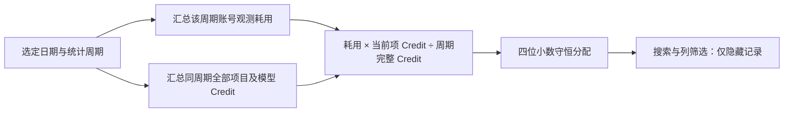

# 用量统计修复验证记录

验证分支：`feat/usage-period-csv`。本轮验证同时包含主分支已有的附件、编辑器与批量输入修复，避免覆盖并行任务的改动。

## 计算规则

| 示例 | 项目 A Credit | 项目 B Credit | 账号观测耗用 | A 分配 | B 分配 |
|---|---:|---:|---:|---:|---:|
| 第一天 | 90 | 10 | 1 | 0.9 | 0.1 |
| 第二天 | 10 | 90 | 3 | 0.3 | 2.7 |
| 两天所属周 | 100 | 100 | 4 | 2 | 2 |

周分配重新计算，不能使用日分配相加得到的 1.2 / 2.8。搜索和模型、数值列筛选不改变额度或占比的周期分母。

## 验证范围

- 小时、日、周、月以及项目、模型分组；本地日期、午夜、跨年/月/周、夏令时重复小时与等价 UTC 表示。
- 跨界额度采样按已知 Credit 估算拆分；负向变化、超过 15 分钟空档及缺少计算依据的区间不计入，未知不当作零。
- 四位小数最大余数分配守恒；真实零保留，未知为空；未知权重明确为部分覆盖。
- 午夜后响应晚于扫描时，下一轮补算前一天末尾区间；重复补算不累计，后续归档保留正确总量。
- CSV 转义、原子发布、校验损坏、上一代恢复、检查点不一致、跨天归档、旧数据库兼容及原始采样过期。
- 停机后的修改文件增量补采、请求去重、部分失败保留检查点、再次重试和跨 Engine 来源隔离。
- API Engine Token、模型、目录与共享请求去重；API 钱包实际扣费不使用订阅周额度公式。
- 用户手动标签优先；Codex 原生标题更新、持久化、重启恢复与 API Engine 隔离。
- 所有前端额度读取均使用后台快照，包含手动刷新及缓存过期；每账号每轮仅一次额度请求，额度和日志扫描同轮启动。

## 完整检查

| 命令 | 结果 |
|---|---|
| `npm --prefix server run test:coverage` | 140 文件，1091 通过，1 跳过；覆盖率门槛通过 |
| `npm --prefix dashboard run test:coverage -- --maxWorkers=2` | 105 文件，604 通过；覆盖率门槛通过 |
| `npm run build` | 前后端类型检查与生产构建通过，存在既有大 chunk 提示 |
| `npm run test:update-security` | 5 通过 |
| `E2E_API_PORT=43510 E2E_UI_PORT=43511 npm run test:e2e` | 64 项 Chromium 用例全部通过，无重试 |
| `git diff --check` | 通过 |
| `npm --prefix dashboard run lint -- --ignore-pattern '.test-data/**'` | 未通过：95 项既有错误、33 警告；改动文件逐项与 main 对照，无新增错误 |

唯一环境跳过项为 `document-conversion.test.ts` 的真实 XLSX 转换：本机缺少 `/usr/lib/libreoffice/program/libsclo.so`。用量统计测试没有跳过。全量 ESLint 的既有错误主要为 React Hooks 规则和显式 any；本次没有关闭规则或降低门槛。

此前浏览器运行暴露并修正了独立工作区共用 Vite 优化缓存、测试目录冲突、外置附件旧路径断言、额度页面旧直连断言以及异步路由响应对象复用问题。最终结果只以表中的最后完整运行计数为准，不把不同运行的通过数相加冒充一次全绿。

## 性能样本

以下为本机合成数据，独立运行，不能视为生产延迟保证。

| 场景 | 样本 | 结果 |
|---|---|---:|
| 小时 CSV 归档 | 100000 请求 | 755 ms，总 Token 守恒 |
| 额度区间计算 | 300000 请求、5000 次采样 | 725 ms，总观测变化守恒 |
| 日周期分配 | 5000 行、50000 个模型项，5 次 | 中位 57 ms |
| 周周期分配 | 同上 | 中位 91 ms |
| 月周期分配 | 同上 | 中位 91 ms |

性能测试命令：`npm --prefix server test -- --run tests/codex-usage-csv.test.ts tests/codex-quota-periods.test.ts -t 'archives 100000|handles large' --disableConsoleIntercept`。项目/模型分母汇总采用单次遍历，避免反复复制增长数组。

## 存储与恢复边界

CSV 位于数据库同目录 `usage-csv/<账号 ID 的 SHA-256>/`。当天请求和额度采样、历史小时归档、账号小时观测变化由同代 manifest 原子发布，并保留上一代。SQLite 采集、请求身份去重和跨 Engine 索引继续保留，作为兼容与恢复来源；这次并非完全移除 SQLite。

可读 JSONL 支持停机补采；已经删除的原始文件不能凭空恢复。停机期间的周额度历史读数无法通过当前接口回补，不将重启后的读数差伪装成逐小时精确扣费。跨界拆分和项目分配是参考估算。

## 后续：重复汇总清理与目录合并

- 仅在 CSV 文件校验、来源、时区、检查点、完整 Token 字段与请求数均一致，且请求投影可恢复时，删除早于昨天的重复日汇总。保留当天、昨天、不可验证的旧记录及恢复所需身份。
- 新增 12 项回归，覆盖自动清理、幂等、拒绝不一致数据、损坏恢复、规则重算、晚到请求、未知值、软链接合并与同名不同目录隔离。原始事件路径与请求身份保持不变。
- CSV 路径显示已提前发布；归档 CSV 有效时不因原始历史部分缺失而改读数据库。数据库回退如实显示文件路径。
- `npm --prefix server run test:coverage`：144 文件、1127 通过、1 项 XLSX 因缺库跳过，覆盖率门槛通过。
- `npm --prefix dashboard run test:coverage -- --maxWorkers=2`：108 文件、638 项全部通过，覆盖率门槛通过。会话测试补充新发送检查接口模拟；创建对话测试等待配置加载并核对显式 native 环境绑定。
- `E2E_API_PORT=43510 E2E_UI_PORT=43511 npm run test:e2e -- e2e/codex-environments.spec.ts e2e/usage-periods.spec.ts`：4 项通过。
- `npm run build`：通过。此次浏览器验证针对账号、API Engine、来源路径和用量周期，不冒称重新执行了此前全部 64 项。
