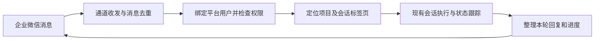

# 企业微信实时交互调研

调研日期：2026-10-13。范围：企业微信与平台双向实时交互，类似 Hermes / OpenClaw 的聊天入口。本文件是调研方案，尚未实现通道或安装 SDK，也未连接企业微信账户。

## 可行性与接入方式

建议采用企业微信「智能机器人 API 模式 + WebSocket 长连接」。平台服务主动连接企微，适合目前通过内网访问的部署方式，无需为了接收消息先开放公网回调地址。需要在企微后台创建机器人，获得 Bot ID 和 Secret，并确保部署机器可访问企微服务。[腾讯官方接入说明](https://cloud.tencent.cn/document/product/1759/121473)

企业微信团队提供 `@wecom/aibot-node-sdk`，有 Node.js/TypeScript 接口，支持接收消息、流式 Markdown 回复、主动发送、心跳和断线重连，可以接入本项目现有 Node.js 后端。`replyStream` 内容上限为 20480 字节；长结果需要控制大小、拆分或转为文件。[官方 SDK](https://github.com/WecomTeam/aibot-node-sdk)

腾讯 ADP 文档还列出机器人回答时限和单一有效连接的限制。其回答时限是否完全适用于独立 SDK 场景，需要在正式接入前以企微协议及实测确认，不能假定长时间运行的编码任务一直可以更新原消息。[腾讯官方限制说明](https://cloud.tencent.cn/document/product/1759/121473#使用限制)

## 本项目可复用的能力

| 现有实现 | 接入用途 | 需要注意 |
| --- | --- | --- |
| `server/src/routes/agent.ts` 的 `/sessions/:id/execute` | 将聊天消息发送给已有会话，获取本轮结果 | 必须携带对应平台用户身份，复用权限校验；同一会话一次只能有一个 execute |
| `/sessions/:id/display` | 读取已渲染的终端画面和会话状态 | 支持游标增量读取；应避免把历史画面重复发到聊天 |
| `/sessions/:id/agent` WebSocket | 接收状态变化及输出，支持持续交互 | `output` 是去掉 ANSI 的 PTY 片段，仍可能含 TUI 重绘和输入回显，不能直接当作纯助手回复转发 |
| `server/src/services/session-state.ts` | 检测忙碌、空闲、等待输入以及会话回复完成 | 需要区分最终回复、执行进度、授权/选择提示；不同 CLI 的输出应分别验证 |
| 现有会话创建、恢复和项目权限 | 接入已有项目下的 Session / Agent | 企业微信身份不能自动获得管理员权限；继续遵守会话所属用户和工具权限 |

以上依据本仓库代码检查，不代表这些接口已完成企微联调。

## 建议的交互流程

首次使用时，在登录后的平台账户中生成一次性绑定码，在企业微信发送绑定码，建立「企微成员 → 平台用户」对应关系。该做法是建议方案，不是已存在的功能。

绑定后选择用户有权访问的项目及会话标签页，后续聊天继续发送到同一会话，保留上下文。网页端仍能看到这个会话及其执行结果。是否允许绑定普通 Terminal，需要单独明确：当其停留在 Shell 时，输入会成为命令，不能默认把它当作 AI 对话。

收到消息后先反馈已接收或当前状态，再持续更新本轮进度和最终回复。会话正忙、等待选择、恢复失败时，应明确反馈状态。队列、取消/打断以及多人群聊的具体交互还需要对齐，不能把“取消等待 API 返回”混同于终止 CLI 正在运行的工作。

## 实现需要补齐的部分

- 管理员通道配置：Bot ID、Secret、启用开关和连接状态。密钥仅留在服务端，沿用现有私密设置的处理方式，不进入公开 `/settings` 响应。
- 身份及会话绑定：持久化企微成员、平台用户、企微聊天与目标项目/会话的对应关系；解绑、停用用户或撤销项目权限后立即阻止继续操作。
- 消息调度：按消息 ID 去重，同一会话串行处理，处理连接重试及回复回执；避免重连后重复执行已发送的提示词。
- 回复整理：依赖本轮内容和渲染后的输出，处理 TUI 重绘、中文换行、进度与最终回复；不能把现有去 ANSI 片段直接转发。
- 生命周期：启动连接、配置更新、自动重连、服务退出清理。一个机器人由一个连接实例负责。

第一版适合先验证文本单聊、多轮上下文与既有 Session / Agent。群聊、图片及文件虽然 SDK 有相应能力，其权限、附件保存和目标路由仍需另行实现与验收，不能视为已经接通。

## 验证重点

绑定错误或跨用户消息不能进入其他用户会话；同一条消息重复推送只执行一次；服务重启后绑定仍有效；权限撤销立即生效；并发聊天不交叉上下文；消息可持续反馈状态且最终回复不混入终端重绘；中文长文本按字节限制处理；长任务及掉线后的回复补发需要真机联调。

实际联调还缺企业微信机器人凭证。应在未来配置页录入，而不是通过聊天提供 Secret。目前不需要改服务器公网端口，也没有启动企微连接。
