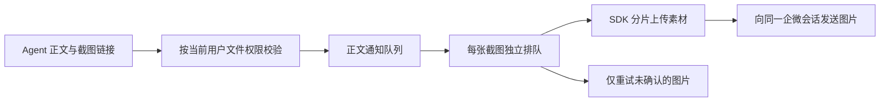
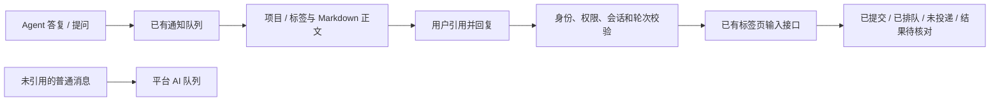

# 企业微信接入

平台配置入口：**平台管理 → 平台 AI → 渠道与用户映射**。管理渠道、绑定身份、设置通知订阅需要平台的 `settings:write` 和 `roles:write` 权限；发指令的平台用户还需要 `agent_api:write` 及目标项目相应权限。先完成“模型配置”中的模型与工具连通性测试并启用平台 AI。

| 入口 | 用途 | 需要公网回调 | 平台参数 |
| --- | --- | --- | --- |
| 智能机器人（长连接） | 文字与截图需求、流式回复、任务主动通知 | 否，服务器主动连接企业微信 | Bot ID、机器人 Secret |
| 自建应用 | 企业内部成员在应用消息会话中交流、接收任务通知 | 是 | CorpID、AgentId、应用 Secret、Token、EncodingAESKey |
| 群机器人（通知） | 将指定用户的待处理问题和任务结果发送到群里 | 否，服务器主动调用群 Webhook | 群机器人的 Webhook 地址 |

## 智能机器人：推荐内网部署使用

1. 在企业微信客户端的智能机器人入口创建或管理机器人，选择 **API 模式 → 长连接**，取得 Bot ID 和 Secret。入口是否可见以及可用范围以你的企业微信账号和客户端为准。
2. 平台点击“添加渠道”，选择“企业微信智能机器人（长连接）”，填写 Bot ID、机器人 Secret，勾选“启用此渠道”后保存。
3. 平台会主动连接 `wss://openws.work.weixin.qq.com`。服务器需能向该地址建立出站连接，无需将平台端口暴露到公网。渠道卡片应显示“已连接并通过认证”；可点击“测试连接”检查认证。
4. 给机器人发送一句文字。未绑定时机器人会提示联系管理员；回到渠道页，在“最近收到的未绑定身份”中点击“填入映射”，选择平台用户后保存。这里使用企微实际发送的 userid，可能是加密标识，不要用显示姓名替代。
5. 再发送“列出我能访问的项目”。回复会在原会话逐步更新。随后可指定项目下发开发任务、查询状态、创建定时任务；任务等待确认或产出结果时，会向原会话主动发送通知。

群内消息由企业微信按机器人交互规则推送，通常需要 @机器人；具体规则以企业微信当前能力为准。平台按“渠道 + 会话 + 发送者 + 绑定的平台用户”隔离上下文，不共享不同成员的私有对话。发送到群里的内容会被群成员看到。

连接由官方 SDK 管理心跳、指数退避重连和发送确认。每个 Bot ID 只能启用一个本平台渠道；同一机器人不要同时交给其他实例运行，否则连接会被替换。卡片显示“被其他连接占用”时，先停止另一个实例，再点击“重新连接”。认证失败时核对 Bot ID/Secret，修改配置后保存即可重建连接。测试复用现有连接，不会额外建立测试连接把自己顶下线。

入站消息先持久保存并按消息 ID 去重，再进入原有平台 AI 调度队列；重连不会重复下发开发任务。机器人流式更新只转发平台已公开的回复文本或阶段信息，不转发模型隐藏推理、工具密钥或登录凭据。按需更新合并到约每 1.2 秒一次，不为转发额外调用模型。

支持直接发送图片、图文混排，以及文字消息引用图片。每条最多 4 张，每张最多 8 MB，支持 PNG/JPEG/GIF/WebP。临时媒体立即下载并解密，避免排队等模型时地址过期；网页对话显示接收进度、缩略图和原图入口。下载、解密或格式校验失败仍保留消息和失败原因，可以重新发送。只发图片时不会自动创建开发任务。

平台模型支持视觉时，原图以图像输入随需求发送。若接口明确拒绝图像，平台保留附件并说明当前不能直接识图，继续处理文字与附件。开发任务可将原图复制到目标项目的 `.agentmanager/pastes`，由工作 Agent 按本地路径查看；图片不会被当成已经由平台模型识别过的结论。未绑定用户不会触发媒体下载；图片查看校验平台登录和对话归属，其他平台账号无法通过猜测链接读取。

临时回复流保留最多约四分钟；模型还在处理时会结束该流并提示稍后通知。服务重启、断线或临时回复失效后，最终结果通过持久出站队列主动发送。任务跟踪只主动通知完成、失败和首次进入待处理状态；普通进度可在平台查询，不会按间隔推送。 已监控的原生会话出现最终答复时，会唤醒项目通知检查并优先处理；会话不在监控范围、流不可用或服务重启时仍依赖周期检查。模型分类和渠道投递需要额外时间。 项目通知按轮次和最终答复去重；历史缺少轮次时，同一标签已入队或已发送的完全相同正文不会再次通知，因此无法区分未知轮次中完全相同的新答复。通知作为新消息发送，不覆盖正在生成的对话回复。取消用户映射、停用渠道或撤销权限会阻止后续处理/发送；已经发送到群或企业微信的消息无法由平台撤回。

## 自动发送回复中的本地截图

智能机器人长连接通知会识别 Agent 正文中指向本地图片的 Markdown 链接，包括 `[查看截图](/绝对路径/report.png)` 和 ``。支持绝对路径、`file:///`、`sandbox:/`，相对路径仅在已知来源会话的项目目录内解析。正文继续按 Markdown 发送，图片随后作为真正的企微图片消息发送；原本不可在企微访问的本地链接会替换为“图片见下方”。外部 HTTPS 链接保持原样，代码示例中的链接不会触发文件读取。



本次仅接入智能机器人长连接的图片出站；自建应用和群 Webhook 仍发送 Markdown。每条正文最多自动发送四张 PNG/JPEG，每张最多 8 MB，重复引用同一路径只发送一次。读取复用现有项目、外部附件和管理员文件权限，个人共享资源凭据始终拒绝读取；符号链接按真实路径校验，文件类型和大小在已打开的文件描述符上检查。图片不会通过公网文件 URL 暴露，也不为发送图片调用模型。

正文与各张图片分别保存在原有持久出站队列，按依赖顺序发送，保留各自投递结果；图片失败或重启恢复不会重发已经确认的正文和图片。图片只保存路径与内容指纹，发送前重新检查权限和指纹，不发送已经被覆盖的文件。已上传的素材 ID 可在有效期内复用，过期重新上传；不创建额外本地文件缓存。缺失、越权、格式或大小不符时，正文明确提示图片未发送，相应图片记录失败；异步发送最终失败会单独提示到平台查看。企微已接收但确认丢失时，当前未确认图片仍可能因重试重复出现，不能承诺外部恰好一次。

需要继续原标签任务时，引用文字通知回复；图片引用仍按原有图片消息入口处理，不用于猜测原任务。测试结束后清理临时会话、原生历史、模拟上传资源和本地测试文件；已发送到真实企微的测试消息及投递审计由现有保留规则管理。

## 单条图文卡片试发

管理员可通过现有渠道测试接口试发一张 `news_notice` 图文卡片，验证客户端是否把文字和图片显示在同一条消息中。这是样式预览，不改变自动任务通知的发送格式。试发复用已有长连接，接收身份必须属于当前管理员并绑定该机器人；不允许指定任意外部接收账号或图片地址。

```http
POST /api/platform-ai/channels/<channel-id>/test
Content-Type: application/json

{"mode":"image_card","recipient_id":"binding:<binding-id>"}
```

`recipient_id` 来自当前用户的项目通知接收身份列表。试发使用企微官网的固定公开示例图片，不上传或公开本地正式截图。卡片包含标题、图片和两段示例文字，点击打开原示例图。返回确认仅代表企微已接收，图片和文字的实际呈现仍须在客户端核对；未获确认不自动重发，以免重复试发。省略 `mode` 或传 `connection` 保持原有连接测试行为。该接口沿用 `settings:write` 与 `roles:write` 权限，属于内部管理接口，不扩展外部 Agent API 契约。

本地截图若要直接用于这类卡片，还需要企微可访问的图片 URL；现有上传素材 ID 不能替代卡片图片 URL。此次试发不提供公网截图存储，也不改变现有文件权限。

## 引用任务通知直接回复

项目自动通知和平台 AI 跟踪任务的通知使用 Markdown，只显示一处项目与标签名称，下面保留 Agent 正文，不再添加 `AM-…` 编号或重复的状态标题，例如：

> **dolphindb_manager / 文档**
>
> 是否使用独立测试环境？

直接引用整条通知，输入“使用独立环境”并发送即可。平台按当前用户、渠道、聊天和实际投递的通知正文查找后台关联，只把新输入的正文提交到对应标签页。关联由已有通知队列的元数据持久保存，不需要在消息中显示技术编号。工作 Agent 的原生输入继续携带后台轮次引用，但网页会话在匹配到同一提交身份后会隐藏这段内部后缀；实时消息、历史与刷新恢复使用同一投影，不改写原始历史或关联指纹。



引用回复使用独立处理通道，最多同时处理两条，不等待平台模型的消息队列，也不调用调度模型；工作 Agent 仍负责处理需求。正常提交或排队的回执只保留在网页对话中，企微不再显示“已收到／已提交／等待 Agent 处理”，直接等待 Agent 答复；未投递、结果未知或跟踪异常仍发送明确提示。回执仅说明提交状态，不能据此认定 Agent 已执行或任务已完成。输入接口继续执行会话权限和发送风险确认，权限确认、交互选择及发送风险提示需要在网页处理，不会通过普通“同意”自动批准。

关联保存在 SQLite，绑定接收渠道、用户、聊天、原生会话、账号环境和原请求轮次；引用正文仅用于定位，不授予权限。投递前重新检查绑定、通知规则/任务及项目会话权限。旧通知对应的会话、账号或任务已变化时，拒绝投递并提示引用最新通知。查询不到原请求轮次时同样拒绝，不猜测目标。

当前快速通道仅支持文字回复；引用通知后附带图片会明确提示回到标签页发送。企业微信引用回调不提供原消息 ID，因此通过正文匹配实际发送记录；支持标题、加粗与链接的基础 Markdown 文本化、无序列表 `-` 转为 `·` / `•` / `●`，以及空白差异。完全相同的通知对应多个轮次、引用被截断或无法匹配时，明确拒绝并提示打开原标签页，不猜测最新轮次。已绑定用户的关联失败会保存为当前会话中的失败消息，引用正文保存在该条消息的内部元数据中，用于核对客户端回调差异，不进入调度模型或宿主日志。升级前已发送的 `AM-…` 前缀通知在原有七天有效期内继续兼容；这些关联到期后旧格式自然失效。

映射有效期为七天，每个数据库最多保留 10000 条；到期或超出保留范围后，引用旧通知会提示关联失效。投递重试沿用已保存的同一正文，标签重命名不会改写已发送通知，接收身份或聊天在重试期间改变时停止旧通知投递。入站按消息 ID 去重，写入前保存操作记录；服务重启或网络故障导致写入结果不明时不会自动重发。可以复制回执并到原标签页核对。

引用回复会用独立请求引用关联后续答复，并复用平台任务跟踪；Agent 的本轮最终答复直接回传，不再按“是否为业务任务完成”过滤。因此“好的。”等简短答复也会送达，企微只显示 Agent 正式答复或异常提示。关联跟踪完成仅表示本轮已收到答复，不表示平台验证了业务结果。

本地自动化测试覆盖本机模型适配器、官方 SDK 与模拟 WebSocket 对端的项目通知、引用消息、简短后续答复、重复回调和回执，以及多标签、权限撤销、过期、会话/账号/任务轮次变化和恢复场景；仍需在真实企业微信客户端验证引用内容的实际呈现与回调。

## 自建应用

1. 管理员登录企业微信管理后台，在“应用管理 → 自建”创建应用，将使用成员加入可见范围。
2. 在企业信息取得 CorpID；在应用详情取得 AgentId、应用 Secret；在“接收消息 → 设置 API 接收”准备 Token、EncodingAESKey。
3. 平台添加“企业微信自建应用”渠道，填写以上五项并启用。保存后复制卡片中的回调路径 `/api/platform-ai/callbacks/<渠道ID>`。
4. 将该路径通过公网 HTTPS 域名反向代理到平台后端。开发环境后端为 `127.0.0.1:43220`，局域网 `192.168.*` 地址不能作为腾讯服务器的回调地址。无需为接入开放整个管理界面。
5. 企业微信后台填写完整公网回调 URL；Token、EncodingAESKey 必须与平台一致。保存通过 URL 校验，并按企业微信后台要求配置应用可见范围、可信域名和实际 API 出口的企业可信 IP。
6. 点击平台“测试连接”校验应用凭据。该测试只获取访问令牌，不代表公网回调已联通；需从应用消息会话实际发送文字验证接收和回复。
7. 按“外部用户映射”绑定成员 UserID，再发送“列出我能访问的项目”验证。可先发送文字，让未绑定成员 ID 出现在平台列表。

Token 是回调签名配置，不是 access_token；Secret 应是当前自建应用 Secret，不是通讯录同步 Secret。当前自建应用适配的是成员到应用的文本会话，不会通过这个回调读取任意群消息。

## 普通群 Webhook 机器人：任务通知订阅

1. 在企业微信目标群添加 Webhook 机器人，复制 `https://qyapi.weixin.qq.com/cgi-bin/webhook/send?key=…` 地址。
2. 平台添加“企业微信群机器人（通知）”，将完整地址填写到凭据字段，启用并保存。地址中的 key 会加密保存，不返回浏览器；编辑时留空保留。
3. 点击“发送测试通知”。平台将直接向群发送一条固定测试文字，不调用模型、不执行开发任务。
4. 在“任务通知订阅”选择该群和平台用户，点击“添加通知订阅”。此后该用户通过网页或其他已绑定渠道发起并由平台 AI 跟踪的任务，其进展、待处理问题、结果以及关联定时任务通知会另投递到这个群。普通聊天回复不会自动广播到群。
5. “通知记录”显示目的渠道、发送状态和错误。取消订阅后，尚未发送的通知也会被阻止；停用渠道同样阻止发送。

群 Webhook 不提供收取群指令的能力，不能用于用户映射。需要在群中下发需求时使用智能机器人长连接。群通知会包含用户所订阅任务的信息，选择订阅用户时应确认该群的成员范围。

## 投递与验证边界

智能机器人、自建应用和群 Webhook 的出站内容均使用各自支持的 Markdown 消息，保留正文中的段落、加粗、列表和链接。超长内容按 UTF-8 字节限制截断并提示到平台查看。

任务通知先落库再异步发送，失败按原有出站队列策略退避重试，达到上限后在通知记录中显示失败。入站去重可防止重复执行开发指令；企业微信侧在“已经接收但确认包丢失”时，通知重试仍可能产生重复消息，不能承诺外部显示严格恰好一次。长文本受渠道长度限制，会保留摘要并提示到平台查看完整内容。

自动化验证覆盖官方 SDK 对接本地 WebSocket 服务的认证、流式收发、重复消息、掉线重连、被其他连接替换、主动推送、权限撤销，以及模拟群 Webhook 投递和旧数据库迁移。正式使用前仍需用真实企业微信账号完成单聊、群聊、长任务结果和网络中断后的收发联调。

参考：[企业微信官方智能机器人 SDK](https://github.com/WecomTeam/aibot-node-sdk)、[腾讯官方自建应用配置说明](https://pages.edgeone.ai/zh/document/im-wecom)、[企业微信群机器人配置文档](https://developer.work.weixin.qq.com/document/path/91770)。
